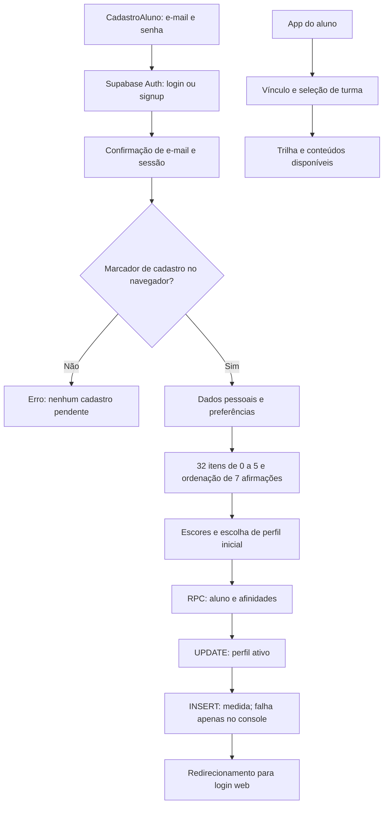

# Issue #1 — cadastro e descoberta do perfil BrainHex

**Parecer técnico e revisão crítica da literatura — 24/10/2026**

**Issue:** [BitStudioLabs/trail-up#1](https://github.com/BitStudioLabs/trail-up/issues/1)

**Código examinado:** `e3d89b2bff3d3b031fdd71b4d628dd620398c6fe`

**Conclusão:** a implementação está parcialmente entregue; **não há evidência suficiente para encerrar a issue como concluída**.

## 1. Decisão recomendada

Manter os sete perfis como linguagem de personalização do produto é uma decisão viável. A justificativa científica adequada é tratá-los como **preferências exploratórias e revisáveis**, preservando a escolha do estudante. O questionário atual é uma **adaptação própria do TrailUp inspirada no BrainHex**, cuja validade ainda precisa ser investigada. Não é uma reprodução do instrumento original nem uma medida comprovada de como uma pessoa aprende melhor.

Para concluir a story, primeiro é necessário resolver a entrega da jornada: confirmação recuperável, persistência consistente do cadastro e acesso efetivo ao ambiente do aluno. Também devem ser corrigidos erros de cálculo e de comunicação que atualmente dão ao resultado uma certeza que o sistema não demonstrou.

A validação longitudinal da personalização deve ter um protocolo e trabalho próprio. Não é necessário esperar um experimento educacional completo para entregar cadastro funcional; também não se pode usar a conclusão dessa entrega como comprovação de eficácia pedagógica.

| Critério original | Evidência observada | Parecer |
| --- | --- | --- |
| E-mail e senha válidos criam conta e apresentam o quiz | `signUp` existe; o quiz é liberado após sessão confirmada, mas depende de um marcador em `localStorage`. | **Parcial.** Explicitar a confirmação de e-mail e corrigir a retomada. |
| E-mail existente recebe aviso e não duplica conta | A aplicação utiliza mensagem genérica por causa da correção de enumeração de contas associada à #329. | **Critério conflitante com a decisão de segurança.** Reformular o aviso; comprovar unicidade em integração. |
| Quiz completo salva BrainHex e disponibiliza a trilha | Escores são enviados à RPC; perfil ativo e medida são gravados separadamente; o destino final é `/login`. Turma depende de vínculo específico. | **Não demonstrado de ponta a ponta.** Há divergências concretas no código. |

## 2. Como a análise foi feita

Foram combinadas três fontes: leitura da issue e seu comentário, inspeção do código e das migrations, e pesquisa bibliográfica dirigida às alegações já presentes no projeto. A leitura abrangeu cadastro web, autenticação, questionário, pontuação, persistência, entrada no app do aluno e atualização posterior de perfis na API.

A pesquisa externa partiu das referências da especificação de 02/10 e da monografia. Foram buscados os títulos exatos, estudos de validade do BrainHex, estudos de personalização educacional, adaptação de instrumentos ao português e documentação oficial de autenticação. Exemplos de consultas: `BrainHex neurobiological gamer typology validation`, `Factors to Consider for Tailored Gamification`, `The relationship between user types and gamification designs`, `Your Favorite Gameplay Speaks Volumes about You` e `reverse wording questionnaire items`.

Priorizaram-se artigos originais, textos dos autores em repositórios institucionais e páginas das editoras. Entraram estudos que ajudam a decidir o uso do instrumento, a interpretação de seus números ou o desenho de validação. Blogs, agregadores e menções sem acesso à fonte primária não sustentam as conclusões. Trata-se de **revisão crítica dirigida**, não revisão sistemática nem meta-análise: não houve busca exaustiva em bases indexadas, triagem por revisores independentes ou protocolo PRISMA completo.

O conjunto abaixo contém **12 estudos** e duas referências técnicas. Quando o texto integral não esteve acessível, a tabela explicita o uso do resumo/registro primário; não se inferiram métodos ou resultados ausentes desse material. O alcance temporal inclui uma publicação de 2026 localizada na busca, sem pretensão de exaustividade até essa data.

**Limites da auditoria:** não houve consulta ao banco de produção, criação de contas reais, execução de migrations, teste de entrega de e-mail ou E2E em navegador. Afirmações sobre fluxos são conclusões da leitura do código, salvo os cálculos identificados como reproduzidos. A existência de uma migration não prova que ela esteja aplicada. Os arquivos de pesquisa do Drive foram consultados por seus espelhos versionados, sem verificar uma versão mais recente no Drive ou os dados brutos originais.

## 3. O que já existe no repositório

O fluxo principal é:



O diagrama mostra o salto entre `L` e `M`: ele não é implementado pelo encerramento do wizard. A geração de mídia é outra etapa e não deve ser confundida com disponibilizar uma trilha navegável.

Há avanços que devem ser preservados:

- tela de acesso com validação local, integração com Supabase e mensagens para falhas;
- proteção contra divulgação direta da existência de conta em determinados erros;
- 32 itens, oito eixos com quatro itens cada e oito itens reversos;
- bloco de ordenação com controles de teclado e rótulos acessíveis;
- função central `computarPerfil`, compartilhando o cálculo exibido e enviado para persistência;
- preservação das sete afinidades e escolha explícita entre perfis representativos;
- tabela de medida com versão, ordem, índice de qualidade e regras de acesso/retenção declaradas;
- testes unitários do instrumento, ordenação, cálculo e construção da medida.

Esses pontos evidenciam implementação, não validade psicométrica. O arquivo histórico que descreve 31 itens retrata o problema anterior; o código examinado já tem 32.

## 4. O que os estudos permitem concluir

| Estudo e acesso consultado | Desenho e resultado relevante | Aplicabilidade e limite para o TrailUp |
| --- | --- | --- |
| **Nacke, Bateman e Mandryk (2014)** — [registro institucional e resumo][S1] | Apresenta sete arquétipos e levantamento com mais de 50 mil jogadores. A origem é satisfação e preferência em jogos. | Sustenta a origem dos perfis. A amostra de jogadores não valida o questionário escolar criado no TrailUp nem prova ganho de aprendizagem. |
| **Busch et al. (2016)** — [artigo integral, IxD&A][S2] | Estudo de campo com 51 participantes e duas mecânicas associadas a Mastermind e Seeker; escores não predisseram significativamente a experiência nas mecânicas correspondentes. | É um contraponto empírico ao vínculo automático entre tipo e experiência. Abrange dois tipos e um protótipo; não prova inutilidade universal. |
| **Tondello et al. (2018)** — [manuscrito aceito integral][S3] | Reanalisa mais de 50 mil respostas da base BrainHex. Encontra problemas de discriminação dos sete estilos e propõe três dimensões mais amplas. | Reforça a cautela com rótulos rígidos. Reutiliza a base original: não são mais 50 mil participantes independentes confirmando Nacke. |
| **Hallifax et al. (2019)** — [artigo integral dos autores][S4] | Estudo por crowdsourcing, 300 respostas selecionadas de 616. Compara BrainHex, Hexad e Big Five por preferências entre elementos de gamificação. O tipo dominante foi insuficiente; Hexad foi mais adequado nesse estudo. | Apoia preservar informações além do dominante e considerar contexto. Não é um ensaio de aprendizagem no TrailUp. |
| **Santos et al. (2021)** — [artigo integral][S5] | 331 respostas válidas; utiliza **Hexad** e storyboards. Há associações específicas, mas não um padrão abrangente e consistente entre tipos e designs. | É evidência indireta sobre personalização. Não é uma validação ou refutação direta do BrainHex. |
| **Sienel, Münster e Zimmermann (2021)** — [resumo e versão HTML do artigo][S6] | Dois estudos em fitness: comparação de modelos e avaliação em aplicativos. MoMo e BrainHex ajudaram a prever avaliações teóricas; prever motivação real no aplicativo foi mais difícil. | Apoia distinguir preferência declarada de efeito observado. O domínio é fitness; não sustenta superioridade automática de telemetria educacional. |
| **Oliveira et al. (2022)** — [artigo integral][S7] | Experimento com 121 estudantes do ensino fundamental, comparando versões personalizada e não personalizada. Não encontrou efeitos principais nos desfechos de flow, motivação/percepção de gamificação e enjoyment examinados. | Evidência educacional diretamente relevante, mas de outra faixa etária e contexto. Ausência de efeito principal não demonstra equivalência universal nem mede eficácia do TrailUp. |
| **Santos et al. (2022), português brasileiro** — [artigo e registro primário][S8] | Investigação psicométrica do **Hexad**, N=421, com análise fatorial e problemas específicos na subescala Disruptor. | Exemplo de validação contextual e linguística e possível comparador futuro. Não transfere validade para itens BrainHex ou para o questionário TrailUp. |
| **Mogavi et al. (2023)** — [resumo do preprint aceito em HCII][S9] | Estudo exploratório com 67 usuários do Stack Exchange: respostas a questionários de arquétipos ajudam a prever características comportamentais e tipo Hexad; BrainHex supera os outros arquétipos testados nesse recorte. | A direção examinada é **questionários → comportamento/Hexad**. Não valida **logs do TrailUp → BrainHex**, seus pesos ou um estimador bayesiano. |
| **Kirchner-Krath et al. (2024)** — [registro institucional e resumo][S10] | Survey com 877 pessoas compara Bartle, Yee, BrainHex e Hexad; encontra sobreposições e cinco dimensões compartilhadas. Recomenda representações contínuas e situacionais. | Reforça tratar motivações como multidimensionais. Não prescreve sete probabilidades exclusivas que somem 100%. |
| **Schultze et al. (2026)** — [resumo e trechos da editora indexados na busca][S11] | Hexad em aprendizagem digital: 1.246 estudantes de 107 turmas; análise estrutural e de perfis latentes. O resumo relata evidência limitada para distinguir os tipos com suas preferências. | Mostra que até um instrumento alternativo mais estudado exige avaliação no público-alvo. Não justifica migração automática do modelo. |
| **van Sonderen, Sanderman e Coyne (2013)** — [artigo integral][S12] | Analisa itens do MFI-20 em 700 respondentes. Não encontra prevenção de viés com itens reversos e observa sinais de confusão/desatenção. | Evidência metodológica de outro domínio: incluir reversos não garante eliminar aquiescência. Não exige remover todos os reversos do TrailUp; exige avaliar sua compreensão. |

A síntese é condicional: perfis podem ser úteis como hipótese de design, mas o elo **perfil → preferência por elemento → experiência → aprendizagem** contém relações diferentes. Uma associação numa dessas etapas não comprova as demais. Essa é a inferência desta análise a partir do conjunto de estudos, não uma conclusão causal única de um artigo.

### 4.1 Pesquisa própria do projeto

A [monografia espelhada][D1] descreve pesquisa de descoberta com 50 estudantes e teste preliminar de usabilidade com cinco participantes. Também diferencia essas fases da avaliação futura em sala. Esses relatos fundamentam requisitos e viabilidade inicial, não validam os escores atuais.

O texto registra correções internas importantes: 34/50 respostas sobre ritmo próprio equivalem a 68%, em contraste com uma estimativa anterior de aproximadamente 90%; a nota média de recomendação 8,8 não é o NPS. Esses dados foram encontrados no documento, **não recalculados a partir de uma base bruta inspecionada nesta auditoria**. Antes de citá-los como resultados finais, manter ligação verificável entre planilha original, versão do instrumento e tabela da monografia.

### 4.2 Correções necessárias nas referências e nas alegações existentes

| Alegação/documento | Correção fundamentada |
| --- | --- |
| Especificação de 02/10 chama BrainHex de instrumento “validado”. | Trocar por tipologia publicada e investigada, com limitações psicométricas; distinguir o instrumento original da adaptação TrailUp. [S1] [S3] |
| A mesma especificação conclui que comportamento é evidência forte e questionário é prior fraco usando Mogavi. | O artigo não testa essa superioridade e usa a direção preditiva oposta. Manter atualização comportamental como hipótese a validar. [S9] |
| Santos 2021 aparece como apoio sem explicitar qual modelo foi medido. | Identificar que foram tipos **Hexad**, por isso a aplicação ao BrainHex é indireta. [S5] |
| Hallifax 2019 é citado como *Adaptive Gamification in Education: A Validation of Player Type Models*. | A fonte localizada que sustenta a comparação é *Factors to Consider for Tailored Gamification*, DOI `10.1145/3311350.3347167`. Não foi localizada publicação com o título composto da especificação. [S4] |
| A monografia atribui o artigo DOI `10.1186/s40561-022-00194-x` a “Santos et al.”. | A autoria começa com **Wilk Oliveira**; citar **Oliveira et al. (2022)**. [S7] |
| A monografia discute Nacke 2014, mas sua lista contém a publicação preliminar de 2011. | Cadastrar separadamente o artigo de 2014, DOI `10.1016/j.entcom.2013.06.002`, sem confundir os dois trabalhos. [S1] |
| Reversos/centragem seriam suficientes para controlar estilo de resposta. | Tratar como decisões de mensuração a testar; reversos podem criar efeitos de método e centragem não remove toda forma de viés. [S12] |

Essas correções devem ser aplicadas também na fonte editorial do Drive quando a equipe atualizar a monografia. Este parecer não altera silenciosamente os espelhos.

## 5. Achados técnicos e sua consequência

**Prioridades usadas neste parecer:** P1 = corrigir para entregar o escopo proposto de cadastro; P2 = corrigir a comunicação/robustez ou explicitar o limite; evolução = trabalho separado, sem apresentar como já validado. Não são alterações dos labels do GitHub.

### F01 — P1: conclusão do cadastro não leva à trilha

**Evidência:** [EmailConfirm, linhas 192–194][C1] remove o marcador, exibe sucesso e navega para `/login`. [Login, linhas 137–157][C2] redireciona professor liberado ao console; para aluno apenas exibe sucesso. O cadastro não estabelece matrícula em turma: a [RPC versionada][C3] grava aluno, afinidades, descrição de IA e relações com professores. No app, a [tela de seleção de turma][C4] informa que o professor precisa adicionar quem não tem turma.

**Consequência:** conta e perfil existentes não bastam para cumprir “minha trilha fica disponível”. Não se comprovou um trigger de produção que resolva essa lacuna.

**Decisão proposta:** após salvar, apresentar uma saída explícita para o app do aluno, incluindo sua versão web quando configurada. Com matrícula e conteúdo, abrir a seleção/trilha. Sem matrícula, mostrar o estado de ingresso em turma com ação útil. Se a story exigir trilha imediata para qualquer visitante, é necessária uma trilha inicial ou ingresso por convite; isso é requisito de produto adicional, não algo que o quiz gera sozinho. Não mudar o critério para “qualquer tela de sucesso” apenas para fechar a issue.

### F02 — P1: confirmação depende do navegador de origem

**Evidência:** [EmailConfirm, linhas 93–119][C5] exige `pending-signup:<email>` no `localStorage` mesmo depois de confirmar a sessão. O marcador contém tipo/e-mail, não um cadastro recuperável no servidor. O wizard mantém respostas apenas em estado React.

**Cenário:** iniciar no computador e abrir o link no celular confirma a identidade, mas não encontra o marcador daquele navegador. Recarregar durante o quiz perde as respostas. Voltar à tela de cadastro e autenticar pode recriar o marcador, porém o callback não oferece retomada transparente.

**Correção proposta:** determinar etapa pendente a partir da identidade autenticada e do estado de onboarding no banco; usar armazenamento local apenas como conveniência. Definir recuperação de rascunho e tratamento de callback repetido, expirado e já concluído. Não usar metadado editável pelo usuário como prova de autorização de papel.

### F03 — P1: conjunto de gravações permite cadastro parcialmente concluído

**Evidência:** [EmailConfirm, linhas 150–190][C6] chama a RPC, atualiza `perfil_ativo` e insere a medida em requisições diferentes. Falha da medida fica em `console.warn`, seguida de sucesso. A [RPC, linhas 163–170][C3] retorna imediatamente quando o aluno já existe, sem reconciliar os perfis recebidos numa nova tentativa.

**Consequência:** o resultado pode perder proveniência; uma falha depois da primeira escrita pode deixar perfil ativo, vetor e medida de tentativas diferentes. A RPC em si executa suas operações em uma transação, mas isso não torna as três requisições atômicas.

**Correção proposta:** criar uma operação de conclusão autenticada no Postgres que grave aluno, vetor, escolha ativa, preferência de feedback e medida de forma consistente, com chave de idempotência. Para conta parcialmente criada, reparar/retomar em vez de tratar a existência de `alunos.id` como conclusão integral. Auth e perfil de aplicação continuam sendo etapas distintas: não prometer uma transação distribuída com o envio de e-mail.

Essa operação deve validar identidade, perfis permitidos, número de entradas, duplicatas, finitude/faixa dos escores e versão. O `SECURITY INVOKER` atual depende das policies reais; sua concessão a `anon` isoladamente não demonstra um bypass. Validar RLS no ambiente de teste antes de afirmar segurança ou vulnerabilidade.

### F04 — P1: “Spearman” transforma empates em concordância artificial

**Evidência:** [brainhexOrdenacao, linhas 101–122][C7] ordena os valores e atribui postos distintos a empates; depois usa a fórmula sem correção de empates. Desempatar por posição do array não elimina o empate estatístico.

**Reprodução local:** com todos os escores de perfil iguais, a correlação retorna **+1** quando a ordenação segue o array do código e **−1** quando ele é invertido. Com respostas válidas `5` em todos os itens diretos e `0` nos reversos, os oito eixos valem `20`; a confiança final vai de **1,0 a 0,6** apenas pela ordenação, embora a escala não forneça uma ordem com a qual concordar. O [diagnóstico executável][A1] registra os valores.

**Correção proposta:** usar postos médios para empates e correlação dos postos; quando uma variável for constante, declarar concordância não estimável (`null` ou estado equivalente), sem premiar nem penalizar uma associação inexistente. Definir explicitamente como a ausência desse indicador entra no índice. Testar empates completos, parciais e invariância à ordem interna das chaves.

### F05 — P1 para o escore pretendido: implementação soma onde o desenho promete média

**Evidência:** [calculateAxisScores][C8] soma quatro itens por eixo. [calcularPrior][C9] divide pela soma dos pesos de mapeamento, mas não pelo número de itens. A função `mediaPorEixo` existe em outro arquivo, porém não é chamada por esse caminho. A escala pode variar de 0 a 20 antes da centragem, enquanto a ordenação varia de −3 a +3. O peso numérico 0,5 não faz as fontes igualmente informativas.

**Reprodução:** mantendo os demais passos e usando o fixture do diagnóstico, o cálculo atual dá **Mastermind 54% / Seeker 5%**; trocar somente soma por média dá **Mastermind 18% / Seeker 26%**. A mudança altera inclusive o dominante. O contrafactual expõe dependência da unidade; **não valida** a fórmula alternativa.

**Correção proposta:** definir a unidade desejada, normalizar de forma explícita, testar sensibilidade e versionar o escore. Mesmo duas medidas centradas em zero não têm necessariamente a mesma escala ou valor informacional. Não trocar a fórmula em produção como correção cosmética: ela afeta perfis, consumidores e comparabilidade histórica.

### F06 — P1 para a fundamentação: certeza científica não corresponde ao instrumento

**Evidência:** a introdução promete uma escala de **0 a 10**, mas o quiz usa **0 a 5**. [BrainHexIntroStep][C10] fala em “identidade de aprendizado”; as [descrições dos perfis][C11] incluem “aprende melhor”. [BrainHexResultStep][C12] apresenta percentuais de compatibilidade, mas não usa `confianca`, `concordancia` ou os motivos de qualidade recebidos no resultado.

O instrumento possui oito eixos, itens próprios, pesos escolhidos pelo projeto, ordenação própria e softmax. `Survivor` foi operacionalizado como persistência/desafio, enquanto a descrição de origem inclui medo e alívio em experiências ficcionais. Essa adaptação altera o significado do construto e precisa ser declarada. [S3]

**Correção proposta:** usar “preferências de experiência” e “afinidades relativas neste questionário”; informar que o resultado é inicial e revisável, sem prometer modo de aprendizagem. Corrigir a escala da introdução. Mostrar limitações de resposta de forma compreensível e sem acusar desatenção. Não exibir “80% de certeza” a partir de um índice ainda não calibrado.

### F07 — P2: escolhas e dados necessários para auditabilidade se perdem

O wizard exige `modoApresentacao` (`imediato`/`pensante`) e o inclui no payload, mas [handleAlunoConfirm][C6] não o grava como `modo_resposta`. Também envia `brainhexRaw`, que não é persistido ali. A [medida][C13] guarda percentuais e metadados, mas não respostas por item nem escore centrado. Sem eles não se pode recalcular o instrumento ou investigar estrutura fatorial a partir dessa tabela.

`segundosPorItem` existe como entrada opcional do cálculo, porém o wizard não mede nem transmite esse tempo; portanto a checagem de resposta rápida não está ativa no cadastro. `isAllAnswered` aceita `NaN` e `99` por verificar apenas `typeof === 'number'`. A UI atual só oferece 0–5, mas o contrato de domínio não garante essa restrição.

**Correção proposta:** persistir a escolha de feedback; validar respostas finitas e dentro da escala; distinguir versão dos itens, versão do algoritmo e parâmetros. Se houver finalidade de pesquisa declarada, guardar o mínimo de respostas/escores necessário para reconstrução, com acesso e retenção definidos. Não coletar mais dados apenas porque uma coluna seria conveniente. Tempo deve servir como sinal contextual, sem penalizar acessibilidade ou pausas automaticamente.

### F08 — P2: ordenação inicial pode ser confundida com preferência declarada

[AlunoSignupWizard][C14] sorteia uma ordem e [BrainHexOrdenacaoStep][C15] permite concluir sem interação. Isso evita obrigar uma troca artificial de quem concorda com a ordem, mas não registra se a lista foi avaliada. Se a escala for pouco discriminante, a ordem sorteada pode determinar o perfil.

**Correção proposta:** solicitar confirmação explícita de que a ordem representa as preferências, permitindo aceitar a ordem sem movê-la. Registrar origem/apresentação e confirmação. Avaliar esse passo em entrevistas de compreensão; embaralhar sozinho não comprova ausência de viés.

### F09 — evolução separada: o atualizador probabilístico não é o caminho operacional identificado

A busca por referências mostrou que `atualizarPerfil` e os indicadores TypeScript aparecem nas funções e testes, sem chamada no fluxo de produção examinado. Há, entretanto, **outro** caminho de atualização: [agente_perfil.py][C16] usa LLM e fallback heurístico; [executor.py][C17] pode persistir por [PerfilRepository][C18]. Esse caminho não usa `aluno_perfil_medida` nem a confiança do prior. Não se deve concluir que não existe adaptação; existe um mecanismo diferente do desenho probabilístico.

O fallback adiciona pontos por acerto/evento e limita cada perfil a 100, sem impor soma 100. Assim, “afinidade” pode ter semânticas diferentes no cadastro e na atualização. É necessário decidir se o contrato representa escores independentes ou composição relativa e auditar consumidores antes de integrar novos estimadores.

Na função TypeScript, transformar `c` em `c/(1-c)` não prova que o número seja uma precisão estatística medida. A soma de precisões exige hipóteses sobre modelo observacional, variância e dependência das observações. O próprio desenho reconhece confiança crescente com evidências contraditórias. Além disso, com confiança inicial 1 e zero observações, a execução retorna 0,999, contrariando a invariância exata documentada.

**Proposta:** retirar a marca de “integrado/validado” da descrição das fases 3–4; tratar calibração e integração em tarefa própria. Enquanto não houver evidência, avaliar indicadores em modo observacional antes de permitir mudanças automáticas de perfil. Se a #1 for encerrada apenas como onboarding, registrar explicitamente essa delimitação e o contrato consumido pela API.

## 6. Como interpretar os números do questionário

São três grandezas distintas:

1. **Escore:** resultado aritmético dos itens e da ordenação.
2. **Afinidade relativa:** transformação dos sete escores para apresentação/composição.
3. **Qualidade da resposta:** índice heurístico baseado em variação, pares de itens e concordância.

Nenhuma delas, sem estudo de calibração, é probabilidade demonstrada de pertencer a um tipo ou de aprender melhor com um formato. A implementação usa `softmax(escore / 1,2)`, arredondamento e piso de 1. Isso garante propriedades numéricas, mas a soma 100 não estabelece validade estatística. Os motivos podem coexistir; a restrição de soma implica que elevar um perfil reduz a parcela dos demais mesmo que o interesse real por eles permaneça igual.

A centragem subtrai uma constante por pessoa: preserva diferenças entre seus escores e não identifica sozinha aquiescência. O indicador denominado `aquiescencia` usa `abs(direto + reverso − 5)/5`; ele penaliza tanto dois valores altos quanto dois baixos. É, portanto, uma medida operacional de discrepância do par, não identificação inequívoca de tendência a concordar. Pares com frases que não são opostos exatos podem divergir legitimamente.

Recomenda-se manter os parâmetros declarados como hipóteses de engenharia e comparar resultados de versões diferentes antes de qualquer alteração. Qualidade do preenchimento, estabilidade temporal do perfil e validade preditiva precisam ser avaliadas separadamente.

## 7. Plano de conclusão da issue

| Ordem | Entrega concreta | Evidência exigida |
| --- | --- | --- |
| 1 | Atualizar os critérios para confirmação de e-mail, mensagem de conta existente e condição de acesso à trilha. | Texto aprovado pelo produto; sem reintroduzir RPC pública de consulta de e-mail. |
| 2 | Retomar onboarding pela sessão e estado persistido; tratar callback repetido e rascunho. | Integração em navegador de origem e navegador novo, com link válido/expirado. |
| 3 | Concluir perfil por operação consistente e idempotente no banco. | Falha injetada em cada etapa; retry produz um único cadastro e uma medida coerente. |
| 4 | Corrigir empates, formalizar unidade do escore e versionar alterações. | Casos extremos e exemplos de referência revisados; relatório de mudança de resultados. |
| 5 | Corrigir escala/textos, preservar feedback escolhido e apresentar resultado provisório. | Revisão da UI e teste de leitura/compreensão; saída da tela corresponde ao registro salvo. |
| 6 | Conectar conclusão ao app do aluno e ao ingresso/seleção de turma. | Um caso novo percorre cadastro → quiz → persistência → turma → trilha. Caso sem turma recebe orientação prevista no critério. |
| 7 | Publicar evidências da verificação e registrar trabalho separado de validação científica. | SHA, ambiente, cenários, resultados e limites documentados na issue/PR. |

Cadastro e persistência devem seguir a fronteira arquitetural do projeto: Supabase/Postgres. Não há necessidade de incluir LLM ou geração de mídia na confirmação da conta.

### 7.1 Critérios de aceite propostos

Estes são uma proposta de substituição/ampliação, não uma alteração já feita no GitHub:

- **Conta nova:** dados válidos criam a identidade uma única vez. Se a confirmação estiver habilitada, o sistema orienta essa etapa e oferece onboarding após a confirmação.
- **Conta existente:** a tentativa não cria duplicata e recebe orientação genérica de acesso/recuperação; informação de cadastro existente só é apresentada no contexto apropriado de autenticação. Testar a configuração real do Supabase. A orientação segue a [OWASP][T1] e o comportamento documentado de [signUp][T2].
- **Retomada:** callback em outro navegador não depende de `localStorage` anterior; cadastro parcial retorna à etapa necessária.
- **Instrumento:** as instruções descrevem a escala efetiva; respostas ausentes, não finitas e fora da escala são rejeitadas; ordenação tem os sete perfis sem repetição e confirmação de avaliação.
- **Resultado:** cálculo determinístico, empates tratados sem inventar concordância, parâmetros versionados e resultado descrito como preferência exploratória.
- **Persistência:** vetor, perfil escolhido, feedback e medida representam a mesma tentativa; repetição não duplica nem mistura resultados.
- **Destino:** estudante com turma e conteúdo acessa sua trilha pelo fluxo previsto. Sem turma, vê a ação de ingresso definida pelo produto; uma trilha imediata universal exige entrega própria.
- **Verificação:** testes de unidade e integração, RLS e E2E local/homologação registrados, com leitura após gravação usando o papel do aluno.

### 7.2 Matriz mínima de verificação

| Cenário | Resultado esperado | Situação desta análise |
| --- | --- | --- |
| E-mail malformado, senha curta e confirmação divergente | Erro compreensível antes de concluir criação. | Helpers parcialmente testados; browser/Auth pendentes. |
| Conta nova com confirmação ligada/desligada | Próxima etapa coerente com a configuração. | Pendente. |
| E-mail existente, senha incorreta/correta, conta confirmada/não confirmada | Sem duplicata; mensagens e recuperação coerentes com a política. | Teste unitário de mensagem passou; integração pendente. |
| Link no mesmo navegador e em navegador novo | Identidade validada e onboarding recuperável. | Dependência problemática identificada no código. |
| Link expirado/reutilizado e armazenamento local apagado | Recuperação clara e sem bloqueio definitivo. | Pendente. |
| Refresh/volta durante quiz | Rascunho recuperado conforme política de produto. | Estado apenas em memória identificado. |
| Respostas incompletas, `NaN`, fora da escala | Não concluir medida inválida. | Lacuna reproduzida na validação de domínio. |
| Todos os perfis empatados e empates parciais | Sem concordância artificial; ordenação interna não muda a análise. | Defeito reproduzido. |
| Preferência alta em vários perfis | Composição e escolha preservadas, sem alegação de diagnóstico. | Cálculo existe; comunicação precisa revisão. |
| Troca da ordem interna das chaves | Resultado estatístico invariável, salvo desempate de apresentação declarado. | Pendente após correção. |
| Falha na RPC, no perfil ativo ou na medida | Sem sucesso enganoso; retry consistente. | Risco identificado no código. |
| Duplo clique e duas requisições concorrentes | Um resultado lógico e dados consistentes. | Pendente. |
| Feedback `pensante` | Preferência persistida e reconhecida no app. | Campo ignorado no handler. |
| Aluno A tenta gravar/ler medida do aluno B | Acesso negado pelas regras efetivas. | Migration lida; banco não testado. |
| Cadastro concluído com/sem turma | Trilha ou ingresso conforme critério; sem fim de fluxo no login. | Divergência identificada no código. |
| Material personalizado ainda indisponível | Estado de carregamento/fallback definido, sem promessa de geração instantânea. | Pendente. |

## 8. Protocolo de pesquisa para fundamentar a evolução

Esta seção é uma proposta metodológica para o TrailUp, não um resultado já obtido.

### Etapa A — conteúdo e compreensão do instrumento

Criar uma matriz ligando cada item ao construto pretendido, fonte conceitual, adaptação linguística e justificativa. Examinar sobreposições como persistência versus competição e preferência versus julgamento de aprendizagem. Realizar entrevistas cognitivas com estudantes do público-alvo: pedir que expliquem as frases e a ordenação em suas próprias palavras, incluindo itens reversos. Revisar termos e testar novamente antes de congelar a versão.

O comparador Hexad em português brasileiro pode auxiliar uma avaliação futura, mas mede construtos relacionados, não funciona como “gabarito verdadeiro” dos sete tipos. [S8]

### Etapa B — viabilidade de onboarding e propriedades da medida

Medir conclusão por etapa, tempo ativo, abandono e erros de confirmação, distinguindo problemas técnicos de recusas ou dificuldades de compreensão. Analisar respostas faltantes, distribuição por item/eixo, consistência interna por dimensão, relações entre dimensões e estabilidade em reaplicação. Usar procedimentos apropriados a itens ordinais; não apresentar um alfa único dos 32 itens como validação de oito dimensões.

O tamanho amostral deve ser planejado conforme o modelo e a precisão requerida. A pesquisa exploratória de 50 estudantes e o teste de cinco usuários não oferecem, por si, evidência suficiente para uma estrutura fatorial e uma comparação confiável entre sete grupos. Se a amostra disponível for pequena, reportar a fase como piloto e restringir inferências.

### Etapa C — utilidade da personalização

Comparar, com distribuição aleatória quando viável, uma experiência base com a personalização do TrailUp e, se houver recursos, uma condição de escolha direta do estudante. Manter conteúdo, dificuldade e oportunidades de estudo comparáveis. Definir desfecho principal antes da coleta: por exemplo, desempenho em avaliação comum com retenção posterior. Medir também conclusão, retorno, percepção de autonomia e motivação, sem confundir tempo de tela com aprendizagem.

Registrar pré-teste, versão da intervenção, perdas de acompanhamento e diferenças por turma. Planejar análise compatível com randomização individual ou por turma, intervalos de confiança e tamanho de efeito, incluindo correção para múltiplos testes quando necessária. Comparações por perfil devem ser exploratórias se não houver poder suficiente. Separar melhora geral do produto de uma interação efetiva entre preferência e tipo de intervenção.

### Etapa D — adaptação comportamental

Antes de substituir preferências declaradas por inferências, demonstrar que os indicadores acrescentam informação em dados não usados para ajustar o modelo. Separar treino e avaliação por aluno e por tempo; comparar com baseline sem atualização e com preferências explícitas. Monitorar reprocessamento dos mesmos eventos, dependência entre sinais, estabilidade e erros por contexto.

Exemplos de confundimento: tempo alto em teoria pode significar dificuldade ou leitor de tela; repetição pode ser tentativa obrigatória; pouco uso social pode refletir ausência de colegas; usar a mídia oferecida pelo sistema não é evidência independente de preferência por ela. Registrar oportunidades disponíveis e decisões anteriores do algoritmo ajuda a identificar ciclos de autorreforço.

Se o produto desejar probabilidades, definir primeiro o evento previsto e verificar calibração em amostra separada. Sem isso, manter “índice”/“escore”, não probabilidade posterior. A melhoria de um indicador de uso precisa ser avaliada contra os objetivos educacionais e a possibilidade de o estudante revisar sua escolha.

## 9. Evidência executada e arquivos de apoio

**Suíte existente executada em 24/10/2026:**

```bash
cd frontend
npm test -- src/features/signup src/lib/cadastroEmUmaEtapa.test.ts src/features/auth/passwordPolicy.test.ts
```

Resultado: **11 arquivos, 128 testes aprovados**. Esses testes cobrem funções e invariantes locais; não comprovam entregabilidade do e-mail, permissões no Supabase, atomicidade entre requisições ou abertura da trilha.

**Diagnóstico adicional:**

```bash
# Na raiz do repositório, com as dependências de frontend instaladas:
node scripts/auditoria-issue-1.mjs
```

O [script][A1] carrega as funções reais via Vite, usa dados sintéticos e não acessa Supabase. A [saída registrada][A2] inclui: 32 itens/eixos, empate produzindo +1/−1, confiança 1,0/0,6, comparação soma/média, aceitação de `NaN`/99 e confiança 1 transformada em 0,999 sem observações. É um diagnóstico do snapshot, não uma nova suíte que transforma o defeito em comportamento desejado.

**Teste de migration tentado:** `cd api && ./.venv/bin/python -m pytest tests/test_migration_perfil_e_cadastro.py -q`. Não executou: o ambiente local retornou `No module named pytest`. Não foi contado como aprovação ou falha funcional. As migrations foram analisadas estaticamente.

## 10. Texto sugerido para atualizar a issue

> A verificação do commit `e3d89b2b` identificou implementação parcial do cadastro e do perfil. Os 128 testes unitários selecionados passaram, mas ainda faltam confirmação recuperável entre navegadores, conclusão consistente das gravações e encaminhamento até a trilha/ingresso em turma. Foi reproduzido um erro no cálculo de concordância em empates e uma divergência entre soma e média no escore. O questionário deve ser apresentado como adaptação exploratória do TrailUp, sem alegação de validade herdada ou eficácia pedagógica. O critério de aviso de e-mail existente precisa ser conciliado com a proteção contra enumeração adotada na #329. Recomenda-se manter a issue aberta até corrigir esses pontos e anexar evidências de integração/E2E, deixando validação longitudinal e atualização comportamental em trabalho específico.

Esse texto foi preparado para revisão; não foi publicado nem usado para encerrar a issue.

## Referências e rastreabilidade

Todos os links científicos abaixo foram consultados em 24/10/2026. O nível de acesso efetivamente utilizado está indicado na tabela da seção 4.

- **S1.** Nacke, L. E.; Bateman, C.; Mandryk, R. L. (2014). *BrainHex: A neurobiological gamer typology survey*. Entertainment Computing, 5(1), 55–62. [DOI](https://doi.org/10.1016/j.entcom.2013.06.002); [registro institucional][S1].
- **S2.** Busch, M. et al. (2016). *Using Player Type Models for Personalized Game Design – An Empirical Investigation*. Interaction Design and Architecture(s), 28, 145–163. [Artigo][S2]. É diferente do trabalho curto *Player Type Models: Towards Empirical Validation* citado em outras fontes.
- **S3.** Tondello, G. F. et al. (2018). *Towards a Trait Model of Video Game Preferences*. International Journal of Human–Computer Interaction. [DOI](https://doi.org/10.1080/10447318.2018.1461765); [manuscrito][S3].
- **S4.** Hallifax, S.; Serna, A.; Marty, J.-C.; Lavoué, G.; Lavoué, É. (2019). *Factors to Consider for Tailored Gamification*. CHI PLAY, 559–572. [DOI](https://doi.org/10.1145/3311350.3347167); [manuscrito][S4].
- **S5.** Santos, A. C. G. et al. (2021). *The relationship between user types and gamification designs*. User Modeling and User-Adapted Interaction, 31, 907–940. [Artigo/DOI][S5].
- **S6.** Sienel, N.; Münster, P.; Zimmermann, G. (2021). *Player-Type-based Personalization of Gamification in Fitness Apps*. HEALTHINF, 361–368. [DOI](https://doi.org/10.5220/0010230603610368); [texto HTML][S6].
- **S7.** Oliveira, W. et al. (2022). *The effects of personalized gamification on students’ flow experience, motivation, and enjoyment*. Smart Learning Environments, 9, 16. [Artigo/DOI][S7].
- **S8.** Santos, A. C. G.; Oliveira, W.; Altmeyer, M.; Hamari, J.; Isotani, S. (2022). *Psychometric investigation of the gamification Hexad user types scale in Brazilian Portuguese*. Scientific Reports, 12, 4920. [Artigo/DOI][S8].
- **S9.** Hadi Mogavi, R. et al. (2023). *Your Favorite Gameplay Speaks Volumes About You: Predicting User Behavior and Hexad Type*. HCI in Games, 210–228. [DOI](https://doi.org/10.1007/978-3-031-35979-8_17); [preprint e resumo][S9].
- **S10.** Kirchner-Krath, J. et al. (2024). *Uncovering the theoretical basis of user types: An empirical analysis and critical discussion of user typologies in research on tailored gameful design*. International Journal of Human-Computer Studies, 190, 103314. [DOI](https://doi.org/10.1016/j.ijhcs.2024.103314); [registro institucional][S10].
- **S11.** Schultze, S.; Hochweber, J.; Habermeyer, T.; Schneider, S. (2026). *A first validation of the gamification user types HEXAD scale for digital learning systems*. Computers in Human Behavior Reports, 22, 101011. [DOI](https://doi.org/10.1016/j.chbr.2026.101011); [editora][S11].
- **S12.** van Sonderen, E.; Sanderman, R.; Coyne, J. C. (2013). *Ineffectiveness of Reverse Wording of Questionnaire Items: Let’s Learn from Cows in the Rain*. PLOS ONE, 8(7), e68967. [Artigo/DOI][S12].
- **T1.** OWASP. *Authentication Cheat Sheet*, seção sobre mensagens de autenticação/cadastro. [Documento oficial][T1].
- **T2.** Supabase. *JavaScript: signUp*. [Documentação oficial][T2].

[S1]: https://ub-ir.bolton.ac.uk/esploro/outputs/journalArticle/BrainHex-A-neurobiological-gamer-typology-survey/9911971008841
[S2]: https://ixdea.org/wp-content/uploads/IxDEA_art/28/28_8.pdf
[S3]: https://dspacemainprd01.lib.uwaterloo.ca/server/api/core/bitstreams/52411884-0ab9-4eb6-9366-002959a152c8/content
[S4]: https://perso.liris.cnrs.fr/guillaume.lavoue/conference/CHIPlay2019.pdf
[S5]: https://link.springer.com/article/10.1007/s11257-021-09300-z
[S6]: https://www.scitepress.org/publishedPapers/2021/102306/pdf/index.html
[S7]: https://link.springer.com/article/10.1186/s40561-022-00194-x
[S8]: https://www.nature.com/articles/s41598-022-08820-x
[S9]: https://arxiv.org/abs/2302.05623
[S10]: https://research.abo.fi/sv/publications/uncovering-the-theoretical-basis-of-user-types-an-empirical-analy/
[S11]: https://www.sciencedirect.com/science/article/pii/S2451958826000850
[S12]: https://journals.plos.org/plosone/article?id=10.1371/journal.pone.0068967
[T1]: https://cheatsheetseries.owasp.org/cheatsheets/Authentication_Cheat_Sheet.html
[T2]: https://supabase.com/docs/reference/javascript/auth-signup
[D1]: ../tcc/fontes-drive/tcc2/monografia-trailup.md
[A1]: ../../scripts/auditoria-issue-1.mjs
[A2]: evidencias/issue-1-diagnostico.json
[C1]: https://github.com/BitStudioLabs/trail-up/blob/e3d89b2bff3d3b031fdd71b4d628dd620398c6fe/frontend/src/pages/EmailConfirm.tsx#L192-L194
[C2]: https://github.com/BitStudioLabs/trail-up/blob/e3d89b2bff3d3b031fdd71b4d628dd620398c6fe/frontend/src/pages/Login.tsx#L137-L157
[C3]: https://github.com/BitStudioLabs/trail-up/blob/e3d89b2bff3d3b031fdd71b4d628dd620398c6fe/api/alembic/versions/20261021_24_perfil_e_cadastro_do_aluno_no_alembic.py#L152-L234
[C4]: https://github.com/BitStudioLabs/trail-up/blob/e3d89b2bff3d3b031fdd71b4d628dd620398c6fe/mobile/src/screens/SelecionarTurmaScreen.tsx#L59-L64
[C5]: https://github.com/BitStudioLabs/trail-up/blob/e3d89b2bff3d3b031fdd71b4d628dd620398c6fe/frontend/src/pages/EmailConfirm.tsx#L93-L119
[C6]: https://github.com/BitStudioLabs/trail-up/blob/e3d89b2bff3d3b031fdd71b4d628dd620398c6fe/frontend/src/pages/EmailConfirm.tsx#L135-L200
[C7]: https://github.com/BitStudioLabs/trail-up/blob/e3d89b2bff3d3b031fdd71b4d628dd620398c6fe/frontend/src/features/signup/brainhexOrdenacao.ts#L101-L122
[C8]: https://github.com/BitStudioLabs/trail-up/blob/e3d89b2bff3d3b031fdd71b4d628dd620398c6fe/frontend/src/features/signup/brainhex.ts#L138-L159
[C9]: https://github.com/BitStudioLabs/trail-up/blob/e3d89b2bff3d3b031fdd71b4d628dd620398c6fe/frontend/src/features/signup/priorDoPerfil.ts#L91-L129
[C10]: https://github.com/BitStudioLabs/trail-up/blob/e3d89b2bff3d3b031fdd71b4d628dd620398c6fe/frontend/src/components/auth/BrainHexIntroStep.tsx#L10-L16
[C11]: https://github.com/BitStudioLabs/trail-up/blob/e3d89b2bff3d3b031fdd71b4d628dd620398c6fe/frontend/src/features/signup/brainhex.ts#L292-L365
[C12]: https://github.com/BitStudioLabs/trail-up/blob/e3d89b2bff3d3b031fdd71b4d628dd620398c6fe/frontend/src/components/auth/BrainHexResultStep.tsx#L24-L176
[C13]: https://github.com/BitStudioLabs/trail-up/blob/e3d89b2bff3d3b031fdd71b4d628dd620398c6fe/frontend/src/features/signup/medidaDoPerfil.ts#L25-L84
[C14]: https://github.com/BitStudioLabs/trail-up/blob/e3d89b2bff3d3b031fdd71b4d628dd620398c6fe/frontend/src/components/auth/AlunoSignupWizard.tsx#L68-L88
[C15]: https://github.com/BitStudioLabs/trail-up/blob/e3d89b2bff3d3b031fdd71b4d628dd620398c6fe/frontend/src/components/auth/BrainHexOrdenacaoStep.tsx#L102-L106
[C16]: https://github.com/BitStudioLabs/trail-up/blob/e3d89b2bff3d3b031fdd71b4d628dd620398c6fe/api/app/agent/graph/nodes/agente_perfil.py#L8-L70
[C17]: https://github.com/BitStudioLabs/trail-up/blob/e3d89b2bff3d3b031fdd71b4d628dd620398c6fe/api/app/agent/graph/nodes/executor.py#L37-L42
[C18]: https://github.com/BitStudioLabs/trail-up/blob/e3d89b2bff3d3b031fdd71b4d628dd620398c6fe/api/app/repositories/perfil.py#L37-L62
