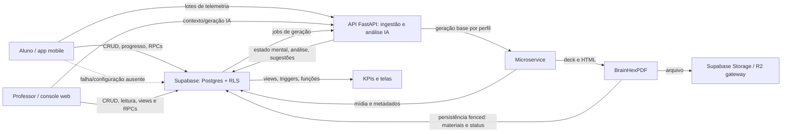

# Mapa ponta a ponta de dados, métricas e KPIs

**Escopo desta versão:** leitura estática dos pacotes `mobile/`, `frontend/`, `api/`, `microservice/`, `brainhexpdf/`, migrations e documentação existente. Issue de acompanhamento: [#565](https://github.com/BitStudioLabs/trail-up/issues/565).

**Nível de evidência:** comportamento descrito como implementado é sustentado por referências de código. Não foi consultado banco ou ambiente de produção nesta análise. Em particular, valores observados em `coleta-de-metricas.md` são resultados históricos de uma janela de 20–27/09/2026, medidos em um único aluno; não descrevem o estado atual nem a escala do produto. Views instaladas por infraestrutura/schema não versionado podem não ter DDL no repositório. Métrica listada não implica que esteja preenchida, atualizada ou validada para decisões pedagógicas.

## 1. Leitura executiva

- O **aluno** produz telemetria de estudo e interação, progresso de conteúdo/atividade, respostas, presença, eventos de gamificação, estado de perfil e uso de notificações. A maior parte do app fala diretamente com Supabase. Telemetria tenta primeiro a API, mas tem caminho de persistência direta; esse fallback salva dados sem executar análise adaptativa.
- O **professor** cria e edita turmas, trilhas, materiais e atividades no Supabase. O console também consulta diretamente progresso/telemetria e views agregadas; a API participa em operações de IA/personalização, não é a fonte geral dos KPIs do dashboard.
- A **API** aceita lotes de telemetria e orquestra análise de IA/personalização. Persiste ciclo, estado mental, domínio estimado, sugestões/logs e estado de erro. Dados analíticos básicos e derivados também são calculados no banco por triggers, funções e views.
- O **microservice** gera mídia base por perfil e delega apresentação ao BrainHexPDF. Jobs, targets, status, erros e tempos são sinais operacionais da geração; não são, por si, evidência de aprendizagem.
- Há KPIs reais no console, mas suas fórmulas não são todas auditáveis pelo repositório: as definições SQL de algumas `vw_metricas_*` não foram localizadas. Uma especificação de métricas em `docs/tcc/10-metricas-e-analise-de-resultados.md` é proposta conceitual, não prova de implementação.
- “Dado coletado” não equivale a “medida válida”: sem versão de definição, janela explícita, denominador, tratamento de nulos, cobertura e qualidade, alguns números não são comparáveis ou não suportam causalidade.

## 2. Mapa de sistemas e fluxo

A linha tracejada é uma alternativa: a coleta direta preserva parte da persistência quando a API não está disponível, mas deixa `analysis_ciclo_id` nulo e não executa o pipeline. A fronteira arquitetural do repositório é: operações CRUD, fila, agendamento e entrega preferencialmente no banco; API para raciocínio/IA e geração adaptativa.

## 3. Aluno: sinais e dados

| Dado/sinal | Origem e forma | Destino / transformação | Uso, limite ou cautela |
|---|---|---|---|
| Sessão de estudo | Contexto de estudo abre/fecha sessão com aluno, turma, tópico, tela/rota e timestamps; flush periódico de lote | `telemetria_sessoes`; lotes em `telemetria_lotes` via API ou Supabase direto | Sessão mede presença/uso, não aprendizagem por si só. Fila local/outbox tenta reenvio; vencimento descrito no mapa histórico é de 7 dias. Fontes: `mobile/src/context/metricas/MetricasContext.tsx`; `mobile/src/services/telemetriaApi.ts`; `mobile/src/services/telemetriaOutbox.ts`. |
| Tempo e presença | `visits`, `dwell_sec`, `active_sec`, `idle_sec` por escopo `topic/content/activity/material`; contagem em segundos | `telemetria_time_metric_entries`; triggers/funções derivam `tempo_gasto_min`; views de telemetria agregam por aluno/turma/entidade | Os escopos são inclusivos/aninhados: somá-los duplica intervalos. `tempo_gasto_min` usa `active_sec`; presença pode exibir dwell. Filtrar escopo e escolher uma definição de tempo. Fontes: `mobile/src/context/metricas/acumuladorLote.ts`, `api/app/schemas/telemetria.py`, migration `20260831_01_telemetria_rls_no_alembic_e_cascade.py`, `docs/architecture/coleta-de-metricas.md`. |
| Interação e navegação | Toques, `touch_count`, amostras de coordenadas percentuais, scroll, distância em px, profundidade máxima, tela/rota, timestamps e eventos do app | Payload do lote e `telemetria_eventos_app`; API normaliza eventos/sinais; caminho direto grava estruturas no Supabase | Sinal comportamental, não medida direta de foco ou compreensão. Contrato limita amostras e tipos; evento volumoso (scroll) pode dominar contagens. Fontes: `mobile/src/interfaces/telemetria/TelemetryContracts.ts`, `mobile/src/context/metricas/MetricasContext.tsx`, `api/app/api/v1/telemetria.py`. |
| Respostas e desempenho | Sinais de correto/incorreto, conclusão, tentativa, `attempt_number`, sequências de erro; respostas acadêmicas em eventos/tabelas de atividade | `telemetria_eventos_app`, `eventos_aluno`, `atividade_aluno`, progresso de conteúdo e itens personalizados | Alimenta acertos, tentativas, revisão e gráficos semanais. Resposta errada/acerto são observações; “domínio” é derivação da análise, não resposta bruta. Fontes: contratos de telemetria; `mobile/src/context/metricas/MetricasContext.tsx`; `api/app/services/linear_analysis_pipeline.py`. |
| Progresso regular | Status, percentual, acertos e atividade/conteúdo/tópico visitado/concluído | `conteudo_aluno`, `atividade_aluno`, `topico_aluno`; o banco recalcula status/percentual do tópico | Nenhum cliente deve gravar status/percentual de `topico_aluno`; progresso é derivado no banco. Professor é bônus quando já há percurso personalizado; conteúdo do professor volta a ser percurso quando a personalização ainda não existe. Fonte: `mobile/src/models/Topico.ts`, `api/alembic/versions/20260826_18_progresso_professor_opcional.py`, regras em `CLAUDE.md`. |
| Progresso personalizado | Por item: `item_key`, tipo, status, percentual, acertos, tempo, pontuação e metadados | `personalizacao_item_progresso`, escrita/leitura direta pelo mobile; cache/outbox para resiliência | Segundo livro-caixa do progresso, associado a blocos/materiais personalizados. Merge especificado para percentual/acertos = máximo, tempo = soma. Fontes: `mobile/src/context/TrilhaContext.tsx`, `mobile/src/services/progressoOutbox.ts`, migration `20260421_02_personalizacao_item_progresso.py`. |
| Conversa com mentor | Mensagem do aluno, turma/tópico/escopo e até oito mensagens recentes de histórico são enviadas pelo painel ao provedor de personalização; eventos `chat_message` armazenam papel e comprimento da mensagem, não o texto | Conteúdo e histórico entram na chamada de conversa; telemetria registra eventos separados para pergunta/resposta | Conversa não deve ser confundida com telemetria de chat, e o evento não representa conteúdo da mensagem. Falhas mostram resposta alternativa no cliente. Fonte: `mobile/src/components/ia/IAMentorPanel.tsx`. |
| Preferências e consentimento | Opções locais `usageEnabled`, `performanceEnabled`, `chatEnabled`, `cameraEnabled`, aceite/recusa; permissões do SO | AsyncStorage e contexto do mobile | Controlam categorias de telemetria; não constituem, por si, opt-out de todos os dados de negócio (progresso, autenticação, notificações). Câmera desligada por padrão e sujeita a vários gates. Fonte: `mobile/src/utils/telemetryConsent.ts`, `mobile/src/app/(tabs)/perfil/coleta-dados.tsx`. |
| Câmera | Captura frontal em dispositivo compatível, JPEG Base64; somente com consentimento, opt-in, preferência ativa e permissão de SO | Sanitização remove bytes antes de persistir; ficam metadados de contagem/envio no fluxo descrito | O mapa histórico documenta que frames não eram decodificados pela heurística, logo não sustentavam reconhecimento de emoção; não generalizar esse achado a código/deploy posterior sem rechecagem. Fonte: `mobile/src/services/telemetriaPayload.ts`, `api/app/api/v1/telemetria.py`, `docs/architecture/coleta-de-metricas.md`. |
| Presença/continuidade | Dias ativos, registros recentes, atividade acadêmica, respostas, vistas, progresso e tempo ativo por tópico | RPC `trailup_resumo_presenca`, ou consultas diretas se a RPC não estiver no cache; série móvel de sete dias | Erro de autorização/rede não deve ser interpretado como zero. `mobile/src/services/studyPresence.ts`. |
| BrainHex e identidade | Identidade Auth, dados de perfil, afinidades por perfil, perfil ativo, turma/matrícula | Supabase Auth, `alunos`, `aluno_perfil`, `perfil`, vínculo com turma | Contextualiza segmentação e personalização; perfil é atributo, não métrica de resultado. Dados pessoais e de menores exigem controle de acesso/retensão. `mobile/src/models/Aluno.ts`, RLS migrations. |
| Conquistas, pontos e ranking | Eventos de aluno, critérios, metas, dias consecutivos, tópicos/atividades concluídos, pontuação/posição | `eventos_aluno`, `conquistas_aluno`, views de ranking; cliente lê posição/eventos | Fórmulas de pontos e ranking dependem de funções/views SQL; posição depende de escopo/classe e corte de exposição. Gamificação não equivale a aprendizagem. `mobile/src/models/Conquista.ts`, `mobile/src/context/ConquistaRankContext.tsx`. |
| Notificações e tempo de uso | Login, plataforma, timezone, device ID, versão, token push; heartbeat em segundos; preferências/rotinas | RPCs do banco; tabelas `aluno_sessoes_app`, `aluno_atividade_diaria`, fila/caixa de notificações e `expo_tokens`; push por Postgres/Expo; rotina diária local | Operação de engajamento e entrega, não comprovação de estudo. Captura device/token deve ser incluída na análise de privacidade e retenção. Fonte: `mobile/src/services/notificacoesDb.ts`, `mobile/src/services/pushNotifications.ts`, arquitetura em `CLAUDE.md`. |

### Métricas do aluno efetivamente derivadas ou consumidas

- **Tempo ativo por tópico**: segundos/minutos de `active_sec`, filtrado por escopo, agregado pelo banco; não somar topic + content + activity + material.
- **Presença**: visitas/dwell/registros de atividade conforme o consumidor; não intercambiar com tempo ativo.
- **Conclusão**: progresso derivado de itens/trilha; percentual não deve ser sobrescrito por cálculo cliente.
- **Acertos/tentativas**: respostas certas/erradas e percentual em atividades; definir denominador e incluir/excluir respostas ausentes antes de comparar.
- **Continuidade**: dias ativos e sequência de dias, com janelas do serviço/tela.
- **Gamificação**: pontos, conquistas, ranking; medir como resultado de engajamento/gamificação, separadamente de aprendizagem.
- **Personalização**: perfil/afinidades, itens gerados, status por formato e progresso de item; cobertura precisa definir quem é alvo e o que conta como material válido.
- **Análise adaptativa**: estado mental/domínio/atenção/ritmo e sugestões derivados pela API. O mapa de 2026-09 descreve heurísticas fixas, não os algoritmos de ML sugeridos pelos nomes das classes. Deve ser auditado no código atual antes de usar para decisões de alto impacto.

## 4. Professor: dados, sinais e KPIs

### Dados introduzidos pelo professor (não confundir com telemetria)

Professor cria/edita turma, tópicos, conteúdos, atividades, questões, cards, anexos/fontes e critérios de personalização. Isso fornece **estrutura, conteúdo e denominadores** para análises, mas não é observação do comportamento do professor nem do aluno. Notas/avaliações manuais, configuração de eventos e critérios de conquistas são entradas explícitas do professor. Em geral as operações vão direto ao Supabase/RPC, respeitando RLS; duplicação e várias filas de sincronização são funções/triggers de banco.

**Conversa do professor com o Escriba:** o navegador envia pergunta (limitada a 500 caracteres), `classe_id` e histórico local à API em `/api/v1/escriba/perguntar`; o endpoint autentica o professor e o serviço usa contexto autorizado da turma para compor a resposta. O histórico fica no navegador e é reenviado a cada pergunta; o endpoint declara que não persiste a conversa. A API pode falhar com indisponibilidade de serviço e a UI apresenta mensagem de erro. Fontes: `frontend/src/components/console/escriba/Escriba.tsx`, `api/app/api/v1/escriba.py`, `api/app/services/escriba.py`.

As mensagens trocadas com o Escriba não aparecem como eventos de telemetria no fluxo consultado; não presumir retenção de conversa na base.

### Fontes do console e medidas exibidas

| KPI/medida | Fonte e cálculo encontrado | Limite / cautela |
|---|---|---|
| Total de alunos | Número de matrículas no escopo selecionado | Denominador precisa respeitar matrículas ativas/período, se houver esses estados. `frontend/src/components/console/DashboardSection.tsx`. |
| Nota média | Média local dos valores preenchidos na associação aluno-turma | Ausências não viram zero; exibida “de 10”. Confirmar escala/histórico antes de comparar. `dashboard/medias.ts`, `KpisPrincipais.tsx`. |
| Conclusão média | Média de `porcentagemConcluida` das matrículas; valor não numérico vira zero | Média por aluno, não ponderada por quantidade de itens; não confundir com taxa de tópicos concluídos. |
| Taxa de acerto | Média local de `acertosPercentual` e/ou respostas certas / respostas em série temporal | Fórmulas/denominadores variam por tela. Sem respostas em uma semana, a série não registra percentual zero. `dashboard/evolucao.ts`. |
| Abandono | `taxa_abandono_pct` em view geral/perfil; também regra local de risco baseada em abandono | DDL da view e definição de abandono não localizadas; não inferir seu denominador. Regras de risco: >30% crítico, nota <5 ou 7 dias sem atividade gera atenção; dois sinais ou abandono crítico vira crítico. São regras operacionais do console, não modelo validado de evasão. `dashboard/risco.ts`. |
| Chat após erro / uso médio | Campos da `vw_metricas_turma_geral_classe`; tempo vem em segundos e UI divide por 60 | View SQL ausente nesta análise; confirmar janela, evento de chat e denominador. |
| Abandono por perfil | `vw_metricas_turma_perfil_classe`, campos de taxa, perfil, segmento e tamanho; frontend pondera por alunos do segmento, cai para média simples se pesos somam zero | Segmentação reconhece perfil dominante, segundo perfil, afinidade >20; amostras pequenas podem enviesar comparações. |
| Distribuição de notas | Soma `total_alunos` por faixa para `metrica === 'nota_media'` | Faixas/limites vêm da view, não do cálculo local consultado. |
| Evolução semanal | Dez semanas alinhadas à segunda; respostas certas + erradas como entregas; acertos = certas / respondidas; delta entre semanas completas | Só a série disponível; conclusão/abandono não têm histórico semanal no backend, conforme comentário da UI. |
| Conteúdo | “Abriram” deriva de registros personalizados ou de registros `conteudo_aluno` cujo status não é `não iniciado` **ou** cujo percentual é positivo; “concluíram” status concluído ou percentual ≥100; erro = 100 − média de acertos em tentativas concluídas e agregado ponderado por tentativas | Associação de item personalizado ao conteúdo usa convenção de `item_key`; conferir versão/formato dessa chave. `dashboard/conteudo.ts`. |
| Presença/tempo por tópico | `vw_telemetria_tempo_topico_aluno`; views por escopo agregam active, idle, dwell e interação | Dashboard pode usar dwell para presença e `tempo_gasto_min` baseado em active. Colocar nome/unidade explícitos evita aparentar divergência. |
| Personalização/jobs | Jobs concluídos, status dos formatos, geração por turma/tópico/perfil e contexto por aluno | KPI de operação/serviço. `created_at`/`finished_at` pode derivar latência, mas deve incluir retry, falha e jobs ainda pendentes; não confundir cobertura com qualidade/benefício. |
| Eventos/batalhas/ranking | Views/eventos e módulos de eventos; issue #156 descreve métricas de participação durante/depois | Escopo da issue é planejado e não prova cobertura atual completa. Evitar expor métrica individual de colega; seguir RLS e decisões do domínio. |

**Transporte do console:** hooks de KPIs carregam views diretamente pelo cliente Supabase; visão geral combina esses dados com joins/cálculos locais. Evolução e Conteúdo consultam tabelas/eventos do Supabase. A API é chamada para contexto/personalização por aluno e ações de geração/análise, não como intermediária de todos os KPIs. Fontes: `frontend/src/lib/supabaseViews.ts`, `frontend/src/hooks/useTurmaKpis.ts`, `frontend/src/components/console/DashboardSection.tsx`, `frontend/src/components/console/dashboard/evolucao.ts`, `.../conteudo.ts`.

**Segurança:** views de métricas devem usar `security_invoker = on`, acesso restrito e RLS; políticas de professor dependem de classes/alunos sob sua posse. Isso é parte do contrato de integridade dos indicadores, não apenas configuração técnica. Fontes: `api/alembic/versions/20260826_09_rls_posse_por_tabela.py`, `20260826_10_rls_views.py`, `20260831_01_telemetria_rls_no_alembic_e_cascade.py`.

## 5. API, análise e persistência

### Ingestão

1. Endpoint de telemetria valida aluno e schema (`api/app/api/v1/telemetria.py`, `api/app/schemas/telemetria.py`). Payload inclui contexto de sessão/turma/tópico/atividade, tempos, eventos, sinais, touch samples e metadados de câmera.
2. Sanitiza/normaliza conteúdo; bytes de câmera são removidos antes de persistência. Upsert de sessão; lote e linhas de evento/tempo ficam idempotentes; lote commitado antes de análise.
3. Reenvio do mesmo lote retorna análise já associada quando existe; não deve duplicar as entradas de tempo. A chave `(lote_id, scope, entry_key)` e o trigger de resolução de entidade sustentam idempotência.
4. Se análise falhar depois do commit, dados brutos permanecem. Erro pode ser associado ao lote (`analysis_error`); ingestão não implica análise bem-sucedida.

### Derivações adaptativas

`analysis_runner.py` constrói estado inicial e chama `linear_analysis_pipeline.py`, que deriva sinais de leitura/ritmo, interação, desempenho/atenção e decisão. Resultados podem incluir histórico mental, domínio estimado, sugestão de material e log de decisão; falhas em persistências específicas têm tratamento próprio. A execução deve ser distinguida de resposta de API e do fallback de gravação direta do mobile.

O relatório histórico `coleta-de-metricas.md` verificou que certos analisadores nomeados como DeepFace/IsolationForest/HMM/Knowledge Tracing/RandomForest/XGBoost eram então regras e limiares, sem executar aqueles algoritmos; frames não eram decodificados. Tratar como achado histórico que requer revalidação atual antes de declarar mudança ou garantia.

### Operações de IA/personalização

A API agrega contexto de aluno e turma e decide/adapta conteúdo. Geração pesada de mídia base por perfil é delegada ao microservice quando disponível. A fila/jobs é enfileirada pelo banco (triggers de eventos de CRUD, matrícula, tema) e processada pela API. Status por job/target e falhas são métricas de operação. O BrainHexPDF renderiza/apresenta e, com fencing de geração, persiste diretamente o material de apresentação e seu status em `conteudo_personalizado` via `merge_personalizacao_materiais_v2`, além de registrar `materiais_gerados`. Retorna `dbWritten`; quando verdadeiro, o microservice não repete o merge. Se a persistência direta não ocorreu, o microservice aplica o merge de fallback. O arquivo é enviado ao Storage/gateway. Fontes: `brainhexpdf/server.ts`, `brainhexpdf/src/services/materialsPersistence.ts`, `microservice/server.ts`.

A camada de material base é compartilhável por turma×tópico×perfil; adequação por aluno é camada leve. `source_hash` deduplica geração; revisão por tipo de material é sinal de invalidação do cache cliente. `docs/architecture/coleta-de-metricas.md` não cobre todo o pipeline de mídia; decisões detalhadas estão em `CLAUDE.md` e specs de BrainHexPDF/personalização.

## 6. Catálogo de KPIs: medido, derivado, proposto

| Classe | Exemplos | Estado e uso apropriado |
|---|---|---|
| Observação bruta | eventos de navegação/resposta; segundos ativos/ociosos; sessão; toque/scroll; consentimento; login/heartbeat | Registro do que ocorreu segundo cliente e relógio; sujeito a cobertura, duplicidade, relógio/dispositivo e preferência de coleta. |
| Agregação/estado operacional | alunos ativos, sessões, tentativas, jobs pending/processing/completed/failed, duração de job, erros da API, cobertura por formato | Operação e suporte. Definir período, população elegível e retry; não chamar sucesso operacional de ganho de aprendizagem. |
| Indicador pedagógico derivado | conclusão, acertos, evolução semanal, tempo ativo, ritmo de leitura, domínio estimado, sequência de erros | Pode apoiar investigação e intervenção com contexto; validação pedagógica/metodológica e limites individuais são necessários. |
| KPI exibido atualmente | total de alunos, médias, abandono, uso de chat/tempo, segmento por perfil, distribuição de notas, evolução semanal, consumo/conclusão de conteúdo, presença | Evidência do que as telas consomem; parte depende de view sem DDL localizada e parte é cálculo local. Não assumir definição canônica unificada. |
| KPI proposto em TCC | WAU/retorno, abandono por etapa, cobertura de personalização, latência média de geração, reprocessamento, variação de ranking | `docs/tcc/10-metricas-e-analise-de-resultados.md` lista como quadro recomendado/exemplar. Não usar como telemetria implementada sem localizar query/evento e confirmar owner. |

## 7. Privacidade, qualidade e interpretação

- **Dados sensíveis:** identidade, desempenho escolar, perfil/afinidades, telemetria granular, localização relativa do toque, comportamento, câmera, device ID e token push. A política de RLS deve ser verificada em papéis reais; view sem invoker pode contornar RLS.
- **Câmera:** não inferir que há reconhecimento facial/emocional só porque imagem é capturada ou existe nome de analisador. Sanitização de bytes e consumo no código devem ser verificados juntos. Consentimento e UX devem descrever o que realmente ocorre.
- **Consentimento:** preferências da telemetria não desligam automaticamente progresso acadêmico, autenticação ou outras operações necessárias ao serviço. Documentar separadamente finalidade/base/retensão de cada categoria.
- **Denominadores:** taxa precisa declarar população elegível, janela e exclusões. Conclusão por matrícula, por item e por tópico são medidas diferentes.
- **Nulos e zero:** ausência de medida não é zero. O fallback de análise desativada e falha de RPC devem aparecer como indisponibilidade/cobertura, não como ausência de atividade.
- **Tempo:** active, idle e dwell respondem perguntas diferentes. Escopos aninhados não são aditivos entre si.
- **Causalidade:** mudança de KPI após release, personalização ou gamificação não demonstra que essa mudança causou o resultado; controlar sazonalidade, baseline, perfil, classe e alterações simultâneas.
- **Segmentação:** perfil ou risco inferido não deve se tornar rótulo permanente. Exibir suporte/limites, amostra e data da observação; evitar ranking ou exposição individual indevida.

## 8. Lacunas encontradas e próximos itens de investigação

1. **DDL das views de KPIs:** localizar fonte real de `vw_metricas_turma_geral_classe`, `vw_metricas_turma_perfil_classe`, `vw_metricas_distribuicao_turma_classe`, `vw_metricas_engajamento_aluno_classe`, `vw_metricas_sessoes_aluno_dia`, `vw_metricas_evolucao_desempenho_aluno_dia` e equivalentes; confirmar expressões, janelas, denominadores e política de nulos. A ausência em migrations não prova que view inexista em produção.
2. **Inventário total do schema:** reconciliar tabelas/views/RPCs que armazenam dado de aluno/professor com consumidores do frontend/mobile e funções SQL. Esta análise cobre caminhos conhecidos e é uma linha de base; não garante enumeração integral de todo objeto do banco.
3. **Estado vivo/qualidade:** medir cobertura por turma/período, lotes com análise, falhas, outbox, duplicatas, atraso de ingestão, valores nulos e consistência entre `eventos_aluno`, progresso e telemetria. Nenhuma consulta de produção foi executada para esta versão.
4. **Operação e geração:** estabelecer latência de API/job/target, taxa de falha/retry, material válido por formato e custo por geração; localizar dashboards/alertas realmente ativos. Não inventar SLO ou metas.
5. **Definições canônicas:** eleger fonte/fórmula/nome/unidade/janela/owner para cada KPI e alinhar frontend, SQL e TCC. Constantes 70% de acerto e 15% de abandono no dashboard são metas visuais locais/provisórias, não configurações comprovadas de negócio.
6. **Professor:** CRUD de conteúdo não identifica interação do professor (tempo para preparar aula, revisão, uso de recomendações, decisões/aceites). Não assumir coleta desses indicadores onde não foi encontrado evento explícito.
7. **Validação analítica:** auditar premissas dos classificadores/regras adaptativas e validar sinais contra desfecho pedagógico; telemetria comportamental isolada não mede dano, compreensão nem causalidade.

## 9. Referências consultadas

- `CLAUDE.md` — fronteiras de serviços, modelo de personalização, regras de progresso, jobs, privacidade/RLS e notificações.
- `docs/architecture/coleta-de-metricas.md` — medição histórica de telemetria e análise adaptativa; janela/população explicitadas no próprio documento.
- `docs/tcc/10-metricas-e-analise-de-resultados.md` — proposta de taxonomia e KPIs, não confirmação de implementação.
- Mobile: `mobile/src/context/metricas/MetricasContext.tsx`, `acumuladorLote.ts`, `mobile/src/interfaces/telemetria/TelemetryContracts.ts`, `mobile/src/services/telemetriaApi.ts`, `telemetriaPayload.ts`, `telemetriaOutbox.ts`, `studyPresence.ts`, `mobile/src/models/Topico.ts`, `Conquista.ts`, `mobile/src/context/TrilhaContext.tsx`.
- Web: `frontend/src/components/console/DashboardSection.tsx`, `frontend/src/hooks/useTurmaKpis.ts`, `frontend/src/lib/supabaseViews.ts`, `frontend/src/components/console/dashboard/medias.ts`, `risco.ts`, `evolucao.ts`, `conteudo.ts`, `presencaPorAluno.ts`.
- API: `api/app/api/v1/telemetria.py`, `api/app/schemas/telemetria.py`, `api/app/services/analysis_runner.py`, `linear_analysis_pipeline.py`.
- Banco: `api/alembic/versions/20260421_01_telemetria_eventos_app_and_time_metrics.py`, `20260421_02_personalizacao_item_progresso.py`, `20260826_09_rls_posse_por_tabela.py`, `20260826_10_rls_views.py`, `20260826_18_progresso_professor_opcional.py`, `20260831_01_telemetria_rls_no_alembic_e_cascade.py`.
- Painel de eventos, planejamento: issue #156. A existência de decisões/escopo nessa issue não certifica implementação completa.
