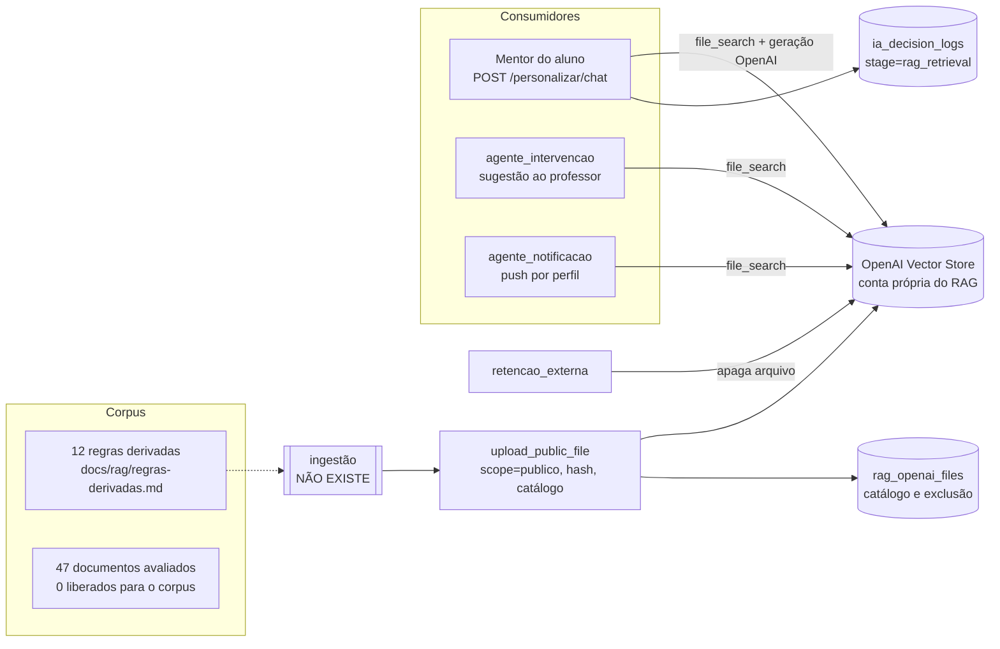

# O RAG em cada parte do sistema (04/11/2026)

A decisão de 04/11/2026 é que **a monografia precisa do RAG funcionando**: o teste em sala depende dele (seções 4.10 e 7.3 da monografia). Este mapa mostra, parte por parte do sistema, o papel do RAG, o que já existe e o que falta para ligá-lo.

**Base da varredura:**
- código da `main` do Lab em `8a5c4c65`;
- banco de produção, só leitura: 0 linhas em `rag_openai_files`, `rag_chunks` e `rag_relacoes`; 0 buscas em `ia_decision_logs` (`stage = rag_retrieval`);
- issues #63, #64, #66, #67, #165, #218, #877 e PR #945.

Inventário do resto do sistema: [`docs/tcc/inventario-completo-2026-11-04.md`](../tcc/inventario-completo-2026-11-04.md).

---

## 1. Resumo: o que impede o RAG de funcionar

| # | Bloqueio | Situação | Quem resolve |
|---|---|---|---|
| B1 | **Não existe ingestão.** Nenhum código chama `upload_public_file`, então nada entra no Vector Store | Corrigido em `upload_public_file` (#945), mas sem chamador | Código: script de ingestão |
| B2 | **O corpus está vazio.** Dos 47 documentos avaliados, **0** foram para "corpus do RAG", por licença. O que existe pronto são as **12 regras derivadas** (RD-01 a RD-12), texto próprio com fonte e metadados | Texto pronto em `docs/rag/regras-derivadas.md` | Código: transformar cada RD num documento indexável |
| B3 | **Configuração.** O RAG só liga com `OPENAI_RAG_ENABLED=true`, `OPENAI_RAG_API_KEY` (conta separada, #945) e `OPENAI_RAG_VECTOR_STORE_ID` na API | Não dá para conferir daqui. As 0 buscas sugerem que está desligado ou que nunca houve uso | Autora, no Dokploy |
| B4 | **A avaliação não roda.** O golden set tem 30 perguntas (`golden-set-documentos-v1.md`), mas não há rotina que meça a recuperação contra ele. As fontes esperadas apontam para documentos `DAT-xx`, que não estão no índice | Só o texto | Código: avaliador e mapeamento GS → RD |
| B5 | **As buscas só são registradas no mentor.** A intervenção e a notificação usam o RAG, mas não gravam em `ia_decision_logs` | Só o chat grava | Código, se a avaliação precisar |

Com B1 a B4 resolvidos, o RAG passa a funcionar de ponta a ponta com o corpus v1, que são as 12 regras derivadas. Os documentos integrais só entram quando a licença de cada um permitir (B2).

---

## 2. Arquitetura do RAG como está no código

**Como funciona uma chamada** (`OpenAIRagService.invoke_structured`):
1. Monta o prompt e os dados da sessão, que estão pseudonimizados.
2. Chama a Responses API da OpenAI com a ferramenta `file_search` no store, filtrando `scope = publico`.
3. O modelo da OpenAI (`gpt-4o-mini`) **gera** a resposta e cita os arquivos.
4. Grava o resumo da busca: ids, scores e latência, sem texto.

Consequência importante: **ligar o RAG muda o provedor de geração.** O mentor e a intervenção deixam de gerar com o Gemini e passam a gerar com a OpenAI, na conta do RAG. Se a chamada RAG falhar, eles caem no modelo sem busca, e depois na regra.

**Travas que já valem:**
- a IA é só para maiores de 18: a busca nem acontece na rota de menor (`llm.py`, antes do `use_rag`);
- o store só aceita e só busca escopo público;
- arquivo de turma ou de aluno nunca vai para esse store (ADR-0002);
- os conjuntos sensíveis ficam fora do índice (política da #74);
- a citação da intervenção só vale se o arquivo citado estiver entre os recuperados.

---

## 3. Mapa por parte do sistema

Legenda da coluna "Usa RAG":
- **sim:** o código chama o `file_search` quando o RAG está ligado;
- **não (decidido):** a triagem decidiu que não deve usar;
- **não:** não usa, e não há decisão registrada.

| Parte do sistema | Arquivo | Usa RAG | O que o RAG faz ou faria ali | Estado e lacuna |
|---|---|---|---|---|
| **Mentor do aluno** (chat) | `api/v1/personalizacao.py` (`POST /personalizar/chat`), prompt `mentor_personalizacao_chat.txt` | **sim** | Fundamenta a resposta ao aluno com a evidência (como estudar, revisar, lidar com o erro) e cita a fonte | Pronto e com registro das buscas (#67). Há guardrail de *grounding* com uma segunda chamada (`mentor_grounding_check.txt`). Falta corpus (B1, B2) e configuração (B3) |
| **Intervenção ao professor** | `agent/graph/nodes/agente_intervencao.py`, prompt `intervencao.txt` | **sim** | Quando um estado negativo se repete (3 dos 5 últimos registros), sugere ao professor uma ação com fonte | Pronto. As fontes citadas aparecem na aba Insights (#823). Não grava a busca em `ia_decision_logs` (B5) |
| **Notificação personalizada** | `agent/graph/nodes/agente_notificacao.py`, prompt `notificacao_personalizada.txt` | **sim** | Escolhe o tom e o momento do lembrete com base na evidência (RD-06: lembrete ligado a progresso e próximo passo) | Pronto: o RAG é a 1ª tentativa, com uma revisão sem RAG. Não grava a busca (B5) |
| **Sugestão de material** (ordem de consumo) | `services/sugestao_material.py`, `evidencias_pedagogicas.py` | **não (decidido)** | A evidência entra como texto derivado em regras **determinísticas**, com fonte e confiança (reescopo da #66) | Funcionando sem RAG. É o uso da Evidence Base que já existe hoje. Manter: a decisão precisa ser reproduzível para o estudo |
| **Insights da turma** | `services/insights_turma.py`, prompt `insights_turma.txt` | não | Poderia citar evidência nas sínteses ao professor | Sem decisão registrada. Candidato natural depois do mentor |
| **Lumi** (assistente do professor) | `services/escriba.py`, prompts `escriba.txt` e `lumi_conhecimento.md` | não | Poderia responder "o que a literatura diz" sobre a turma | Sem decisão registrada. Também é candidato |
| **Missões sugeridas pela IA** | `services/missoes_ia.py` | não | — | Propõe metas de missão; evidência pouco útil aqui |
| **Material base por perfil** (texto, áudio, apresentação) | `services/personalizacao.py`, microservice, BrainHexPDF | não (decidido) | — | Fonte curricular é o conteúdo do professor. A literatura não altera o conteúdo da disciplina (monografia 6.3) |
| **Fontes do professor** | `repositories/fontes_personalizacao.py`, `app/ingestion/` | não (decidido) | — | Vão para o contexto da geração, nunca para o store público (ADR-0002). Exigiriam store separado por turma |
| **Análise da telemetria** (6 estágios) | `services/linear_analysis_pipeline.py` | não | — | Regras determinísticas. A evidência vale como limite de interpretação (RD-12: logs são comportamento, não emoção) |
| **Grafo LangGraph** (supervisor) | `agent/graph/` | não (decidido) | — | O nó `agente_rag` da #63 foi substituído: o RAG entra pelo consumidor, não como nó |
| **Formato pedido pelo conteúdo** | `services/demanda_formato.py` | não | — | Classificação por conteúdo; sem evidência envolvida |
| **Falas do boss, tema do mapa, missão diária** | `boss_falas.py`, `classe_mapa_tema.py`, `missao_diaria_texto.py` | não | — | Texto de jogo; sem evidência |
| **Alteração do professor** | `services/alteracao_professor.py` | não | — | Decide se o aluno revisa; sem evidência |
| **Correção de redação** | edge function `validate-essay-answer-ai` | não | — | Corrige pelo gabarito do professor |
| **App do aluno** | `mobile/` | indireto | Mostra a resposta do mentor e os lembretes | Não mostra a fonte citada. Avaliar se a citação deve aparecer ao aluno |
| **Console do professor** | aba Insights | indireto | Mostra as fontes da intervenção | Pronto (#823) |
| **Banco** | `rag_openai_files`, `rag_chunks` (pgvector), `rag_relacoes` | catálogo | `rag_openai_files` é o catálogo que a exclusão consulta. `rag_chunks` vem do desenho pgvector (ADR-0001, substituído) | Tudo vazio. `rag_chunks` e `rag_relacoes` ficaram sem uso |
| **Retenção e exclusão** | `services/retencao_externa.py` | sim | Apaga o arquivo no store quando ele sai do catálogo | Pronto, com a chave do RAG (#945) |
| **Registro das buscas** | `services/rag_observabilidade.py`, `docs/rag/observabilidade.md` | sim | Latência, cobertura, scores e taxa de intervenção do guardrail, sem texto | Só o mentor grava (B5). As consultas SQL de métrica estão prontas |
| **LGPD** | `docs/lgpd/transferencias-internacionais.md` (linha 5) | — | A OpenAI recebe os dados da sessão, pseudonimizados e só de adultos, com `store=false` | Registrado (#945). O corpus é público e não tem dado pessoal |

---

## 4. O corpus: o que pode ser indexado hoje

| Origem | Quantidade | Pode indexar? | Por quê |
|---|---|---|---|
| Regras derivadas RD-01 a RD-12 | 12 | **Sim** | Texto próprio, com fonte, população, tipo de estudo, confiança e limite. A triagem prevê que texto derivado entre no índice como documento próprio, com `tipo=derivado` |
| Documentos aprovados da Evidence Base | 24 aprovados entre os 28 decididos | Não, por enquanto | Nenhum foi para "corpus do RAG": a licença não permite indexar o texto integral, ou o documento serve só para citação |
| Documentos pendentes | 19 | Não | Sem decisão final da curadora |
| Conjuntos sensíveis (saúde mental, neurodivergência, biometria) | 5 | **Nunca** | Política da #74 |
| Conjuntos de pesquisa (EdNet, OULAD…) | — | Não, como linha | Só viram texto derivado |

**Corpus v1 = 12 regras derivadas.** Cobrem:
- formato e escolha (RD-01, RD-02);
- revisão espaçada (RD-03);
- recuperação ativa (RD-04);
- autorregulação (RD-05, RD-08);
- lembretes (RD-06);
- feedback (RD-07, RD-11);
- gamificação como engajamento, não aprendizagem (RD-09, RD-10);
- logs como comportamento (RD-12).

São justamente os domínios das perguntas do golden set.

Os atributos de cada arquivo no store seguem o contrato da #73:
- `scope=publico`;
- `tipo=derivado`;
- `construto`, `confianca` e `tipo_estudo`;
- `rd` (o id, como RD-03);
- `fontes` (os DAT-xx).

---

## 5. Avaliação do RAG (para a monografia)

O golden set v1 tem 30 perguntas. Algumas são **não respondíveis** de propósito, como GS-18 e GS-19, para medir se o sistema admite que não há evidência. Para virar medição, faltam três coisas:

1. **Fontes esperadas no índice.** Cada pergunta aceita documentos `DAT-xx`. Como o índice terá as RDs, é preciso mapear "pergunta → RDs aceitáveis". Cada RD já cita os DAT dela, então o mapeamento sai dessas citações e não é invenção.
2. **Medida da recuperação, sem geração.** A busca direta no store (`vector_stores.search`) devolve os arquivos e scores sem gerar texto. Com ela se mede:
   - **recall@k**: a RD esperada aparece entre os k primeiros?
   - **MRR**: em que posição ela aparece?
   - **precisão@k**.
   - Custa pouco e é reproduzível: mesma versão do corpus, mesmo k.
3. **Medida da resposta** (com geração), feita no mentor:
   - para as respondíveis: a resposta cita uma fonte aceitável?
   - para as não respondíveis: a resposta reconhece a falta de evidência?
   - Esta parte pede julgamento. A avaliação é humana, com uma rubrica de 3 níveis.

O resultado entra na seção 8.1 da monografia ("Resultados da Evidence Base") e responde ao item do Apêndice F: "testar respostas do RAG contra um conjunto de perguntas de validação".

---

## 6. Plano para ligar o RAG

| Passo | O quê | Tipo | Depende de |
|---|---|---|---|
| 1 | **Corpus v1:** gerar um arquivo por regra derivada a partir de `regras-derivadas.md`, com os atributos da seção 4 e o hash de conteúdo | PR (código) | — |
| 2 | **Ingestão:** script `api/scripts/rag_indexar_corpus.py`, que chama `upload_public_file`, é idempotente pelo hash, mostra o que muda e só envia com `--aplicar` | PR (código) | 1 |
| 3 | **Configuração:** conferir `OPENAI_RAG_ENABLED`, `OPENAI_RAG_API_KEY` e `OPENAI_RAG_VECTOR_STORE_ID` no Dokploy. Conferir também se o store tem arquivos sem `scope=publico` | Autora | — |
| 4 | **Indexar:** rodar o passo 2 com `--aplicar` e conferir `rag_openai_files` | Autora, ou eu com autorização | 2, 3 |
| 5 | **Avaliador:** mapeamento GS → RD e script de recall@k/MRR pela busca direta, com relatório versionado em `docs/rag/` | PR (código) | 1 |
| 6 | **Rodar a avaliação** e registrar o resultado (seção 8.1 da monografia) | Execução | 4, 5 |
| 7 | (opcional) Registrar as buscas da intervenção e da notificação em `ia_decision_logs` (B5) | PR (código) | — |
| 8 | (opcional) Decidir se a Lumi e os insights também usam o RAG | Decisão | 6 |

Os passos 1, 2 e 5 não dependem de nada externo e podem começar já. O 3 e o 4 dependem de quem tem acesso ao Dokploy e à conta da OpenAI do RAG.

---

## 7. O que dizer na monografia depois disso

- **Seção 6.5:** o RAG fundamenta três decisões de IA (mentor, intervenção e notificação) por busca semântica num corpus de regras derivadas da Evidence Base.
- **A sugestão de material** usa a mesma evidência de forma determinística, para ser reproduzível no estudo.
- **O corpus v1** tem só texto próprio (regras derivadas) por causa da licença dos documentos integrais. Essa é uma limitação declarada.
- **Seção 8.1:** recall@k e MRR no golden set de 30 perguntas, e o comportamento nas perguntas sem evidência.
- **Não dizer:**
  - que o RAG "garante" a resposta certa (Apêndice H);
  - que ele recupera os artigos integrais.
