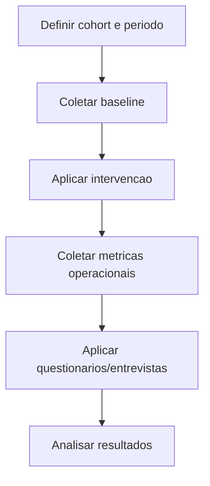

# 09. Metodologia de pesquisa e avaliacao

Data de atualizacao: 2026-04-19

## 1. Objetivo metodologico
Avaliar se a personalizacao orientada a BrainHex e a gamificacao associada melhoram indicadores de engajamento e desempenho em contexto educacional real.

## 2. Natureza das evidencias atuais
As pesquisas anexadas no projeto sao de fase inicial (descoberta e mercado). Elas orientam:
- priorizacao de funcionalidades;
- desenho de experiencia;
- hipoteses de valor.

Nao substituem protocolo experimental final.

## 3. Perguntas de pesquisa sugeridas
- PR1: a personalizacao aumenta tempo ativo por topico?
- PR2: ha ganho em conclusao e acerto por atividade?
- PR3: qual perfil BrainHex responde melhor a cada formato?
- PR4: quais elementos de UX impactam retencao semanal?

## 4. Desenho de avaliacao recomendado
Fase 1 (baseline):
- medir indicadores sem intervencoes novas.

Fase 2 (intervencao controlada):
- aplicar personalizacao por cohort;
- manter grupo comparavel quando possivel.

Fase 3 (avaliacao longitudinal):
- acompanhar estabilidade dos ganhos ao longo de ciclos.

## 5. Instrumentos
- logs de telemetria do sistema;
- dados de progresso e eventos no banco;
- questionarios de percepcao de utilidade e usabilidade;
- entrevistas semiestruturadas com docentes.

O questionário, o roteiro de entrevista, o consentimento e a triangulação estão no
[capítulo 13](13-instrumentos-qualitativos.md) (#22).

## 6. Procedimento de coleta

### 6.1 Protocolo de coleta no sistema (#13)

O desenho e as decisões estão em
[`2026-11-01-cohort-e-baseline-design.md`](../superpowers/specs/2026-11-01-cohort-e-baseline-design.md).
O protocolo segue os passos do fluxo acima:

1. **Definir a cohort e o período.** A cohort é a turma, com uma data de corte. O professor dono
   registra cada turma com `estudo_coorte_registrar`, informando o rótulo do estudo, o braço
   (`intervencao` ou `comparacao`), `baseline_inicio`, `corte` e `fim`. O registro precisa
   acontecer **antes** de o baseline começar: o sistema recusa baseline no passado e trava o
   corte quando a data dele chega. A turma de comparação também recebe um corte, que vale como
   data de referência.
2. **Coletar o baseline.** A janela é `[baseline_inicio, corte)` e dura pelo menos 7 dias. A
   personalização fica **retida desde o registro** nos dois braços:
   - o aluno não vê o material gerado, os cards, as falas geradas do boss nem o andamento da
     geração, e o app mostra o material do professor;
   - o ciclo de análise só mede e avisa o professor: não muda tema, cronômetro nem ordem do
     material, e não manda notificação ao aluno.

   A geração continua, então o material está pronto no corte. As regras fixas do jogo por
   perfil (tema, cronômetro padrão, batalha) e o guia ficam iguais nos dois braços. Se algo
   escapar da trava, o relatório marca `baseline_contaminado`, que mede a exposição.
3. **Aplicar a intervenção.** A partir do corte, a turma de intervenção recebe a personalização,
   sem job: a trava libera pela data. A turma de comparação fica retida até o fim do estudo e
   recebe a personalização no dia seguinte (lista de espera).
   Cada aluno tem duas datas de entrada, a atribuída e a observada, que aparecem em
   `vw_estudo_participantes`.
4. **Coletar as métricas operacionais.** A coleta já é automática:
   - o tempo ativo vem da telemetria;
   - a conclusão de tópico fica registrada com data em `topico_aluno_conclusao`;
   - as entregas vêm de `atividade_tentativas`;
   - o acerto vem de `questao_aluno`.

   Toda mudança de produto feita no meio da coleta precisa entrar em `marco_produto`. As
   migrations e as mudanças de protocolo entram sozinhas. O resto é registrado com
   `marco_produto_registrar`: deploy de API, build novo do app, mudança de prompt e aula fora do
   planejado.
5. **Analisar.** `metricas_estudo_coortes` traz PR1 e PR2 por turma, antes e depois do corte, e
   também:
   - a série semanal relativa ao corte;
   - os marcos que caíram dentro de cada janela;
   - a diferença-em-diferenças entre os braços.

   O resultado é só agregado: uma célula com menos de 5 alunos volta nula. A lista `limitacoes`
   da resposta acompanha qualquer resultado reportado (§10).

### 6.2 PR3: perfil × formato (#20)

`metricas_perfil_formato(turmas, inicio, fim)` cruza o perfil BrainHex com o formato do material
personalizado: engajamento (uso, tempo ativo e fatia do tempo) e acerto na 1ª tentativa pelo
formato dominante de cada tópico, com intervalo de Wilson a 95%. Para PR3, a janela é o `corte`
e o `fim` da turma de intervenção. O perfil é lido de duas formas, pelo dominante e pelo vetor
completo de afinidades. Abaixo de 5 alunos (ou de n efetivo 5), a célula volta nula.

O resultado é observacional: o grafo escolhe o formato pelo perfil, então ele mostra
associação, não causa. A conclusão só volta para a priorização por um ajuste manual, e o caminho
está em [`2026-11-02-perfil-formato-pr3-design.md`](../superpowers/specs/2026-11-02-perfil-formato-pr3-design.md) §5.

## 7. Controle de vieses
- padronizar janelas temporais;
- registrar alteracoes de produto durante coleta;
- segmentar por turma/disciplina;
- monitorar dados faltantes e outliers.

## 8. Etica e privacidade
- anonimizar relatorios analiticos;
- restringir acesso a dados identificaveis;
- explicitar finalidade e periodo de uso dos dados;
- seguir politicas internas de conformidade LGPD.

## 9. Analise recomendada
- estatistica descritiva por cohorte;
- comparacao pre vs pos intervencao;
- analise segmentada por perfil BrainHex;
- triangulacao quantitativa + qualitativa (matriz no [capítulo 13 §6](13-instrumentos-qualitativos.md#6-triangulação)).

## 10. Criterios de aceitacao de impacto
- melhoria estatisticamente e pedagogicamente relevante;
- manutencao do ganho por mais de um ciclo;
- satisfacao docente e discente sem aumento de carga operacional critica.
