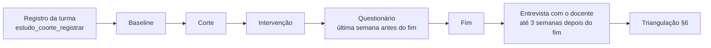

# 13. Instrumentos qualitativos: questionário e entrevista

Data de atualização: 2026-11-05 · Issue [#22](https://github.com/BitStudioLabs/trail-up/issues/22)

O capítulo 09 lista quatro instrumentos (§5). Os dois quantitativos já existem desde a #13: a
telemetria e o progresso no banco, lidos por `metricas_estudo_coortes`. Este capítulo traz os
dois qualitativos e as regras para cruzar os dados (§9, triangulação):

- o questionário de percepção de utilidade e usabilidade, para alunos (§3);
- o roteiro de entrevista semiestruturada, para docentes (§4).

Sem eles, o critério "satisfação docente e discente sem aumento de carga operacional crítica"
(09 §10) não tem como ser medido.

## 1. Decisões

| # | Decisão | Por quê |
|---|---|---|
| Q-1 | **O questionário é anônimo e se liga à turma, não ao aluno.** Cada turma do estudo recebe um link próprio. O link leva um código opaco da turma, e o formulário não pede nome, e-mail, matrícula nem data de nascimento. | A cohort da #13 é a turma (decisão C-1). Ligar a resposta ao aluno exigiria uma chave pseudônima, e a resposta passaria a ser dado pessoal, muitas vezes de menor. O cruzamento por turma e braço basta para a triangulação (§6). |
| Q-2 | **As respostas ficam fora do produto, num formulário da conta institucional da equipe.** A exportação em CSV vai para a pasta do estudo, com acesso só da equipe de pesquisa. | Dentro do app, a resposta passaria pelo mesmo login do estudo, e o aluno poderia ligá-la ao desempenho, à nota ou ao XP. Fora do app também não é preciso migration, RLS nem tela nova. |
| Q-3 | **Responder não rende XP, moedas nem nota, e não responder não custa nada.** O app não mostra lembrete com recompensa. | Recompensa enviesa quem responde e como responde. É a mesma regra do épico de gamificação: nada pode custar ponto a quem não participa. |
| Q-4 | **Um resultado só é reportado com pelo menos 5 respostas na célula.** Abaixo disso, a célula volta como "amostra insuficiente". As respostas abertas saem só como trechos curtos, revisados para tirar nomes, apelidos e qualquer detalhe que identifique. | É o mesmo `n_minimo` da #13 (decisão C-10). Numa turma de três, a média é a resposta de uma pessoa. |
| Q-5 | **O questionário é aplicado nos dois braços, na última semana da janela de intervenção** (`[fim − 7 dias, fim]`), antes de a turma de comparação receber a personalização. | O momento é o mesmo nos dois braços, então a diferença entre eles é comparável. Se a comparação respondesse depois de receber a personalização, a lista de espera apagaria o contraste. |
| Q-6 | **A entrevista é com o professor dono de cada turma do estudo, depois do `fim`.** Ela é gravada em áudio só com consentimento. A transcrição é pseudonimizada (D1, D2…), e o áudio é apagado depois de transcrito e conferido. | O áudio identifica pela voz. A transcrição pseudonimizada basta para a análise. |
| Q-7 | **O questionário e a entrevista têm aceite próprio, além da finalidade `pesquisa` do app** (§5). | A finalidade `pesquisa` (#613, `aluno_finalidade_permitida`) autoriza o uso dos **dados do app** na pesquisa e é ela que filtra o lado quantitativo (`vw_alunos_pesquisa_elegiveis`). O questionário e a entrevista são coleta nova, fora do app, e precisam de aceite deles. Recusar qualquer um dos dois não muda nada no uso do app. |

## 2. Quando cada instrumento entra no estudo

O questionário e a entrevista entram em `marco_produto` como marco manual da turma, com
`marco_produto_registrar`. Assim a série semanal mostra a semana em que foram aplicados, e o
efeito de aplicar o questionário não se confunde com o da intervenção.

## 3. Questionário de percepção (alunos)

Tempo previsto: de 8 a 10 minutos. Escala de 1 a 5 (1 = discordo totalmente, 5 = concordo
totalmente), salvo onde estiver indicado de outro jeito.

### 3.1 Abertura (no próprio formulário)

> Este questionário faz parte de uma pesquisa de TCC sobre o TrailUp. Ele não pede seu nome nem
> seu e-mail, e ninguém consegue saber o que você respondeu. Responder é opcional. Não vale nota,
> XP nem moedas, e não responder não muda nada para você. Você pode parar a qualquer momento.
> As respostas são usadas só nesta pesquisa e apagadas até [data de descarte, §5].

Depois vem o aceite (§5.2). Sem o aceite, o formulário termina.

### 3.2 Bloco A: usabilidade (SUS)

Os 10 itens da System Usability Scale (Brooke, 1996), em tradução livre. A pontuação segue o
padrão do instrumento:
- nos itens ímpares, a resposta menos 1;
- nos itens pares, 5 menos a resposta;
- a soma é multiplicada por 2,5, e o resultado vai de 0 a 100.

Se a banca pedir uma tradução validada do SUS para o português, ela substitui esta, sem mudar a
pontuação.

1. Eu gostaria de usar o TrailUp com frequência.
2. Achei o TrailUp mais complicado do que precisava ser.
3. Achei o TrailUp fácil de usar.
4. Acho que eu precisaria de ajuda de alguém para conseguir usar o TrailUp.
5. As partes do TrailUp (trilha, missões, ranking, loja) funcionam bem juntas.
6. Achei o TrailUp inconsistente: coisas parecidas funcionam de jeitos diferentes.
7. Imagino que a maioria das pessoas aprenderia a usar o TrailUp rápido.
8. Achei o TrailUp trabalhoso de usar.
9. Eu me senti seguro(a) usando o TrailUp.
10. Precisei aprender muita coisa antes de conseguir usar o TrailUp.

### 3.3 Bloco B: utilidade percebida

São itens adaptados do construto de utilidade percebida do TAM (Davis, 1989) para o contexto de
estudo. O escore é a média dos itens.

11. O TrailUp me ajudou a estudar o conteúdo da disciplina.
12. Com o TrailUp, entendi o conteúdo mais rápido do que sem ele.
13. O TrailUp me ajudou a perceber o que eu ainda não sabia.
14. Eu continuaria usando o TrailUp mesmo se não fosse pedido pelo professor.

### 3.4 Bloco C: personalização e jogo

Esses itens servem para PR3 e PR4 e para o contraponto da #154, sobre a pressão da competição.
Cada item é lido isoladamente; os itens não somam um escore.

15. O material parecia feito para o meu jeito de estudar.
16. O tipo de material (texto, áudio, apresentação) combinava comigo.
17. As missões e conquistas me deram vontade de continuar.
18. O ranking ou a competição com colegas me deixou pressionado(a). *(item invertido na leitura: concordar é sinal de alerta)*
19. Em algum momento senti que estava jogando mais do que estudando.
20. O tempo das atividades foi suficiente para eu pensar com calma.

### 3.5 Bloco D: uso

21. Em média, quantos dias por semana você abriu o TrailUp? *(0 · 1–2 · 3–4 · 5 ou mais)*
22. Onde você mais usou? *(celular · computador · os dois)*

O bloco D não identifica ninguém e serve só para ler a resposta ao lado da telemetria (§6).
Com a plataforma, dá para conferir o viés da #30: a web não tem câmera, então a telemetria muda.

### 3.6 Bloco E: perguntas abertas (opcionais)

23. O que mais te ajudou a estudar no TrailUp?
24. O que mais atrapalhou ou incomodou?
25. Se você pudesse mudar uma coisa, o que seria?

## 4. Roteiro de entrevista semiestruturada (docentes)

Duração prevista: de 30 a 45 minutos. As perguntas principais são feitas a todos, na ordem
abaixo. Os desdobramentos (↳) são usados só se o assunto não surgir sozinho. O entrevistador
não mostra os resultados quantitativos da turma antes de terminar o bloco 5, para não induzir as
respostas.

**Bloco 1. Contexto (5 min)**
1. Como era a turma e a disciplina no período do estudo?
   ↳ Teve algo fora do planejado (greve, prova, feriado, troca de conteúdo)? *(isso vira marco em `marco_produto` se ainda não estiver lá)*

**Bloco 2. Carga operacional (10 min)** *(critério de impacto, 09 §10)*
2. Quanto tempo por semana você gastou com o TrailUp: montar trilha, revisar material, acompanhar a turma?
   ↳ Comparado a como você preparava a disciplina antes, foi mais, menos ou igual?
3. Teve alguma tarefa que você precisou refazer ou corrigir à mão? Qual?
   ↳ Material gerado com erro, geração que falhou, aluno que não aparecia.
4. Em que momento o TrailUp deu mais trabalho do que ajudou?

**Bloco 3. Personalização (10 min)** *(PR1 a PR3)*
5. Você percebeu diferença no jeito de os alunos estudarem depois que a personalização foi liberada?
   ↳ Em algum aluno ou grupo específico, sem dizer nomes?
6. Você confiou no material gerado para cada perfil? Por quê?
7. O que você mudaria na forma como o material é adaptado?

**Bloco 4. Gamificação e clima da turma (5 min)** *(PR4 e #154)*
8. Como a turma reagiu às missões, conquistas, ranking e eventos?
   ↳ Alguém ficou de fora ou desanimou por causa da competição?
   ↳ Você viu cola ou combinação entre alunos para ganhar pontos?

**Bloco 5. Dados e decisões (5 min)**
9. As informações do console (painel, recomendações, insights) mudaram alguma decisão sua sobre a turma? Qual?
10. Teve algum dado que você esperava ver e não encontrou?

**Bloco 6. Fechamento (5 min)**
11. Você usaria o TrailUp de novo numa próxima turma? Em que condições?
12. Tem algo que eu não perguntei e você acha importante?

### 4.1 Ficha de registro da entrevista

Uma ficha por entrevista, preenchida logo depois dela. Ela fica junto da transcrição
pseudonimizada.

| Campo | Conteúdo |
|---|---|
| Código do docente | D1, D2… (a tabela que liga o código ao nome fica separada, com acesso só do entrevistador) |
| Turma(s) | código opaco da turma (o mesmo do questionário) e braço |
| Data, duração e meio | presencial ou online; com ou sem gravação |
| Consentimento | TCLE assinado (sim/não); gravação autorizada (sim/não) |
| Resumo por bloco | 3 a 5 linhas para cada um dos 6 blocos |
| Trechos marcantes | até 5 citações literais, com o minuto da gravação |
| Marcos citados | eventos fora do planejado, para conferir com `marco_produto` |
| Códigos aplicados | da lista de §4.2 |
| Observações do entrevistador | o que chamou atenção e não cabe nos blocos |

### 4.2 Códigos iniciais da análise

A análise é temática (Braun e Clarke, 2006). Ela começa por estes códigos dedutivos, tirados das
perguntas de pesquisa e dos critérios de impacto, e aceita códigos novos que surgirem das
entrevistas. Dois membros da equipe codificam cada transcrição e registram as divergências e como
foram resolvidas.

| Código | Liga a |
|---|---|
| `carga.tempo`, `carga.retrabalho` | critério de carga operacional (09 §10) |
| `personalizacao.percebida`, `personalizacao.confianca` | PR1–PR3 |
| `formato.adequacao` | PR3 |
| `jogo.engajamento`, `jogo.pressao`, `jogo.conluio` | PR4 e #154 |
| `dados.decisao`, `dados.lacuna` | console e insights |
| `contexto.evento_externo` | ameaças à validade (09 §7) |

## 5. Ética e consentimento

### 5.1 O que todo participante fica sabendo antes de aceitar

- **Finalidade:** avaliar se o TrailUp ajuda a estudar e a dar aula, para o TCC.
- **O que é coletado:** no questionário, as respostas, sem identificação. Na entrevista, a conversa e, se autorizado, o áudio.
- **Quem acessa:** só a equipe de pesquisa.
- **Período:** as respostas são guardadas até a defesa do TCC e apagadas até 6 meses depois dela. O áudio é apagado assim que a transcrição é conferida.
- **Voluntariedade:** participar é opcional e não afeta nota, XP, moedas nem a relação com o professor. Dá para desistir a qualquer momento. No questionário anônimo não há como retirar uma resposta já enviada, e isso é dito antes do envio.
- **Contato:** um e-mail da equipe para dúvidas.

### 5.2 Formas de aceite

| Participante | Aceite |
|---|---|
| Aluno maior de idade | aceite no início do formulário (§3.1) |
| Aluno menor de idade | autorização do responsável, colhida pela escola ou pelo professor antes da aplicação, e assentimento do próprio aluno no início do formulário |
| Docente | TCLE assinado antes da entrevista, com autorização separada para a gravação |

Esse aceite é distinto da finalidade `pesquisa` do app (#613), que o aluno marca no Perfil e o
responsável marca no termo ("Uso em pesquisa acadêmica"). Aquela autoriza usar os dados do app;
este autoriza responder ao questionário ou dar a entrevista. Um não substitui o outro.

Pesquisa com pessoas em ciências humanas e sociais segue a Resolução CNS 510/2016. A necessidade
de submeter o projeto a um Comitê de Ética em Pesquisa é decidida com o orientador **antes** da
primeira aplicação, e a decisão fica registrada no capítulo 08.

## 6. Triangulação

A unidade de cruzamento é a **turma × fase** (pré e pós) e o **braço** (intervenção e
comparação), a mesma da #13. O lado quantitativo vem de `metricas_estudo_coortes`; o qualitativo,
dos escores de §3 e dos códigos de §4.2.

As duas populações não são a mesma. O lado medido conta só quem tem a finalidade `pesquisa`
ligada no app (`vw_alunos_pesquisa_elegiveis`, `20261104_04`). O lado declarado conta quem
respondeu ao questionário. As duas taxas, consentimento e resposta, saem junto do resultado.

### 6.1 Matriz

Para cada linha, a equipe anota se os dois lados **convergem**, **se complementam** (um explica o
outro) ou **divergem**. Uma divergência não é descartada: ela é reportada e discutida.

| Pergunta | Medido (`metricas_estudo_coortes`) | Declarado |
|---|---|---|
| PR1: tempo ativo | minutos por aluno e semana, pré × pós, diferença-em-diferenças | item 21 (dias de uso); itens 17 e 19 |
| PR2: conclusão e acerto | tópicos concluídos, atividades entregues, acerto na 1ª tentativa | utilidade percebida (itens 11–14); docente, `personalizacao.percebida` |
| PR3: perfil × formato | `metricas_perfil_formato` (#20) | itens 15 e 16; docente, `formato.adequacao` |
| PR4: retenção | percentual de pareados ativos por semana | SUS; itens 17 e 18; docente, `jogo.*` |
| Carga operacional (09 §10) | não há medida automática | docente, `carga.*` |
| Satisfação discente (09 §10) | — | SUS e utilidade percebida, por braço |

### 6.2 Leitura

- **Por braço:** compare o SUS e a utilidade percebida da intervenção com os da comparação. Como os dois respondem no mesmo momento (Q-5), a diferença é atribuível ao braço, com as ressalvas de 09 §7.
- **Com a série:** leia a resposta da turma ao lado da série semanal e dos marcos. Por exemplo, utilidade alta numa turma cujo tempo ativo caiu depois do corte é uma divergência a explicar, e a entrevista do docente é o primeiro lugar onde procurar a explicação.
- **O que não dá para fazer:** cruzar a resposta de um aluno com o comportamento do mesmo aluno. Isso é consequência de Q-1 e entra nas limitações.

### 6.3 Limitações (acompanham qualquer resultado)

1. O questionário é autodeclarado: quem gosta mais tende a responder mais. A taxa de resposta por turma é reportada junto (respostas ÷ pareados da turma).
2. Quem respondeu ao questionário e quem entra na métrica (finalidade `pesquisa`) são grupos que se sobrepõem, mas não são iguais.
3. O cruzamento é por turma, não por aluno (Q-1).
4. Turmas com menos de 5 respostas ficam fora da comparação (Q-4).
5. O docente é, ao mesmo tempo, quem conduz a turma e quem avalia o produto. Isso é desejado no desenho, mas aumenta o viés de desejabilidade.
6. A tradução do SUS é livre até ser substituída por uma versão validada (§3.2).

## 7. Referências

- BRAUN, V.; CLARKE, V. Using thematic analysis in psychology. *Qualitative Research in Psychology*, v. 3, n. 2, p. 77–101, 2006.
- BROOKE, J. SUS: a "quick and dirty" usability scale. In: JORDAN, P. W. et al. (org.). *Usability Evaluation in Industry*. London: Taylor & Francis, 1996. p. 189–194.
- DAVIS, F. D. Perceived usefulness, perceived ease of use, and user acceptance of information technology. *MIS Quarterly*, v. 13, n. 3, p. 319–340, 1989.
- BRASIL. Conselho Nacional de Saúde. Resolução nº 510, de 7 de abril de 2016.
- Capítulo 09 (§5, §7, §8, §9, §10) e o desenho da #13: [`2026-11-01-cohort-e-baseline-design.md`](../superpowers/specs/2026-11-01-cohort-e-baseline-design.md).
