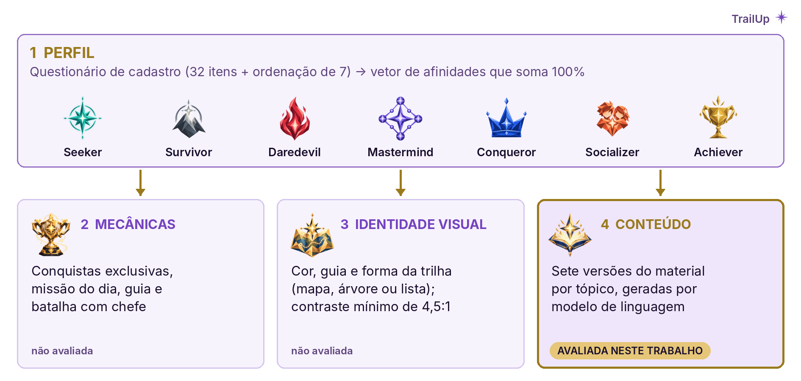
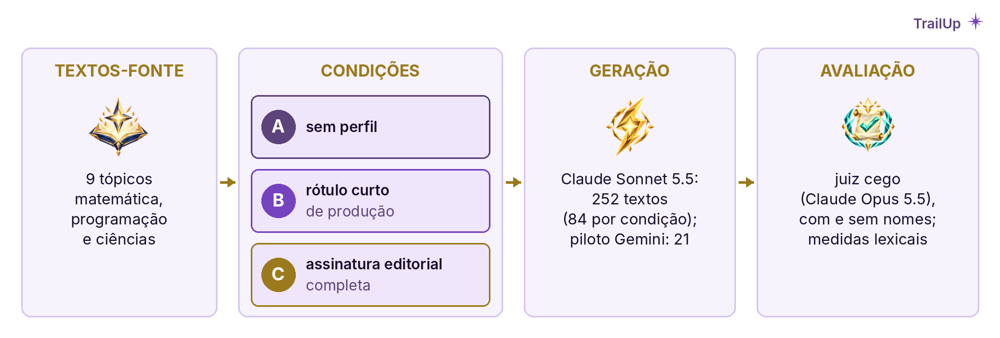

# Da tipologia à trilha: personalização de conteúdo por perfil de jogador com modelos de linguagem

**Geisbelly Victoria Feitosa Moraes Domiciano¹, Guilherme Domiciano Feitosa Silva², Fábio Castro Araújo³**

- ¹Estudante do Curso de Ciência da Computação, Centro Universitário Luterano de Palmas – CEULP/ULBRA.
- ²Estudante do Curso de Engenharia de Software, Centro Universitário Luterano de Palmas – CEULP/ULBRA.
- ³Professor/Orientador, Centro Universitário Luterano de Palmas – CEULP/ULBRA.

## Resumo

Personalizar a gamificação por tipo de jogador é comum na educação, mas não se sabe se um modelo de linguagem, ao adaptar o material a cada perfil, reproduz as características definidas. Com base na *Design Science Research*, este trabalho apresenta como artefato a plataforma TrailUp, que personaliza mecânicas, identidade visual e conteúdo por perfil BrainHex, e avalia sua camada de conteúdo com 252 textos em três condições de *prompt*. O rótulo do perfil bastou para um juiz automático reconhecê-lo, mas só a especificação completa aumentou a aderência lexical às características definidas, o que indica a correção a fazer no artefato.

**Palavras-chave:** Gamificação; BrainHex; modelos de linguagem.

## 1 Introdução

A gamificação melhora a aprendizagem, mas de forma desigual. Na meta-análise de Sailer e Homner (2020), os efeitos foram de g = 0,49 sobre resultados cognitivos, 0,36 sobre motivação e 0,25 sobre comportamento, com heterogeneidade alta (I² de 64% a 75%). O tipo de jogador aparece entre as possíveis explicações dessa variação, mas não pôde ser testado, porque a maioria dos estudos não o registrava. Ainda assim, personalizar a gamificação por tipo de jogador é a estratégia mais comum da área, aplicada sobretudo em educação (Klock *et al.*, 2020).

Entre as tipologias disponíveis, este trabalho adota o BrainHex, que descreve sete arquétipos de jogador construídos a partir de achados neurobiológicos e de tipologias anteriores: Seeker (Explorador), Survivor (Sobrevivente), Daredevil (Aventureiro), Mastermind (Estrategista), Conqueror (Conquistador), Socializer (Socializador) e Achiever (Realizador) (Nacke; Bateman; Mandryk, 2014). No restante do texto, usam-se os nomes originais. O modelo representa cada pessoa por afinidades com esses arquétipos, e não por um rótulo único (Lavoué *et al.*, 2019). Foi a tipologia mais frequente nos estudos de personalização revisados por Oliveira *et al.* (2023) e esteve entre as que melhor previram preferências e comportamento declarado de usuários (Sienel; Münster; Zimmermann, 2021; Hadi Mogavi *et al.*, 2023). A adoção, contudo, tem limitações conhecidas. Hallifax *et al.* (2019) consideraram o Hexad mais adequado para escolher elementos de gamificação, e a escala original do BrainHex apresentou baixa consistência interna, reduzindo-se a três dimensões motivacionais em mais de 50 mil respostas (Tondello *et al.*, 2018). A opção pelo BrainHex decorre da natureza do artefato: o Hexad descreve tipos de usuário de sistemas gamificados, enquanto o BrainHex descreve tipos de jogador de jogos. No TrailUp, os arquétipos não só selecionam elementos de gamificação, mas alimentam a narrativa e a identidade visual, com guias, cenários e trilhas próprios. Diante das limitações, eles são tratados como afinidades a estimar, e não como categorias rígidas.

Os modelos de linguagem permitem estender a personalização por perfil ao próprio material didático: além dos elementos de jogo, o texto pode ser adaptado a cada perfil, com tom, profundidade e ênfase ajustados conforme o *prompt* (Dibitonto *et al.*, 2026). Essa adaptação já foi avaliada para perfis de leitor, aprendiz e visitante de museu (Huynh; McNamara, 2025; Kricheli *et al.*, 2026; Dibitonto *et al.*, 2026), mas não foi localizada avaliação para tipos de jogador. Permanece em aberto, portanto, se o modelo, ao receber o perfil no *prompt*, produz um texto que segue as características desse perfil ou apenas um texto identificado com o seu nome.

Diante dessa lacuna, este trabalho tem dois objetivos: (i) apresentar a plataforma educacional gamificada TrailUp como artefato que usa o perfil BrainHex para personalizar mecânicas, identidade visual e conteúdo; e (ii) avaliar em que medida textos gerados por modelo de linguagem para cada perfil seguem as características definidas para ele. Trata-se de pesquisa aplicada, conduzida segundo a *Design Science Research*, que produz um artefato para um problema real e o avalia para realimentar seu projeto (Hevner *et al.*, 2004). Aqui, a avaliação é um experimento controlado com três condições de *prompt*.

## 2 Material e métodos

O artefato, a plataforma TrailUp, é composto por aplicativo do aluno, console do professor, API de inteligência artificial e serviço de geração de mídia, sobre banco de dados Supabase, em arquitetura pensada para operar com poucos recursos. As mecânicas e o perfil foram definidos com base em análise crítica da literatura e em levantamento exploratório de preferências realizado em disciplina do curso, usado apenas de forma agregada.

A personalização atravessa quatro camadas (Figura 1), a primeira das quais é o perfil. O questionário de cadastro é uma adaptação exploratória, com 32 itens autorais em oito eixos, e não reproduz o instrumento original. O oitavo eixo, imersão, não corresponde a um arquétipo e contribui com peso parcial para Seeker, Daredevil e Socializer. Cada eixo tem um item reverso; os escores por perfil de cada pessoa são centrados na própria média e combinados, com peso igual, a uma ordenação forçada de sete afirmações. O resultado é um vetor de afinidades percentuais que somam 100. Não se calcula índice de confiança, porque itens e pesos ainda não foram calibrados. Pelo mesmo motivo, os indicadores de comportamento que o sistema extrai da telemetria de uso, como a persistência após erros, associada ao Survivor, ainda não alteram as afinidades gravadas e não interferem no experimento. As outras três camadas estão resumidas no Quadro 1.

**Figura 1** — Camadas de personalização por perfil no TrailUp

<small>Fonte: Elaboração própria (2026).</small>

Na Figura 1, o perfil estimado no cadastro orienta as três camadas seguintes; apenas a de conteúdo, em destaque, foi avaliada neste trabalho.

**Quadro 1** — Decisões de projeto por camada e base na literatura

| Camada | Decisão no TrailUp | Base na literatura | Avaliada |
|---|---|---|---|
| Perfil | Vetor de afinidades com os sete arquétipos, sem índice de confiança | Afinidades, não tipo único (Lavoué *et al.*, 2019); limitações psicométricas (Tondello *et al.*, 2018) | Não |
| Mecânicas | Elementos comuns a todos; conquistas exclusivas, missão do dia, guia e batalha com chefe variam com o perfil | Conquistas e *ranking* favorecem competência; narrativa e equipe, pertencimento (Sailer *et al.*, 2017; Sailer; Homner, 2020) | Não |
| Identidade visual | Cor, guia e forma da trilha por perfil; contraste mínimo de 4,5:1 | Efeitos da cor são frágeis fora do laboratório (Elliot, 2015; Gnambs, 2020): a cor identifica o perfil, não o estimula | Não |
| Conteúdo | Sete versões por tópico, geradas por modelo de linguagem | Modelos ajustam tom e ênfase ao perfil (Dibitonto *et al.*, 2026); sem avaliação para tipo de jogador | Sim |

<small>Fonte: Elaboração própria (2026).</small>

O Quadro 1 indica o apoio de cada decisão na literatura e se ela foi avaliada. A Figura 2 ilustra a camada visual.

**Figura 2** — Cenário, emblema e forma da trilha em cada perfil

<small>Fonte: Elaboração própria a partir dos recursos visuais do aplicativo TrailUp (2026).</small>

Na Figura 2, cada perfil recebe cenário, emblema e cor próprios, e a trilha assume a forma de mapa (Seeker, Conqueror e Daredevil), árvore (Mastermind e Survivor) ou lista (Socializer e Achiever), com os mesmos tópicos e o mesmo progresso.

A camada de conteúdo foi avaliada por um experimento controlado (Figura 3). Nove textos-fonte, três por área (matemática, programação e ciências), foram escritos pelo Claude Opus 5.5, instruído como professor, e revisados pela primeira autora quanto à correção técnica. Cada texto foi adaptado aos sete perfis em três condições de *prompt*: sem perfil (A); com o rótulo curto usado em produção (B), formado pelo nome do arquétipo, pelo nome do guia e por uma indicação de estilo de duas ou três palavras; e com a assinatura editorial completa (C), que o código do projeto define para cada perfil como tom de voz, ritmo, estilos de abertura e fechamento, quatro marcadores linguísticos e proibições de estilo.

O experimento foi conduzido à parte, fora do repositório, como fase de testes práticos; sem tempo para a aplicação em sala, optou-se por dados sintéticos gerados por IA. As condições B e C reproduzem o rótulo e a assinatura definidos no código do TrailUp, cuja inspeção mostrou que apenas o gerador de reserva, em Python, recebe a assinatura; o gerador de produção, Gemini 3.6 Flash, recebe somente o rótulo. Como a cota gratuita do Gemini era limitada, o corpus principal foi gerado com o Claude Sonnet 5.5, e um piloto de 21 textos foi gerado com o Gemini. O corpus reúne 252 textos, 84 por condição, porque três tópicos foram gerados duas vezes para medir a consistência entre repetições.

**Figura 3** — Desenho do experimento sobre a camada de conteúdo

<small>Fonte: Elaboração própria (2026).</small>

Na avaliação, última etapa da Figura 3, um juiz automático (Claude Opus 5.5), cego à condição, recebeu os textos embaralhados em lotes de sete e indicou o perfil mais provável de cada um, tendo como referência apenas a descrição curta de cada perfil usada pelo sistema (acaso de 14,3%). O julgamento foi repetido com os nomes de perfil e de guia apagados, para verificar se o reconhecimento dependia do estilo do texto ou apenas do nome. As proporções têm intervalo de confiança (IC) de 95% de Wilson; usaram-se o teste binomial contra o acaso e, entre condições, o limite do valor-p do teste exato de McNemar válido para qualquer arranjo dos pares. Mediram-se ainda: a similaridade entre as sete versões de cada tópico, dada pelo cosseno entre vetores TF-IDF (*term frequency–inverse document frequency*), que ponderam cada palavra pela frequência no texto e pela raridade no conjunto, com valores de 0 (nenhum vocabulário em comum) a 1 (textos idênticos) (Salton; Buckley, 1988); a frequência dos marcadores da assinatura por mil palavras; e a presença dos conceitos-chave do texto-fonte. *Scripts*, *prompts* e textos gerados estão disponíveis mediante solicitação aos autores.

## 3 Resultados e discussão

A Tabela 1 resume o experimento. Sem perfil no *prompt*, o acerto foi de 14,3% (12/84), equivalente ao acaso, porque o juiz não discriminou os perfis: classificou quase todos os textos como Mastermind ou Seeker, o que indica que o *prompt* de produção já impõe uma ambientação própria. Com o perfil, o acerto chegou a 96,4% (81/84) na condição B e a 92,9% (78/84) na C (teste binomial contra 1/7, p < 0,001), diferença de três textos não significativa (McNemar exato, p ≥ 0,25). Isoladamente, isso sugeriria que o rótulo curto basta. Com os nomes apagados, porém, o acerto caiu 14,3 pontos percentuais (p.p.) em B (p < 0,01) e 4,8 p.p. em C (p > 0,10), o que indica que parte do reconhecimento em B dependia do nome.

**Tabela 1** — Medidas por condição de *prompt* (84 textos por condição)

| Medida | A: sem perfil | B: rótulo curto | C: assinatura |
|---|---|---|---|
| Acerto do juiz (%) [IC 95%] | 14,3 [8,4–23,3] | 96,4 [90,0–98,8] | 92,9 [85,3–96,7] |
| Acerto com nomes de perfil apagados (%) | 15,5 | 82,1 | 88,1 |
| Similaridade média entre as sete versões | 0,125 | 0,094 | 0,061 |
| Marcadores do próprio perfil / dos demais (por mil palavras) | 0,80 / 0,79 | 0,93 / 0,85 | 8,21 / 1,03 |
| Similaridade entre repetições: mesmo perfil / perfis diferentes | 0,130 / 0,130 | 0,212 / 0,097 | 0,417 / 0,064 |
| Conceitos-chave presentes (%) | 99,6 | 99,8 | 100,0 |

<small>Fonte: Elaboração própria (2026). IC de Wilson. A linha de repetições usa os três tópicos gerados duas vezes.</small>

Em C, os marcadores da assinatura foram cerca de oito vezes mais frequentes que os dos demais perfis; em B, a frequência foi semelhante. Como esses marcadores constavam do próprio *prompt* de C, a medida indica aderência lexical à especificação, e não adequação pedagógica ao perfil. As versões de C também foram menos similares entre si (0,061 contra 0,094) e mais estáveis entre repetições do mesmo perfil, indício apenas descritivo, por se basear em três tópicos. Os conceitos-chave estiveram presentes em 99,6% a 100% dos textos, o que afasta omissão lexical, mas não avalia a correção do conteúdo. A assinatura alongou os textos em cerca de 14% em relação a B.

Reconhecer o perfil e seguir suas características são, portanto, resultados distintos: o rótulo curto foi suficiente para que o juiz identificasse o perfil, mas apenas a assinatura completa aumentou a aderência lexical às características especificadas, e só em B o reconhecimento caiu de forma significativa sem os nomes. O resultado dialoga com Dibitonto *et al.* (2026), em que o tom ajustado ao visitante chegou a conflitar com o conteúdo da obra: adaptar ao perfil não equivale a cumprir o que se pretendia. Se o próprio perfil é uma estimativa incerta, a camada que depende do modelo de linguagem precisa, ao menos, executar com fidelidade o que foi especificado.

O estudo tem limitações. Gerador, juiz e autor dos textos-fonte pertencem à mesma família de modelos, e juízes automáticos tendem a reconhecer e favorecer textos semelhantes aos próprios (Panickssery; Bowman; Feng, 2024); a referência do juiz, além disso, coincidia com a descrição usada em B. O piloto com o Gemini, com apenas sete textos por condição, não permite estender os resultados ao modelo de produção. O juiz tampouco substitui especialistas, com quem esses modelos concordam menos do que os especialistas entre si (Szymanski *et al.*, 2025). Os textos-fonte são sintéticos, as medidas são lexicais e nenhuma afere aprendizagem; o questionário de perfil e as mecânicas não foram avaliados.

## 4 Conclusão

Este trabalho apresentou a plataforma TrailUp como artefato para personalizar a gamificação por perfil BrainHex e avaliou uma de suas camadas. Quanto ao primeiro objetivo, o artefato trata o perfil como vetor de afinidades e o aplica de modo distinto em mecânicas, identidade visual e conteúdo, explicitando o que cada camada ainda não teve avaliado. Quanto ao segundo, a avaliação respondeu à questão proposta: informar o perfil ao modelo torna o texto reconhecível, mas não garante que ele siga as características do perfil: parte do reconhecimento dependia do nome, e a aderência lexical às características só aumentou com a especificação completa no *prompt*. A preparação da avaliação cumpriu, ainda, o papel de realimentar o artefato: revelou que essa especificação existia no código, mas não chegava ao gerador de produção, falha que orienta a próxima iteração do projeto. Como próximos passos, prevê-se levar a assinatura ao gerador de produção, validar o questionário com estudantes, confirmar os achados com avaliadores humanos e juízes de outra família de modelos e verificar em sala os efeitos sobre a aprendizagem.

## Declaração de uso de inteligência artificial

Couberam aos autores a concepção e a arquitetura do TrailUp, incluindo os ajustes técnicos que tornaram o projeto viável com poucos recursos, e as decisões de projeto (BrainHex, camadas e assinaturas por perfil), além da revisão dos textos-fonte, da aprovação do desenho experimental e da interpretação dos resultados. O Claude Code (Claude Opus 5.5, Anthropic) apoiou a ideação do tema, a investigação do repositório, o desenho experimental, a busca bibliográfica, os *scripts* e a redação, com revisão dos autores.

## Referências

DIBITONTO, Massimiliano *et al.* Museum audio guides generation using visitor categories and large language models. Multimedia Systems, v. 32, n. 7, art. 439, 2026. DOI: https://doi.org/10.1007/s00530-026-02494-5.

ELLIOT, Andrew J. Color and psychological functioning: a review of theoretical and empirical work. Frontiers in Psychology, v. 6, art. 368, 2015. DOI: https://doi.org/10.3389/fpsyg.2015.00368.

GNAMBS, Timo. Limited evidence for the effect of red color on cognitive performance: a meta-analysis. Psychonomic Bulletin & Review, v. 27, p. 1374-1382, 2020. DOI: https://doi.org/10.3758/s13423-020-01772-1.

HADI MOGAVI, Reza *et al.* Your favorite gameplay speaks volumes about you: predicting user behavior and Hexad type. In: FANG, Xiaowen (ed.). HCI in Games. Cham: Springer, 2023. p. 210-228. (Lecture Notes in Computer Science, v. 14047). DOI: https://doi.org/10.1007/978-3-031-35979-8_17.

HALLIFAX, Stuart *et al.* Factors to consider for tailored gamification. In: ANNUAL SYMPOSIUM ON COMPUTER-HUMAN INTERACTION IN PLAY, 2019, Barcelona. Proceedings [...]. New York: ACM, 2019. p. 559-572. DOI: https://doi.org/10.1145/3311350.3347167.

HEVNER, Alan R. *et al.* Design science in information systems research. MIS Quarterly, v. 28, n. 1, p. 75-105, 2004. DOI: https://doi.org/10.2307/25148625.

HUYNH, Linh; MCNAMARA, Danielle S. Natural Language Processing as a scalable method for evaluating educational text personalization by LLMs. Applied Sciences, v. 15, n. 22, art. 12128, 2025. DOI: https://doi.org/10.3390/app152212128.

KLOCK, Ana Carolina Tomé *et al.* Tailored gamification: a review of literature. International Journal of Human-Computer Studies, v. 144, art. 102495, 2020. DOI: https://doi.org/10.1016/j.ijhcs.2020.102495.

KRICHELI, Joshua Shay *et al.* Evaluating personalized content using large language models. Proceedings of the International Florida Artificial Intelligence Research Society Conference, v. 39, n. 1, 2026. DOI: https://doi.org/10.32473/flairs.39.1.141858.

LAVOUÉ, Élise *et al.* Adaptive gamification for learning environments. IEEE Transactions on Learning Technologies, v. 12, n. 1, p. 16-28, 2019. DOI: https://doi.org/10.1109/TLT.2018.2823710.

NACKE, Lennart E.; BATEMAN, Chris; MANDRYK, Regan L. BrainHex: a neurobiological gamer typology survey. Entertainment Computing, v. 5, n. 1, p. 55-62, 2014. DOI: https://doi.org/10.1016/j.entcom.2013.06.002.

OLIVEIRA, Wilk *et al.* Tailored gamification in education: a literature review and future agenda. Education and Information Technologies, v. 28, p. 373-406, 2023. DOI: https://doi.org/10.1007/s10639-022-11122-4.

PANICKSSERY, Arjun; BOWMAN, Samuel R.; FENG, Shi. LLM evaluators recognize and favor their own generations. arXiv, 2024. Disponível em: https://arxiv.org/abs/2404.13076. Acesso em: 2 nov. 2026.

SAILER, Michael *et al.* How gamification motivates: an experimental study of the effects of specific game design elements on psychological need satisfaction. Computers in Human Behavior, v. 69, p. 371-380, 2017. DOI: https://doi.org/10.1016/j.chb.2016.12.033.

SAILER, Michael; HOMNER, Lisa. The gamification of learning: a meta-analysis. Educational Psychology Review, v. 32, n. 1, p. 77-112, 2020. DOI: https://doi.org/10.1007/s10648-019-09498-w.

SALTON, Gerard; BUCKLEY, Christopher. Term-weighting approaches in automatic text retrieval. Information Processing & Management, v. 24, n. 5, p. 513-523, 1988. DOI: https://doi.org/10.1016/0306-4573(88)90021-0.

SIENEL, Nadine; MÜNSTER, Patrick; ZIMMERMANN, Gottfried. Player-type-based personalization of gamification in fitness apps. In: INTERNATIONAL JOINT CONFERENCE ON BIOMEDICAL ENGINEERING SYSTEMS AND TECHNOLOGIES, 14., 2021, [*S. l.*]. Proceedings [...]. v. 5: HEALTHINF. Setúbal: SciTePress, 2021. p. 361-368. DOI: https://doi.org/10.5220/0010230603610368.

SZYMANSKI, Annalisa *et al.* Limitations of the LLM-as-a-judge approach for evaluating LLM outputs in expert knowledge tasks. In: ACM INTERNATIONAL CONFERENCE ON INTELLIGENT USER INTERFACES, 30., 2025, Cagliari. Proceedings [...]. New York: ACM, 2025. p. 952-966. DOI: https://doi.org/10.1145/3708359.3712091.

TONDELLO, Gustavo F. *et al.* Towards a trait model of video game preferences. International Journal of Human-Computer Interaction, v. 34, n. 8, p. 732-748, 2018. DOI: https://doi.org/10.1080/10447318.2018.1461765.
