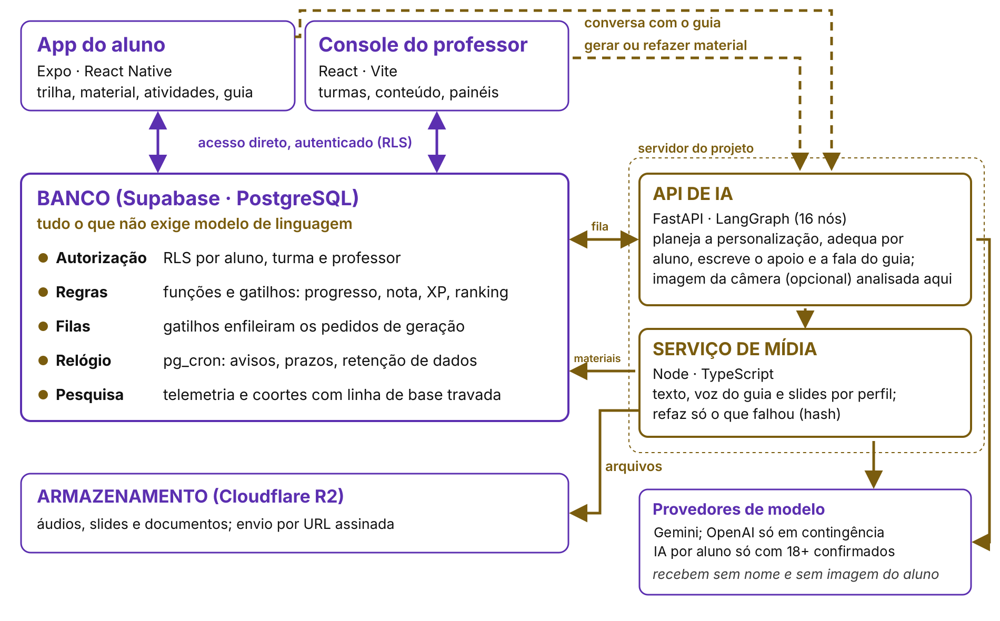
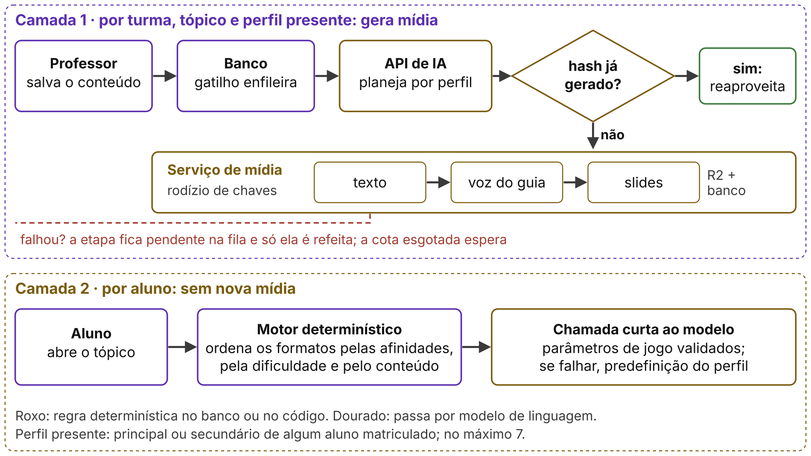
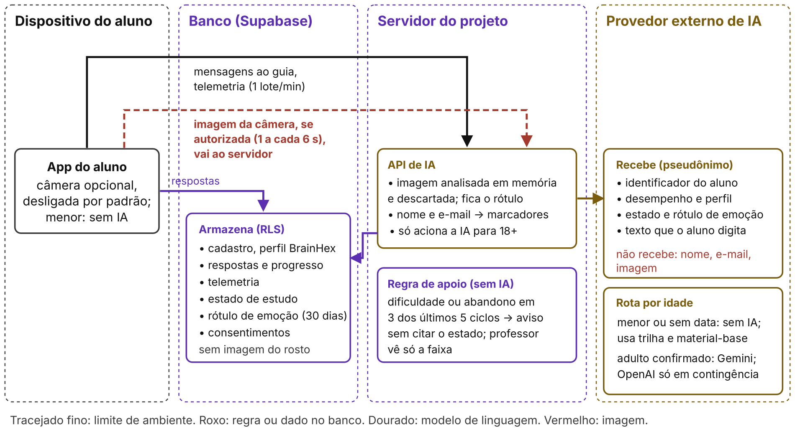

# IA onde importa: princípios arquiteturais para personalização e acolhimento na educação gamificada

**Geisbelly Victoria Feitosa Moraes Domiciano¹, Fábio Castro Araújo²**

- ¹Estudante do Curso de Ciência da Computação, Centro Universitário Luterano de Palmas – CEULP/ULBRA.
- ²Professor/Orientador, Centro Universitário Luterano de Palmas – CEULP/ULBRA.

## Resumo

Acoplar IA generativa, instável e cobrada por uso, a uma plataforma educacional exige decisões sobre custo, falhas e dados de estudantes. Segundo a *Design Science Research*, este trabalho deriva cinco princípios arquiteturais de problemas observados no TrailUp, plataforma gamificada com perfis inspirados no BrainHex, e os avalia analiticamente, por inspeção do código e testes simulados, em seis cenários. As regras seguem sem a IA, e a mídia-base depende dos perfis presentes, não dos alunos, mas o ganho pode sumir em turmas pequenas. A contribuição é mostrar quando subordinar a IA a regras determinísticas delimita custo, falha e exposição de dados.

**Palavras-chave:** Inteligência artificial generativa; arquitetura de software; personalização.

## Introdução

A gamificação (uso de pontos, níveis e rankings fora dos jogos) tem efeitos variáveis sobre a aprendizagem, e o tipo de jogador é uma das explicações (Sailer; Homner, 2020). Personalizar por tipo é a estratégia mais comum (Klock *et al.*, 2020); o BrainHex, com sete arquétipos (Nacke; Bateman; Mandryk, 2014), foi a mais frequente nos estudos educacionais de Oliveira *et al.* (2023), mas as tipologias se sobrepõem, e Kirchner-Krath *et al.* (2024) recomendam tratar as preferências como afinidades contínuas (Lavoué *et al.*, 2019). Personalizar não basta: a motivação depende de competência, autonomia e pertencimento (Ryan; Deci, 2000), favorecido por narrativa e equipe (Sailer *et al.*, 2017). Aqui, acolhimento designa o tom com que a plataforma fala com o aluno, o apoio na dificuldade e regras que não punem o erro; é diretriz de projeto, sem efeito medido. Modelos de linguagem, IA que gera texto a partir de instruções, servem às duas coisas, mas podem enviesar respostas, exigem supervisão humana (Kasneci *et al.*, 2023) e saem caros em grande volume (Chen; Zaharia; Zou, 2023).

Os trabalhos citados tratam do que adaptar; este trata de como organizar a plataforma. O problema investigado é como acoplar serviços de IA não determinísticos (a mesma entrada pode gerar saídas diferentes), cobrados por uso e sujeitos a falha a uma plataforma que precisa manter regras pedagógicas consistentes, proteger dados de estudantes e registrar o que a pesquisa mede. O caso é o TrailUp, plataforma gamificada de estudo para graduandos que gera material por perfil e usa IA no apoio ao aluno. Os objetivos são (i) formular princípios arquiteturais (regras sobre onde fica cada função do sistema) a partir de problemas dele, (ii) mostrar como a plataforma os implementa e (iii) examinar, em cenários, onde valem e onde falham. P1, P3 e P5 aplicam práticas conhecidas: separar o que não depende da IA, não refazer o que já foi feito e registrar o que o sistema faz; a contribuição está em derivá-las do caso, combiná-las com P2 e P4 e delimitar onde valem. A pesquisa segue a *Design Science Research* (DSR), método que constrói e avalia um artefato para resolver um problema prático (Hevner *et al.*, 2004).

## Material e métodos

O trabalho seguiu as atividades de Peffers *et al.* (2007): problema e objetivos (requisitos), projeto e demonstração (o TrailUp), avaliação (cenários) e comunicação. Dos seis requisitos, a literatura motivou dois: personalizar por perfil (R1) e acolher sem expor o aluno (R2). Um levantamento de experiência do usuário de 2025, com 50 estudantes (questionário, observação de aulas, diário de campo), reforçou R1: 34 dos 50 (68%) dizem aprender em ritmo próprio. O instrumento, pesquisa exploratória de mercado para orientar o produto, pedia o nome; convidados por mensagem privada, os participantes souberam do uso no trabalho de conclusão de curso, sem termo de consentimento formal nem comitê de ética. Por isso, o levantamento entra só agregado, como origem de requisito. O desenvolvimento impôs funcionar sem serviços externos (R3), proteger dados, inclusive de menores (Brasil, 2018, art. 14) (R4), operar com planos gratuitos (R5) e registrar o que a pesquisa mede (R6). Cada princípio seguiu a cadeia problema, requisito violado, decisão, generalização e critério conferível em cenário (Tabelas 1 e 2); as decisões nasceram de incidentes, e a generalização veio depois, o que a expõe a viés retrospectivo. O código é público (github.com/Geisbelly/TrailUp), com testes e incidentes registrados.

Seis cenários avaliam custo, continuidade, proteção e limites do P2. Os resultados vêm de análise e testes (como test_base_so_perfis_da_turma e test_roteamento_ia_menores), não da produção. Cada afirmação tem um nível de evidência: implementado, se está no código; testado, se um teste a exercita (provedores simulados, banco local); ou observado, se consta dos registros. O resto é proposta. Sem avaliação independente nem teste de carga.

Os modelos cobram por *tokens*, unidades de texto da entrada e da saída. A projeção usa o Gemini 3.6 Flash (US$ 0,75 e 3,75 por 1M *tokens* de entrada e saída, inclusive de raciocínio; preço que dobra em 2027) e o Gemini 2.5 Flash TTS, que converte texto em fala (US$ 0,50 e 10,00), a preços de 3 e 4/11/2026 e câmbio PTAX de R$ 5,4935. A saída vem do tamanho medido dos arquivos (texto de 29 kB; áudio de 1,5 MB a 128 kbit/s, ≈ 93 s); entrada, raciocínio, *tokens* de áudio e novas tentativas são hipóteses. O esforço veio do histórico de *commits* (registros de alterações), com pausas de até 2 h contadas como trabalho (faixa: 1 h a 4 h). Os assistentes de programação Claude Code e Cursor apoiaram a implementação; o Claude Opus 5.5 (Anthropic), a análise do código, referências, redação e figuras, sob revisão da autora.

## Resultados e discussão

A Tabela 1 resume os cinco princípios, cada um ligado ao requisito de que derivou.

**Tabela 1** — Princípios arquiteturais: problema, decisão, evidência e limite

| Princípio (requisito) | Problema observado | Decisão e implementação | Evidência | Condição ou limite |
|---|---|---|---|---|
| P1 Fronteira (R3) | Queda da API parava o estudo | Regras, filas e agendamentos no banco | Parcial: 44/168 funções sem migração | Exige governança de esquema |
| P2 Duas camadas (R1, R5) | Gerar 7 perfis gastava cota com perfis sem aluno | Base só para perfis presentes; adequação individual sem mídia | Implementado e testado | Menos perfis que alunos; sem partilha entre turmas |
| P3 Não gerar duas vezes (R3, R5) | Falha no áudio refazia tudo (≈30 pipelines/dia); base gerada 5 vezes | Chave de ciclo e hash da fonte; retoma a etapa falha; uma base por vez | Observado; testado (rede simulada, banco local) | Modelo ou prompt novo só invalida se a versão subir |
| P4 Acolher com minimização (R2, R4) | Proposta inicial monitorava o rosto; possíveis menores | Apoio por regra; câmera opcional; marcadores; IA só para maiores | Implementado; marcadores e rota testados (simulação) | Pseudonimização parcial; menores acessam sem IA |
| P5 Pesquisa embutida (R6) | Tempo de tela aberta não mede estudo | Tempo ativo; catálogo de regras com fonte; linha de base das coortes | Implementado; coortes testadas em banco local | Estudo de coortes não conduzido |

<small>Fonte: Elaboração própria (2026).</small>

Na Tabela 1, o P1 aparece na implantação (Figura 1): aplicativo e console acessam direto o banco (Supabase, sobre PostgreSQL), sob controle de acesso por linha (*row-level security*, RLS), que limita cada consulta ao papel e à turma do usuário. Sem a API de IA, serviço do projeto que chama os modelos, seguem funcionando trilha, notas, pontos de experiência (XP), ranking, filas e avisos agendados, que são funções e gatilhos (rotinas que o banco executa quando um dado muda). Dependem dela a geração de material, a conversa com o guia e o texto do apoio; a adequação por aluno cai numa predefinição.

**Figura 1** — Visão de implantação do TrailUp

<small>Fonte: Elaboração própria (2026).</small>

Na Figura 1, as setas roxas são acesso autenticado ao banco, e as tracejadas, pedidos à API; só a API e o serviço de mídia chamam provedores de modelo. O limite do P1 é de governança: regras no banco exigem versionar funções e gatilhos, e em 30/09/2026 44 das 168 funções (26%) não estavam em nenhuma migração, o script versionado que altera o banco.

No P2, a mídia-base (texto, áudio e apresentação do tópico) é gerada por turma, tópico e perfil presente (principal ou secundário de algum aluno matriculado), enquanto a adequação individual só ordena formatos e ajusta parâmetros de jogo, sem nova mídia (Figura 2). O perfil vem de um questionário autoral de 32 itens inspirado no BrainHex, sem equivalência com o original nem validação psicométrica, que gera um vetor de afinidades contínuas (Kirchner-Krath *et al.*, 2024): o perfil principal escolhe a base, e o vetor ordena os formatos. Como os vetores saíam quase planos, o motor passou a pesar só o excesso de cada afinidade sobre a média; o ganho de casar formato e perfil segue como hipótese. No P3, cada material carrega uma chave com o ciclo de geração e o *hash* (identificador calculado que muda quando o conteúdo muda) do conteúdo-fonte; a apresentação confere ainda as versões do *pipeline* (a sequência de etapas de geração) e do design. Uma nova tentativa reaproveita o que tem a mesma chave e refaz só a etapa que falhou, e o banco libera uma base por vez. Como a chave não inclui o modelo nem as instruções (*prompt*), trocá-los não invalida texto e áudio já gerados, salvo se a versão for incrementada à mão: o P3 evita regerar, mas não garante que o material corresponda à configuração atual. Chen, Zaharia e Zou (2023) reduzem o custo por consulta com adaptação de *prompts*, aproximação e cascata de modelos (tentar um modelo barato antes de um caro); P2 e P3 atuam antes, reduzindo o número de gerações. Testes cobrem a retomada (rede simulada) e duas tarefas na mesma base (banco local), não outras concorrências.

**Figura 2** — Personalização em duas camadas

<small>Fonte: Elaboração própria (2026).</small>

Na Figura 2, o losango é o P3, e a camada 2 não gera mídia; a Figura 3 traz o P4.

**Figura 3** — Fluxo de dados por ambiente: o que cada fronteira recebe

<small>Fonte: Elaboração própria (2026), com base no registro de transferências internacionais do repositório.</small>

Na Figura 3, a imagem da câmera, se autorizada, vai ao servidor, é analisada em memória e descartada; o banco guarda só o rótulo, por 30 dias, e o modelo dessa análise não foi validado. O provedor recebe identificador, desempenho, perfil, estado de estudo, rótulo e texto digitado; o rótulo de emoção só ajusta ritmo, tema e oferta de apoio, fora de nota e ranking, e o aluno pode desligá-lo; nome e *e-mail* viram marcadores, o que é pseudonimização, não anonimização: a correspondência ainda reidentifica o aluno. O Gemini é usado no plano gratuito, cujos termos permitem usar os dados para melhorar os serviços, com revisão humana, e restringem o envio de dados pessoais (Google, 2026): uma limitação externa e não resolvida, que a pseudonimização não afasta. O TrailUp destina-se a graduandos adultos: a IA só é acionada com maioridade confirmada pela data de nascimento do cadastro, e quem tem menos de 18 anos ou não a informou usa a plataforma sem IA. Como os termos do Gemini vedam serviços acessados por menores e o cadastro não os impede, resta uma limitação de compatibilidade com o provedor; atender esse público exigiria outra arquitetura. Não se afirma adequação à LGPD.

O P5 prepara a pesquisa sem demonstrar efeitos: fixa uma linha de base para comparar coortes (turmas acompanhadas no tempo), e, por heurística, conta como ativo só o estudo com até 15 s sem toque, o que subestima a leitura: em 21/09/2026, contou cerca de 545 s de 2.000 s com o material aberto; tempo ativo não indica atenção nem aprendizagem (ver Tabela 2).

**Tabela 2** — Cenários de avaliação: condição, critério, resultado e evidência

| Cenário e condição (princípio) | Critério | Resultado | Evidência |
|---|---|---|---|
| Projeção de crescimento: 40 ou 400 alunos, 1 tópico (P2) | Mídia-base por tópico não cresce com os alunos | Até 7 bases; chamadas curtas crescem, sem medição | Testado (perfis presentes); teto calculado |
| Turma pequena, *n* alunos (limite, P2) | Base por perfil gera menos que por aluno | Depende: ganha só se *k* < *n* | Análise do código |
| Mesmo conteúdo em várias turmas (limite, P2) | Base reaproveitada entre turmas | Não: base gerada por turma | Análise do código; partilha é proposta |
| Cota esgotada (P3) | Concluído não é refeito | Sim; o novo espera a cota | Testado; espera observada |
| API indisponível (P1) | Funções sem IA seguem; pedidos não se perdem | Esperado: geração fica pendente | Análise do código; não testado com a API fora |
| Risco ao aluno (P4) | Papel vê só seu escopo; nome e imagem não saem | Parcial: identificador, perfil e texto seguem | RLS implementado; marcadores e rota testados |

<small>Fonte: Elaboração própria (2026).</small>

Na Tabela 2, cada aluno com perfil traz dois perfis distintos (principal e secundário); com *k* perfis distintos e *n* alunos com perfil, 2 ≤ *k* ≤ min(7, 2*n*). Geram-se *k* bases contra *n* versões, e só há ganho se *k* < *n*. Com três alunos, *k* vai de 2 (mesmo par de perfis) a 6 (nenhum repetido): pode ser melhor, igual ou pior que três versões. A vantagem só é garantida a partir de oito alunos. A Tabela 3 separa os custos.

**Tabela 3** — Custos do TrailUp por natureza

| Item | Valor | Natureza | Escopo |
|---|---|---|---|
| IA no desenvolvimento | R$ 314,24 | Pago | OpenAI e Claude, set/2025–nov/2026, só deste projeto |
| Servidor (API e mídia) | R$ 80/mês | Pago | Por outro projeto, partilhado; fora do valor acima |
| Banco, site e notificações | R$ 0 | Plano gratuito | Com limites; planos pagos: US$ 64/mês (projeção) |
| Saída de dados do banco | 6,38 GB (cota 5 GB) | Medido | Painel do Supabase (29/08/2026); motivou o R2 |
| Esforço | ≈ 716 h (613–1.009) | Estimado | Histórico de commits, 137 dias |

<small>Fonte: Elaboração própria (2026).</small>

Na Tabela 3, só a IA do desenvolvimento foi paga; a operação paga foi só projetada (R$/mês, T turmas de 40 alunos): C = 434,92 + 72,30·T por perfil e 434,92 + 163,80·T por aluno, com fixo de planos (US$ 64 = R$ 351,58), servidor (R$ 80) e domínio (R$ 3,33), somados antes do arredondamento. Por material, com 50% para novas tentativas, (38.000 × 0,75 + 31.200 × 3,75 + 350 × 0,50 + 2.336 × 10) × 1,5 / 1.000.000 = US$ 0,254 ≈ R$ 1,39, somando Flash e TTS (25 *tokens* por segundo de áudio). Cada turma soma R$ 52,80 de chamadas curtas (adequação, apoio e análise: 120 mil tokens de entrada e 40 mil de saída por aluno ao mês, a R$ 1,32 arredondado) e a mídia de 2 tópicos ao mês: R$ 19,50 por perfil (14 bases) ou R$ 111 por aluno (80 versões). Uma turma custa R$ 507 por perfil e R$ 599 por aluno; dez, R$ 1.158 e R$ 2.073. A economia do P2 e do P3 é estimada, não medida.

## Conclusão

Os objetivos foram atendidos: os cinco princípios vieram de problemas do TrailUp, estão implementados (o P1 em parte) e foram examinados em cenários. A geração por perfil só reduz bases com menos perfis distintos que alunos (*k* < *n*), e conteúdo repetido em outra turma gera nova base. Restam riscos: o P3 pode servir material de modelo ou prompt anterior, o plano gratuito do Gemini, regras fora do versionamento, texto do aluno nos provedores e gargalos de cota e servidor. Próximos passos: medir *tokens*, avaliar as saídas da IA e partilhar bases entre turmas. Para plataformas educacionais com IA, o caso sugere decidir antes o que fica fora dela, fronteira que torna previsíveis custo, falhas e exposição.

## Referências

BRASIL. Lei nº 13.709, de 14 de agosto de 2018. Lei Geral de Proteção de Dados Pessoais (LGPD). Brasília, DF: Presidência da República, 2018. Disponível em: https://www.planalto.gov.br/ccivil_03/_ato2015-2018/2018/lei/l13709.htm. Acesso em: 3 nov. 2026.

CHEN, Lingjiao; ZAHARIA, Matei; ZOU, James. FrugalGPT: how to use large language models while reducing cost and improving performance. arXiv, 2305.05176, 2023. DOI: https://doi.org/10.48550/arXiv.2305.05176.

GOOGLE. Gemini API Additional Terms of Service. [*S. l.*]: Google, 2026. Disponível em: https://ai.google.dev/gemini-api/terms. Acesso em: 4 nov. 2026.

HEVNER, Alan R. *et al.* Design science in information systems research. MIS Quarterly, v. 28, n. 1, p. 75-105, 2004. DOI: https://doi.org/10.2307/25148625.

KASNECI, Enkelejda *et al.* ChatGPT for good? On opportunities and challenges of large language models for education. Learning and Individual Differences, v. 103, art. 102274, 2023. DOI: https://doi.org/10.1016/j.lindif.2023.102274.

KIRCHNER-KRATH, Jeanine *et al.* Uncovering the theoretical basis of user types: an empirical analysis and critical discussion of user typologies in research on tailored gameful design. International Journal of Human-Computer Studies, v. 190, art. 103314, 2024. DOI: https://doi.org/10.1016/j.ijhcs.2024.103314.

KLOCK, Ana Carolina Tomé *et al.* Tailored gamification: a review of literature. International Journal of Human-Computer Studies, v. 144, art. 102495, 2020. DOI: https://doi.org/10.1016/j.ijhcs.2020.102495.

LAVOUÉ, Élise *et al.* Adaptive gamification for learning environments. IEEE Transactions on Learning Technologies, v. 12, n. 1, p. 16-28, 2019. DOI: https://doi.org/10.1109/TLT.2018.2823710.

NACKE, Lennart E.; BATEMAN, Chris; MANDRYK, Regan L. BrainHex: a neurobiological gamer typology survey. Entertainment Computing, v. 5, n. 1, p. 55-62, 2014. DOI: https://doi.org/10.1016/j.entcom.2013.06.002.

OLIVEIRA, Wilk *et al.* Tailored gamification in education: a literature review and future agenda. Education and Information Technologies, v. 28, n. 1, p. 373-406, 2023. DOI: https://doi.org/10.1007/s10639-022-11122-4.

PEFFERS, Ken *et al.* A design science research methodology for information systems research. Journal of Management Information Systems, v. 24, n. 3, p. 45-77, 2007. DOI: https://doi.org/10.2753/MIS0742-1222240302.

RYAN, Richard M.; DECI, Edward L. Self-determination theory and the facilitation of intrinsic motivation, social development, and well-being. American Psychologist, v. 55, n. 1, p. 68-78, 2000. DOI: https://doi.org/10.1037/0003-066X.55.1.68.

SAILER, Michael *et al.* How gamification motivates: an experimental study of the effects of specific game design elements on psychological need satisfaction. Computers in Human Behavior, v. 69, p. 371-380, 2017. DOI: https://doi.org/10.1016/j.chb.2016.12.033.

SAILER, Michael; HOMNER, Lisa. The gamification of learning: a meta-analysis. Educational Psychology Review, v. 32, n. 1, p. 77-112, 2020. DOI: https://doi.org/10.1007/s10648-019-09498-w.
