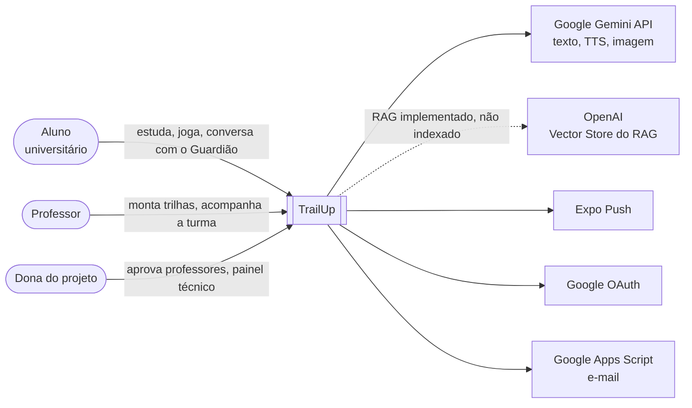
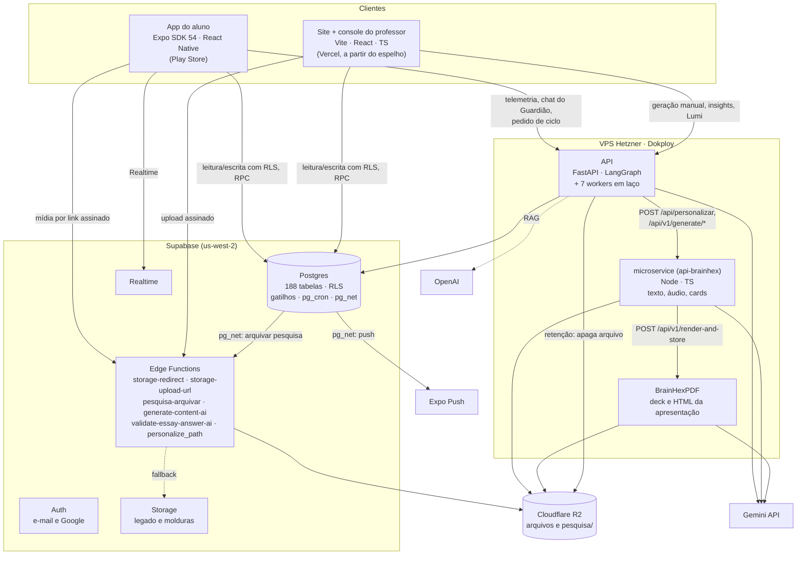
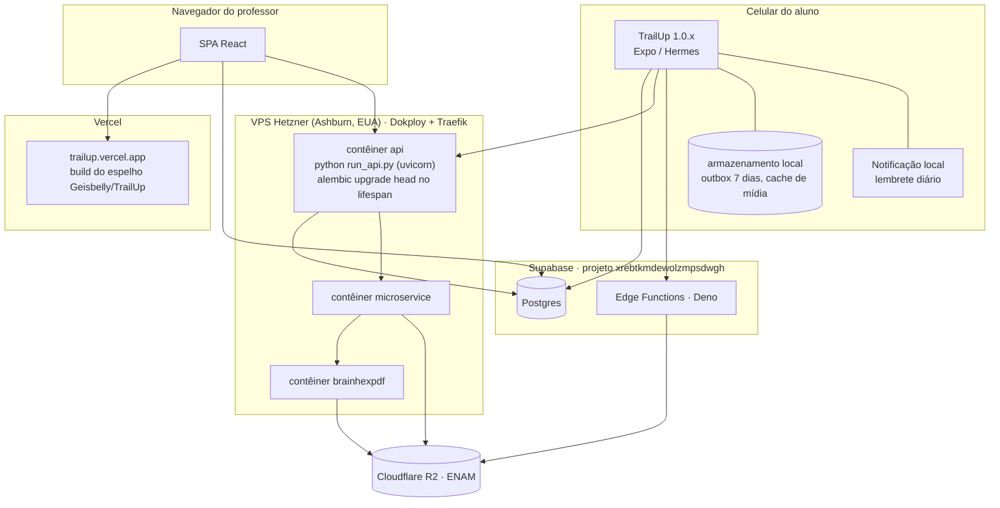
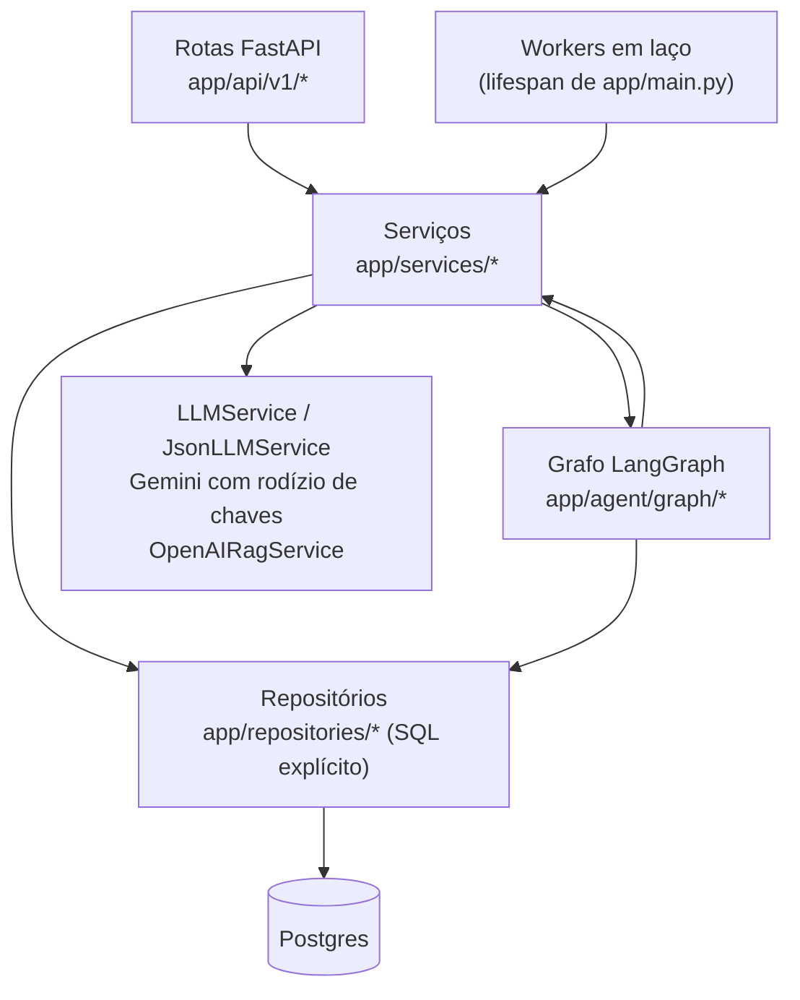

# 1. Arquitetura

Procedência: código da `main` do Lab em `66cf0c33` e banco de produção consultado só para leitura, ambos em 05/11/2026. Os números de tabelas, funções e rotinas estão no [dossiê do sistema](../sistema-para-a-monografia-2026-11-04.md#1-o-sistema-em-números).

## 1.1 Contexto (C4, nível 1)

Quem usa o sistema e com que serviços externos ele conversa.

## 1.2 Contêineres (C4, nível 2)

## 1.3 Regra de fronteira

A API faz só o que envolve modelo de linguagem: LangGraph, RAG, geração e decisão adaptativa. O resto, que o `CLAUDE.md` chama de encanamento, fica no Postgres.

```mermaid
flowchart LR
  subgraph BANCO["Postgres: encanamento"]
    direction TB
    B1[enfileirar jobs<br/>gatilhos]
    B2[progresso e notas<br/>gatilhos]
    B3[notificações e push<br/>gatilhos + pg_cron + pg_net]
    B4[eventos, missão diária,<br/>retenção, auditoria<br/>pg_cron]
    B5[cópia de turma/tópico/atividade<br/>RPC em transação]
    B6[autorização<br/>RLS + helpers SECURITY DEFINER]
  end
  subgraph IA["API: só IA"]
    direction TB
    A1[processar fila de geração]
    A2[analisar telemetria]
    A3[grafo adaptativo]
    A4[chat do Guardião, Lumi, insights]
    A5[classificar alteração do professor]
    A6[texto da missão, falas do boss]
  end
  BANCO -- "fila (tabela)" --> IA
  IA -- "resultado (tabela)" --> BANCO
```

A comunicação entre os dois lados é sempre por **tabela de fila**: o banco grava o pedido e o worker da API reivindica, processa e grava o resultado. Por isso, se a API cair, nada que dependa de relógio para; o pedido só espera na fila.

| Fila (tabela) | Quem enfileira | Worker da API |
|---|---|---|
| `personalizacao_jobs` + `_job_targets` | gatilhos `fn_enqueue_class_delta_job`, `fn_enqueue_student_enrollment_job`, `fn_enqueue_classe_mapa_tema_job`; console (manual) | `personalizacao_jobs_loop` |
| `telemetria_analise_fila` | gatilho `trg_telemetria_lotes_enfileira_analise` | `analise_fila_loop` |
| `alteracao_professor` | gatilho nas tabelas do editor e em `questao_gabarito` | `alteracao_professor_loop` |
| `missoes_ia_pedidos` | `pg_cron` 03:05 (`fn_missao_diaria_enfileirar_texto`) e console (`missao_ia_pedir`) | `missoes_ia_loop` |
| `diagnostico_topico` | app (`diagnostico_pedir`) | `diagnostico_loop` |
| `retencao_fila_externa` | gatilhos de exclusão (fontes, `rag_openai_files`, arquivos) | `retencao_externa_loop` |
| checkpoints do LangGraph | o próprio grafo | `checkpoint_retention_loop` |

## 1.4 Implantação

- **Repositórios:** o código vive em `BitStudioLabs/trail-up`, o canônico. O site no ar, a API e os serviços publicam do espelho `Geisbelly/TrailUp`.
- **Migrations:** a API roda `alembic upgrade head` ao subir. Se o banco estiver à frente do código publicado, a API não sobe.
- **BrainHexPDF:** todo `POST` exige `x-api-secret`, e sem `API_SHARED_SECRET` a produção responde 503. `GET /api/v1/decks` fica sem cabeçalho, porque o app e o console abrem essa URL direto, mas só entrega `conteudo_aluno/brainhex/**/*.html`.
- **Monitoramento:** as sondas saem do Supabase, fora do VPS, a cada minuto, e o aviso sai por e-mail. A meta de disponibilidade vale 24 horas por dia, todos os dias, porque o TrailUp é um app e não tem horário de funcionamento. O app fala direto com o Supabase, então a saúde dele vem do próprio cliente (seção 5.8).
- **Ambiente local:** `npm run docker:up` sobe console `:8080`, API `:8000` e microservice `:3000`.

## 1.5 Camadas da API

- **Repositórios:** usam SQL com `text()` do SQLAlchemy async. Não há ORM de entidades.
- **Grafo LangGraph:** são duas instâncias compiladas.
  - `graph_personalizacao`: checkpoint persistente no Postgres.
  - `graph_ephemeral`: usado pela análise de telemetria.
- **Portão de idade:** fica em `llm.ainvoke_structured`, antes de qualquer chamada a modelo, inclusive a busca do RAG.

## 1.6 Rotinas do banco

São 21 rotinas no `pg_cron`, todas ativas em 05/11/2026. Elas continuam rodando com a API fora do ar, que é o motivo de estarem no banco. Horários em UTC: 03:00 UTC é meia-noite em Brasília.

| Frequência | Rotina | O que faz |
|---|---|---|
| 1 min | `trailup_eventos_classe_varredura` | abre e encerra eventos da turma |
| 1 min | `trailup_monitor_tick` | sonda, aplica estados, abre incidentes e envia alertas |
| 5 min | `trailup_desafio_varredura` | encerra desafios abandonados |
| 5 min | `trailup-notificacoes-varrer` | entrega a fila de notificações |
| 5 min | `trailup-notificacoes-conciliar-push` | confere o recibo do push |
| 10 min | `trailup_notificacoes_rank` | avisa mudança de posição no rank |
| 10 min | `trailup_pesquisa_arquivo` | dispara o arquivo da pesquisa |
| 10 min | `trailup_saude_clientes` | varre a saúde dos clientes |
| 30 min | `trailup_painel_tecnico_avisar_dono` | avisa a dona no sino do console |
| 30 min | `trailup_retencao_avisos` | avisa antes de apagar por inatividade |
| 1 h (:07) | `trailup_notas_com_prazo` | recalcula notas com prazo vencido |
| diária 03:00 | `trailup_missao_diaria` | gera as missões do dia |
| diária 03:05 | `trailup_missao_diaria_texto` | enfileira a reescrita do texto |
| diária 03:17 | `trailup_expurgo_medidas_perfil` | expurga medidas antigas de perfil |
| diária 03:23 | `trailup_retencao` | redige e apaga por política |
| diária 03:41 | `trailup_retencao_ia_decision_logs` | retenção das decisões da IA |
| diária 03:47 | `trailup_ia_uso_llm_retencao` | apaga uso do modelo com mais de 180 dias |
| diária 06:10 | `trailup_notificacoes_intensidade` | recalcula a intensidade de avisos por aluno |
| diária 06:17 | `trailup_monitor_expurgo` | expurga sondas antigas |
| diária 06:30 | `trailup_auditoria_metricas` | roda as 20 invariantes |
| diária 09:00 | `trailup_notificacoes_recalcular_rotinas` | recalcula as rotinas de lembrete |
