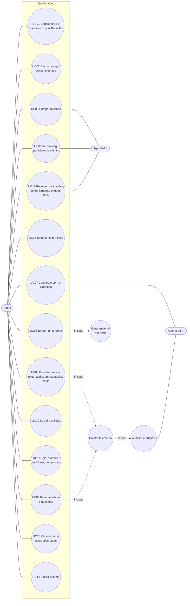
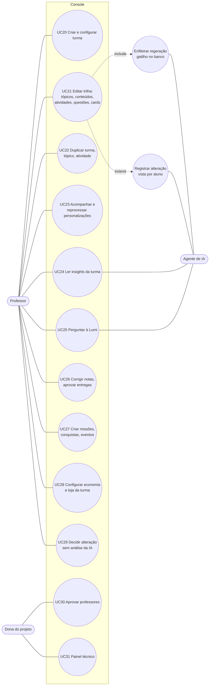

# 2. Casos de uso

## 2.1 Atores

| Ator | Tipo | Onde atua |
|---|---|---|
| Aluno | primário | app (`mobile/`) |
| Professor | primário | console web (`frontend/`) |
| Dona do projeto | primário | abas Aprovações e Painel técnico do console. A proteção é no banco (`app_e_dono()`) |
| Agendador | secundário, sistema | `pg_cron`: 16 rotinas |
| Agente de IA | secundário, sistema | workers e grafo da API |
| Provedor de modelo | secundário, externo | Gemini, e OpenAI no RAG |

## 2.2 Diagrama: aluno

## 2.3 Diagrama: professor e dona

## 2.4 Especificação resumida

| UC | Pré-condição | Fluxo principal | Onde mora a regra |
|---|---|---|---|
| UC01 | — | Cria conta pelo Supabase Auth, responde 32 itens (8 eixos) e grava 7 afinidades em `aluno_perfil` | `frontend/src/features/signup/brainhex.ts`, banco |
| UC02 | conta | Consentimento de telemetria, pesquisa e, para menor, responsável. Revogar para a coleta | `consentimento_*`, RLS |
| UC03 | conta | Entra na turma (`classe_aluno`); o gatilho enfileira `student_enrollment` | `fn_enqueue_student_enrollment_job` |
| UC04 | matrícula | O app lê `conteudo_personalizado` do perfil dominante e baixa a mídia pelo gateway assinado; o progresso por item vai para `personalizacao_item_progresso` | RLS, `storage-redirect`, gatilho de progresso |
| UC05 | matrícula | Tentativa registrada no servidor; nota e status recalculados no banco | `atividade_tentativas`, `trailup_recalcular_*` |
| UC06 | perfil Survivor, Daredevil ou Conqueror | Boss com falas do perfil (`boss_falas`), ou falas fixas na ausência delas | `PERFIS_COM_BATALHA`, app |
| UC07 | maior de 18 confirmado | `POST /personalizar/chat`: Guardião do perfil, sem gabarito, com destinos do app | API; 403 para menor |
| UC08 | matrícula | Missão diária criada às 03:00, texto por IA às 03:05; missões da turma | `pg_cron`, `missoes_ia_loop` |
| UC09 | matrícula | Ranking por view com filtro de saída; eventos abrem e fecham sozinhos | `vw_rank_posicoes_por_classe`, `fn_eventos_classe_varrer` |
| UC12 | conta | Caixa de entrada, push pelo banco, rotina local no aparelho | motor de notificações no banco |
| UC13/14 | conta | Relatório de dados; pedido de exclusão; cópia anônima para pesquisa só com consentimento | `solicitacoes_exclusao`, retenção, `pesquisa-arquivar` |
| UC21 | dono da turma | Salvar já enfileira `class_delta_sync` (com coalescência); se algum aluno já viu, registra alteração | gatilhos do editor |
| UC23 | dono da turma | Lê `personalizacao_jobs` direto; reprocessar e gerar por perfil chamam a API | RLS + `/personalizar/jobs/manual-*` |
| UC24 | dono da turma | `POST /insights/turma/{id}/gerar` (intervalo mínimo de 5 min); listar, aceitar e ignorar direto no banco | API + GRANT por coluna |
| UC25 | professor | `POST /escriba/perguntar`; alunos aparecem como `A1…An` | API |
| UC29 | alteração `pendente_analise` | `alteracao_decidir` | RPC |
