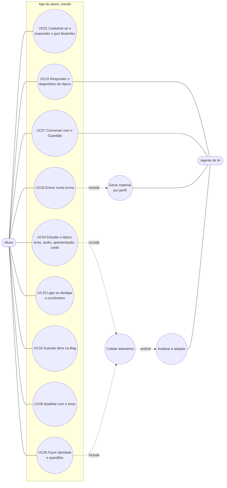
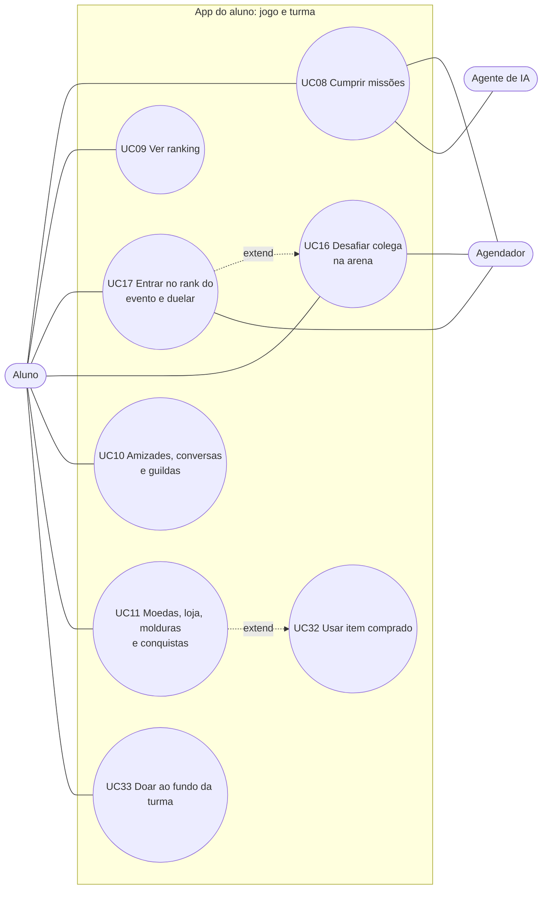
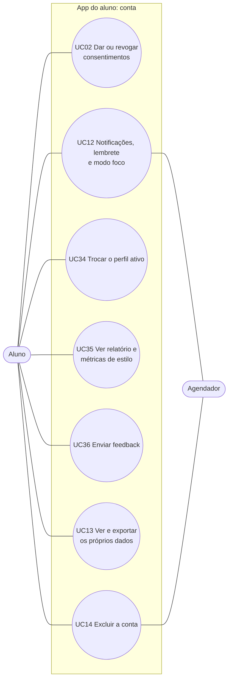
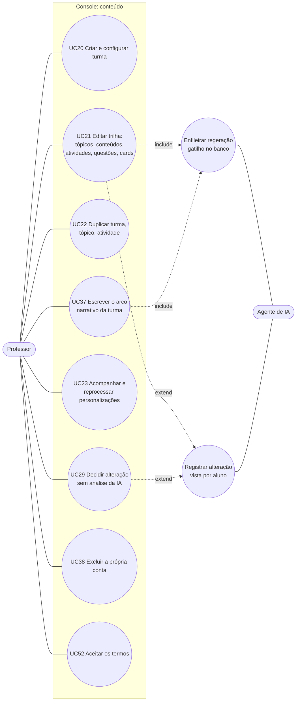
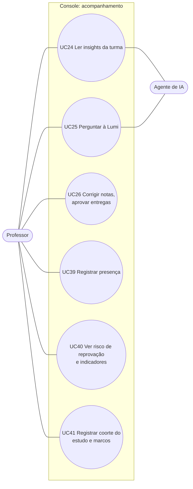
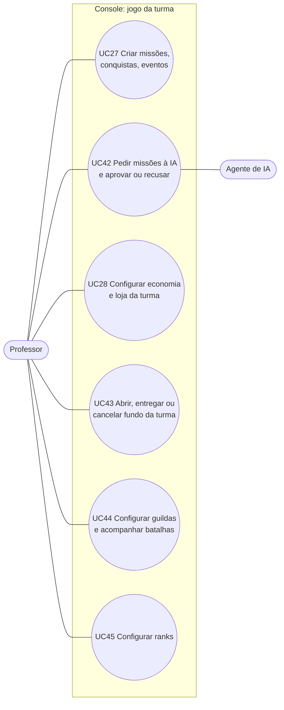
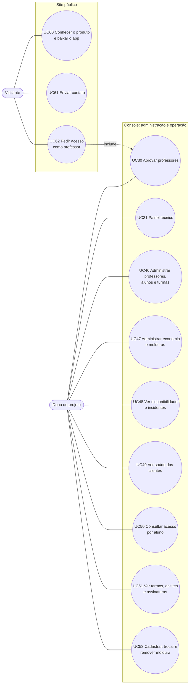
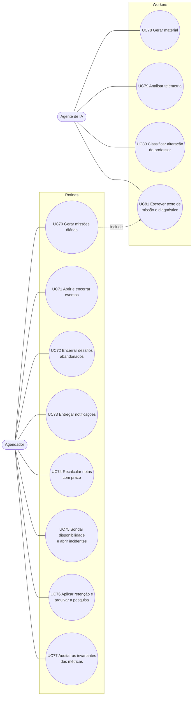

# 2. Casos de uso

Procedência: telas de `mobile/src/app` e do console (`ConsoleShell`), rotas da API, funções do banco e rotinas do `pg_cron` em produção, medidas em 05/11/2026.

Os números dos casos de uso são estáveis: UC01 a UC14 e UC20 a UC31 mantêm o significado da primeira versão, e os novos ocupam UC15 a UC19 e de UC32 em diante. Assim, referências já feitas na monografia continuam válidas.

## 2.1 Atores

| Ator | Tipo | Onde atua |
|---|---|---|
| Visitante | primário, sem sessão | site público (`/`, `/blog`, `/sobre`, `/contato`, `/download`, `/privacidade`, `/termos`) |
| Aluno | primário | app (`mobile/`) |
| Professor | primário | console web (`frontend/`). Só entra depois de aprovado |
| Dona do projeto | primário | abas Administração (que inclui as aprovações e os termos) e Painel técnico do console. A proteção é no banco (`app_e_dono()`) |
| Agendador | secundário, sistema | `pg_cron`: 21 rotinas, listadas em [1.6](./01-arquitetura.md#16-rotinas-do-banco) |
| Agente de IA | secundário, sistema | 7 workers e grafo da API |
| Provedor de modelo | secundário, externo | Gemini, e OpenAI no RAG |

## 2.2 Aluno: estudar

## 2.3 Aluno: jogar com a turma

## 2.4 Aluno: conta, privacidade e avisos

## 2.5 Professor: turma e conteúdo

## 2.6 Professor: acompanhar a turma

## 2.7 Professor: gamificação e economia

## 2.8 Dona do projeto e visitante

## 2.9 Sistema: o que roda sem ninguém pedir

## 2.10 Especificação: aluno

| UC | Pré-condição | Fluxo principal | Onde mora a regra |
|---|---|---|---|
| UC01 | — | Cria conta pelo Supabase Auth, responde 32 itens (8 eixos) e grava 7 afinidades em `aluno_perfil` | `frontend/src/features/signup/brainhex.ts`, banco |
| UC02 | conta | Consentimento de telemetria, pesquisa e, para menor, responsável. Revogar para a coleta | `consentimento_*`, RLS |
| UC03 | conta | Entra na turma (`classe_aluno`); o gatilho enfileira `student_enrollment` | `fn_enqueue_student_enrollment_job` |
| UC04 | matrícula | O app lê `conteudo_personalizado` do perfil dominante e baixa a mídia pelo gateway assinado; o progresso por item vai para `personalizacao_item_progresso` | RLS, `storage-redirect`, gatilho de progresso |
| UC05 | matrícula | Tentativa registrada no servidor; nota e status recalculados no banco | `atividade_tentativas`, `trailup_recalcular_*` |
| UC06 | perfil Survivor, Daredevil ou Conqueror | Boss com falas do perfil (`boss_falas`), ou falas fixas na ausência delas | `PERFIS_COM_BATALHA`, app |
| UC07 | maior de 18 confirmado | `POST /personalizar/chat`: Guardião do perfil, sem gabarito, com destinos do app | API; 403 para menor |
| UC08 | matrícula | Missão diária criada às 03:00, texto por IA às 03:05; missões da turma e de guilda. O progresso é avaliado em gatilho e a recompensa sai uma vez | `pg_cron`, `fn_missao_diaria_gerar`, `missoes_ia_loop` |
| UC09 | matrícula | Ranking por view com filtro de saída: posição, limite visível, o próprio aluno | `vw_rank_posicoes_por_classe` |
| UC10 | matrícula | Convite, aceite, recusa e bloqueio entre colegas; conversa privada e de guilda cifrada em repouso; guilda criada ou integrada dentro da janela da turma; desafio cooperativo de guilda | `social_*`, `guilda_*`, `chat_*` |
| UC11 | matrícula | Saldo = soma do razão `moedas_ledger`. Compra concede a posse pelo preço da turma; molduras e conquistas por critério | `loja_comprar`, `conquistas`, `moldura_aluno` |
| UC12 | conta | Caixa de entrada, push pelo banco, rotina local no aparelho, tipos silenciados, horário de silêncio e modo foco | motor de notificações no banco |
| UC13/14 | conta | Relatório de dados; pedido de exclusão; cópia anônima para pesquisa só com consentimento | `solicitacoes_exclusao`, retenção, `pesquisa-arquivar` |
| UC15 | matrícula, tópico não iniciado | O app pede o diagnóstico, responde quando pronto ou dispensa. O banco corrige e decide o nível | `diagnostico_pedir`, `_responder`, `_dispensar`; worker `diagnostico_loop` |
| UC16 | matrícula, colega da turma | Cria desafio, convida, cada lado responde as questões. Ao encerrar, o placar define vitória, empate ou sem adversário. Só `ranqueada` move o Elo | `arena_desafio_criar`, `arena_convite_responder`, `arena_responder`, `fn_desafio_encerrar` |
| UC17 | evento `aberto` com rank | Inscreve-se ou sai com o evento aberto; o adversário do duelo vem dos inscritos mais próximos; duelo fora do XP e do Elo | `evento_classe_inscrever`, `_sair`, `evento_duelo_criar`, `evento_sugerir_adversarios` |
| UC18 | matrícula | Guarda anotações e cartões pessoais ligados a tópico ou conteúdo; exclusão lógica | `bag_criar`, `_atualizar`, `_listar`, `_excluir` |
| UC19 | conta | Liga ou desliga o cronômetro das atividades. Sem escolha, vale o perfil. O tempo não entra na nota | `aluno_cronometro` |
| UC32 | compra `ativa` | Aplica o item na atividade, no tópico ou na questão, dentro do limite por situação; a chave do cliente torna o pedido repetível | `loja_usar`, `loja_usar_item`, `loja_uso_log` |
| UC33 | fundo aberto na turma | Doa moedas; a doação é atômica, idempotente e não passa da meta. Vê o total e a própria doação | `fundo_turma_contribuir` |
| UC34 | conta | Escolhe entre os perfis representativos (a conta de demonstração, entre os 7) e muda `perfil_ativo`; o progresso é recalculado e a coorte diária do perfil novo é gerada na hora. A missão do dia só segue um perfil representativo | `perfisSelecionaveisDoAluno`, `fn_atualizar_aluno_perfil`, `trg_alunos_missao_diaria_perfil` |
| UC35 | conta | Lê o próprio relatório e as métricas de estilo | telas `perfil/relatorio`, `perfil/metricas-estilo` |
| UC36 | conta | Envia feedback, com teto de envios por aluno | `fn_enviar_contato`, `contato_envios` |

## 2.11 Especificação: professor

| UC | Pré-condição | Fluxo principal | Onde mora a regra |
|---|---|---|---|
| UC20 | professor aprovado | Cria a turma, define matéria e dados básicos e escolhe o tema do mapa. Mudar o tema enfileira `class_theme_sync` | `classe`, `fn_enqueue_classe_mapa_tema_job` |
| UC21 | dono da turma | Salvar já enfileira `class_delta_sync` (com coalescência); se algum aluno já viu, registra alteração | gatilhos do editor |
| UC22 | dono da turma | Copia numa transação só; não copia matrícula, progresso, telemetria nem personalização | `duplicar_classe`, `duplicar_topico`, `duplicar_atividade` |
| UC23 | dono da turma | Lê `personalizacao_jobs` direto; reprocessar e gerar por perfil chamam a API | RLS + `/personalizar/jobs/manual-*` |
| UC24 | dono da turma | `POST /insights/turma/{id}/gerar` (intervalo mínimo de 5 min); listar, aceitar e ignorar direto no banco | API + GRANT por coluna |
| UC25 | professor | `POST /escriba/perguntar`; alunos aparecem como `A1…An` | API |
| UC26 | dono da turma | Lista as entregas, avalia e lança nota; a última avaliação fica em `atividade_aprovacao` | `avaliar_entrega`, `professor_notas_da_turma` |
| UC27 | dono da turma | Cria missão manual, conquista da turma e evento com peças, janela e abertura automática | `missoes`, `conquista_da_turma_salvar`, `evento_classe_abrir` |
| UC28 | dono da turma | Ajusta preços, estoque, dotação, limites de uso, metas e valores de evento, em camadas (atividade, tópico, turma, global). Estorna compra ainda não usada | `economia_salvar_*`, `loja_estornar`, `economia_auditoria` |
| UC29 | alteração `pendente_analise` | `alteracao_decidir` | RPC |
| UC37 | dono da turma | Escreve o arco (até 3000 caracteres). Ele entra na geração; o aluno o vê só dentro do material | `classe_arco_narrativo` |
| UC52 | professor sem prova da versão vigente | Ao abrir o console, aceita os termos uma vez | `professor_registrar_aceite_termos`, `consentimento_professor` |
| UC38 | conta de professor | A conta sai na hora, com as turmas e tudo o que depende delas; o usuário do Auth vai para a fila externa e fica só o registro do pedido. A dona não pode usar este caminho | `fn_excluir_minha_conta_professor`, `trg_professor_removido_apaga_turmas` |
| UC39 | dono da turma | Marca presença ou participação, de alunos escolhidos ou da turma inteira. Vira `presenca_aula` ou `participacao_aula` em `eventos_aluno`, com a data na referência, o que impede repetir no mesmo dia | `registrar_presenca_da_turma` |
| UC40 | dono da turma | Vê quem está sinalizado e quais fatores dispararam (atividade, acertos, faltas, prazos, estado negativo recorrente), além dos indicadores da turma | `professor_risco_reprovacao_turma`, `vw_metricas_*` |
| UC41 | dono da turma, baseline futuro | Registra a coorte com braço, baseline, corte e fim. Depois que a data passa, o gatilho trava os campos | `estudo_coorte_registrar`, `fn_estudo_coorte_trava`, `marco_produto` |
| UC42 | dono da turma | Pede de 1 a 5 sugestões (padrão 3); o worker gera; nada chega ao aluno sem aprovação; cada decisão vai para o log | `missao_ia_pedir`, `fn_missao_ia_registrar`, `missoes_ia_log` |
| UC43 | dono da turma, sem fundo ativo | Abre um fundo com meta; entrega só com meta atingida; cancelar estorna todas as doações | `fundo_turma_criar`, `fundo_turma_encerrar` |
| UC44 | dono da turma | Define o tamanho máximo e a janela de formação das guildas; acompanha batalhas e desafios da turma | `guilda_configurar_turma`, `arena_professor_resumo` |
| UC45 | dono da turma | Escolhe e organiza os ranks da turma | `ranks`, `rank_tipo` |

## 2.12 Especificação: dona, visitante e sistema

| UC | Pré-condição | Fluxo principal | Onde mora a regra |
|---|---|---|---|
| UC30 | `app_e_dono()` | Aprova ou recusa o pedido de acesso do professor | `ProfessorApprovalSection`, RPC |
| UC31 | `app_e_dono()` | Vê a última atividade de cada worker, filas e avisos | `PainelTecnico` |
| UC46 | `app_e_dono()` | Lista e ajusta professores, alunos e turmas pela aba Administração | RPCs `admin_*`, `admin_turma_matricular` |
| UC47 | `app_e_dono()` | Ajusta catálogo global, preço e chave das molduras e ações de moldura; lê a auditoria e a consistência da economia | `admin_economia`, `molduras_acoes`, `economia_consistencia` |
| UC48 | `app_e_dono()` | Vê alvos, disponibilidade, incidentes e marcas de deploy | `painel_disponibilidade` |
| UC49 | `app_e_dono()` | Vê erros, Web Vitals e versões por superfície, sem stack, URL completa nem texto digitado | `cliente_erro`, `cliente_sessao`, `fn_cliente_saude_varrer` |
| UC50 | `app_e_dono()` | A lista abre com código curto; mostrar nomes fica registrado | `monitor_consulta` |
| UC51 | `app_e_dono()` | Lê situação e histórico, registra termo em papel, revoga com motivo e corrige a data de nascimento. Nada apaga prova: toda ação é uma linha nova | `admin_termos`, `admin_termo_revogar`, `professor_registrar_termo_papel` |
| UC53 | `app_e_dono()` | Cadastra moldura com imagem, nome, origem, preço ou conquista e a abertura onde a foto entra; edita, troca a imagem e remove a que não tem dono. `codigo` não muda depois de criado | `admin_moldura_gravar`, `admin_moldura_remover`, bucket `molduras` |
| UC60 | — | Navega no site e segue para a loja de aplicativos | `frontend/` |
| UC61 | — | Envia a mensagem pelo formulário; o banco aplica o teto de envios | `fn_enviar_contato_publico`, `contato_publico_envios` |
| UC62 | — | Cadastra-se em `/cadastro-professor` e aguarda UC30 | rota pública + RPC |
| UC70 | turma com alunos | 03:00 gera a coorte `turma × perfil`; 03:05 enfileira o texto | `fn_missao_diaria_gerar`, `fn_missao_diaria_enfileirar_texto` |
| UC71 | evento marcado | A cada minuto abre o `rascunho` marcado para abrir no início e encerra e apura o `aberto` vencido; clique e rotina ao mesmo tempo não creditam duas vezes | `fn_eventos_classe_varrer` |
| UC72 | desafio aberto há mais de 30 min | A cada 5 min chama o encerramento, até 200 por passada | `fn_desafio_varrer_abandonados` |
| UC73 | item na fila | A cada 5 min entrega e concilia push; a cada 10 min varre mudança de rank | `notificacoes_varrer`, `notificacoes_conciliar_push`, `notificacoes_rank_varrer` |
| UC74 | atividade com prazo | A cada hora recalcula a nota das atividades de prazo vencido | `trailup_recalcular_notas_com_prazo` |
| UC75 | alvo ativo | A cada minuto colhe, aplica a máquina de estados, varre sinais, sonda e envia alertas | `fn_monitor_tick` |
| UC76 | política em `retencao_politica` | Redige e apaga por prazo; avisa antes; arquiva `pesquisa/` no R2 | `trailup_retencao`, `pesquisa_arquivo_disparar` |
| UC77 | — | Às 06:30 roda as 20 invariantes e guarda resultado e amostra | `fn_auditoria_metricas_rodar` |
| UC78–81 | item na fila | O worker reivindica, chama o modelo e devolve ao banco. Sem modelo, nada é inventado | `personalizacao_jobs_loop`, `analise_fila_loop`, `alteracao_professor_loop`, `missoes_ia_loop`, `diagnostico_loop` |

## 2.13 Fluxos alternativos e exceções

| UC | Situação | O que acontece |
|---|---|---|
| UC03 | matrícula repetida com job em aberto | não duplica: o gatilho reaproveita `pending` ou `processing`. Falha ao enfileirar não desfaz a matrícula |
| UC04 | material por gerar | o app mostra o conteúdo do professor, que volta a ser o percurso até o material existir |
| UC04 | API fora do ar | a leitura continua, porque é Supabase direto e gateway; só a geração espera |
| UC05 | prazo vencido | nota ajustada pelo prazo; `prazo_extra` estende por aluno |
| UC07 | menor de 18 ou sem data confirmada | 403 antes de chamar modelo. Cadastro não é barrado |
| UC15 | tópico já iniciado | recusa `ja_iniciado`: o diagnóstico é só antes de começar |
| UC15 | modelo falhou | nova tentativa com espera de 2^n minutos, até 120; na terceira falha, `sem_ia` |
| UC15 | turma retida pelo estudo | devolve `retido`: a turma não recebe o recurso |
| UC16 | adversário não aceitou nem jogou | resultado `sem_adversario`, sem Elo |
| UC17 | evento encerrado ou sem peça `arena` | recusa; encerrado, o rank é o resultado e ninguém entra nem sai |
| UC32 | pedido repetido por queda da rede | devolve o mesmo resultado pela chave do cliente |
| UC32 | acima do limite da situação | recusa; o corte fica em `loja_uso_log` |
| UC33 | doação passaria da meta | cobra só o que falta |
| UC42 | sem modelo | o pedido falha, as tentativas são espaçadas e param. Nada é inventado |
| UC42 | sugestão repete título, traz link ou métrica fora do catálogo | `fn_missao_ia_registrar` descarta |
| UC43 | entregar antes da meta | recusa `meta_nao_atingida` |
| UC29 | modelo indisponível | a alteração fica `pendente_analise`, o aluno não vê selo e o professor decide |
| UC53 | moldura com dono | recusa `23503`: a moldura não sai, e o caminho é desligar a chave, o que a tira da loja e das recompensas sem tirar de quem já tem |
| UC53 | gravação falha depois do envio | o console apaga o arquivo que acabou de subir; o antigo só sai depois de o banco confirmar a troca |
| UC53 | app em build antigo | continua com o desenho do pacote nas molduras que já existem e descarta o código que não conhece |
| UC75 | sonda sem resposta | `ok` nulo: conta como `sem_dado`, não como falha |
| UC75 | Supabase fora | nada roda; cobre só a batida externa, quando configurada |

## 2.14 Rastreabilidade

Do caso de uso ao fluxo (capítulo 3), ao dado (capítulo 5) e ao estado (capítulo 6).

| UC | Fluxo | Dados | Estado |
|---|---|---|---|
| UC01, UC02, UC03 | P1 + P2 | 5.1, 5.3.1, 5.7 | 6.13 |
| UC04, UC05 | P4, P5 + P6, P9 | 5.2, 5.3.1, 5.4 | 6.3, 6.4 |
| UC07 | P10 | 5.4 | — |
| UC08, UC70 | P14 | 5.5.1 | 6.8 |
| UC09, UC17, UC71 | P15, P16 | 5.5.1, 5.5.3 | 6.5 |
| UC10, UC16, UC72 | P15 | 5.5.3, 5.5.4 | 6.8, 6.12 |
| UC11, UC28, UC32, UC33, UC43 | P17 | 5.5.2 | 6.11 |
| UC12, UC73 | P12 | 5.6 | 6.6 |
| UC13, UC14, UC76 | P13 | 5.7 | 6.13 |
| UC15 | P18 | 5.3.3 | 6.10 |
| UC20, UC21, UC22, UC23, UC37, UC78 | P0 + P3 | 5.1, 5.3 | 6.1, 6.2, 6.3 |
| UC24, UC25, UC79 | P5 + P6, P8 | 5.4 | 6.7 |
| UC29, UC80 | P11 | 5.2 | 6.7 |
| UC40, UC41, UC77 | P19 | 5.9 | — |
| UC42, UC81 | P14 | 5.5.1 | 6.8 |
| UC51, UC52 | P13 | 5.7 | 6.13 |
| UC06 | P0 + P3 | 5.3.1 | — |
| UC18, UC19 | — (só banco) | 5.2 | — |
| UC26, UC74 | P9 | 5.2 | 6.4 |
| UC27 | P14, P16 | 5.5.1, 5.5.3 | 6.5, 6.8 |
| UC30, UC62 | — (só banco) | 5.1 | — |
| UC34 | — (só banco) | 5.3.1 | — |
| UC35 | — (leitura) | 5.4 | — |
| UC36, UC61 | — (só banco) | 5.7 | — |
| UC38 | — (só banco) | 5.7 | — |
| UC39, UC45 | P9 | 5.5.1 | — |
| UC44 | P15 | 5.5.3 | 6.8 |
| UC46 | — (só banco) | 5.1 | — |
| UC47, UC53 | P17 | 5.5.1, 5.5.2 | 6.11 |
| UC60 | — (site público) | — | — |
| UC31, UC48, UC49, UC50, UC75 | P20 | 5.8 | 6.14 |
