# 3. Pipeline de ponta a ponta

O ciclo inteiro, do cadastro ao material adaptado e de volta à análise:

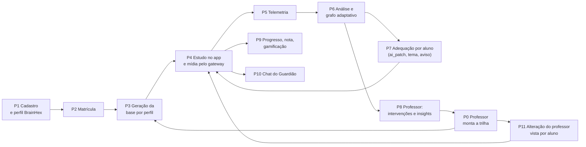

Cada etapa abaixo traz o diagrama de sequência e onde está no código.

---

## P0 + P3 — O professor salva a trilha e a base por perfil é gerada

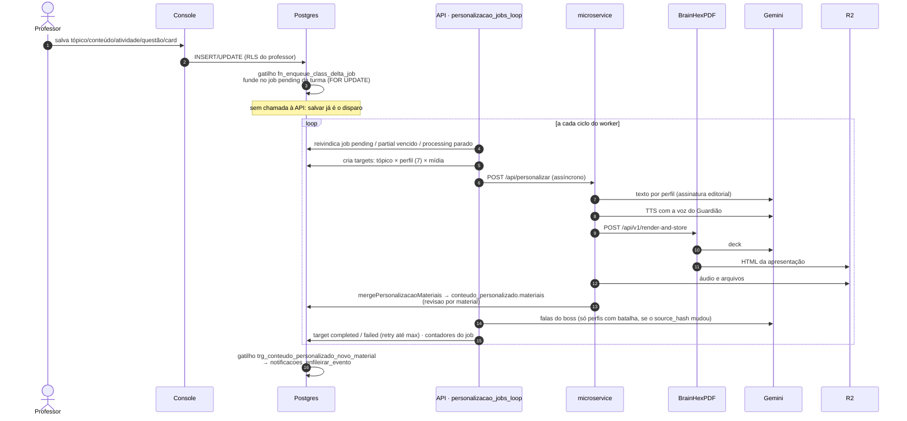

- **Deduplicação:** `source_hash` inclui `_PERSONALIZACAO_PIPELINE_VERSION`. Hash igual não gera de novo.
- **Kinds de job:** `class_delta_sync`, `student_enrollment`, `class_theme_sync`, `full_class_sync`, `student_cleanup`, `manual_retry`, `manual_profile_generate`, `manual_profile_generate_all`. Os manuais furam o circuit breaker.
- **Sem cota de TTS:** o alvo vai direto para `failed`. Reprocessar retoma só as partes de áudio que faltam.
- **Fallback:** se o microservice não responder, o `MultiOutputPipeline` em Python gera o material.
- **Código:**
  - `api/app/services/personalizacao_jobs.py`
  - `api/app/services/media_agents.py`
  - `microservice/server.ts`
  - `api/alembic/versions/20260827_03*`

## P1 + P2 — Cadastro, perfil e matrícula

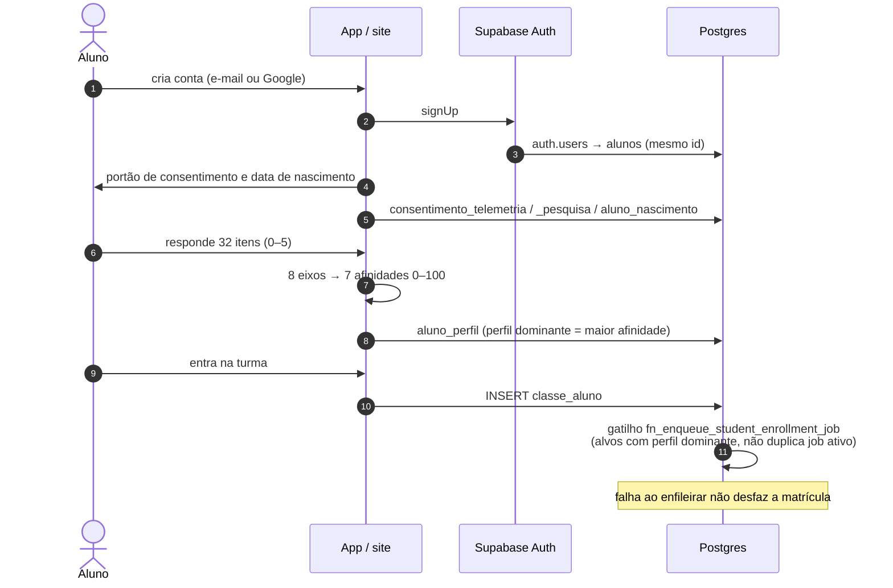

**Regra de idade:** sem data de nascimento, ou com menos de 18 anos, o aluno usa o material-base, que é gerado sem dado dele, mas não tem chat, ciclo adaptativo, TTS nem imagem por IA.

## P4 — Estudo no app e mídia pelo gateway

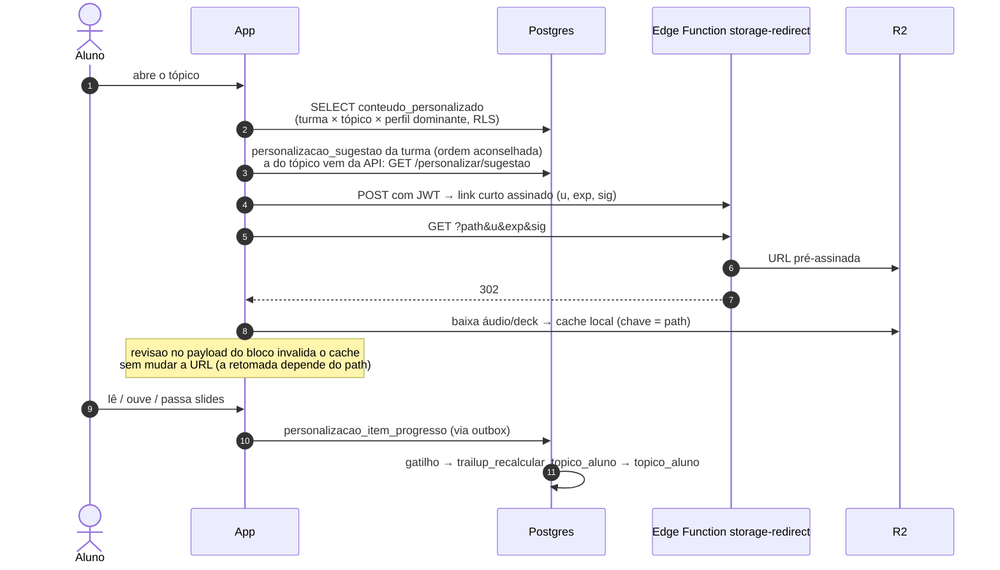

- **Exigência do link assinado:** `GATEWAY_EXIGE_LINK_ASSINADO=true` desde 04/11. Link sem assinatura recebe 401.
- **Código:**
  - `mobile/src/context/TrilhaContext.tsx`
  - `mobile/src/utils/linkDoGateway.ts`
  - `frontend/supabase/functions/storage-redirect`

## P5 + P6 — Telemetria, análise e grafo adaptativo

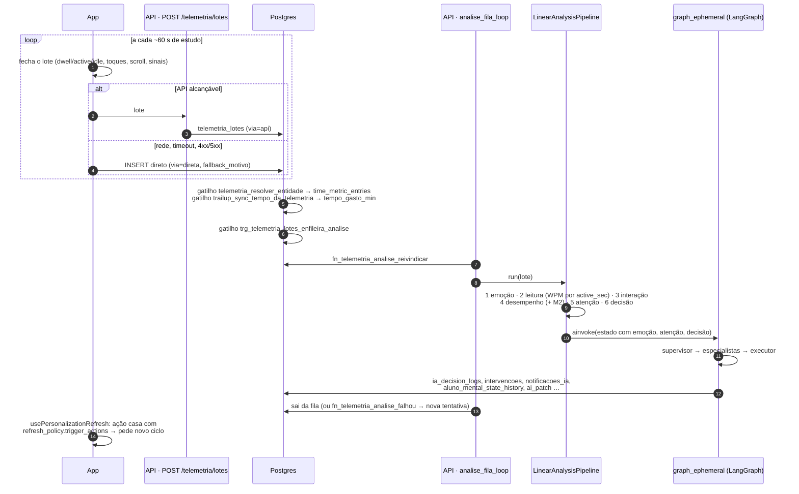

- **Fechamento da sessão:** é local e imediato (`cicloSessao.ts`). Só o envio do último lote espera a fila.
- **Lote no worker:** chega sem o frame da câmera, porque o lote gravado não guarda rosto. A emoção por imagem (YuNet + FER+) só roda no envio direto pela API.
- **Turma retida pelo estudo:** o grafo roda só emoção, perfil e intervenção.

## P7 — Ciclo de personalização por aluno

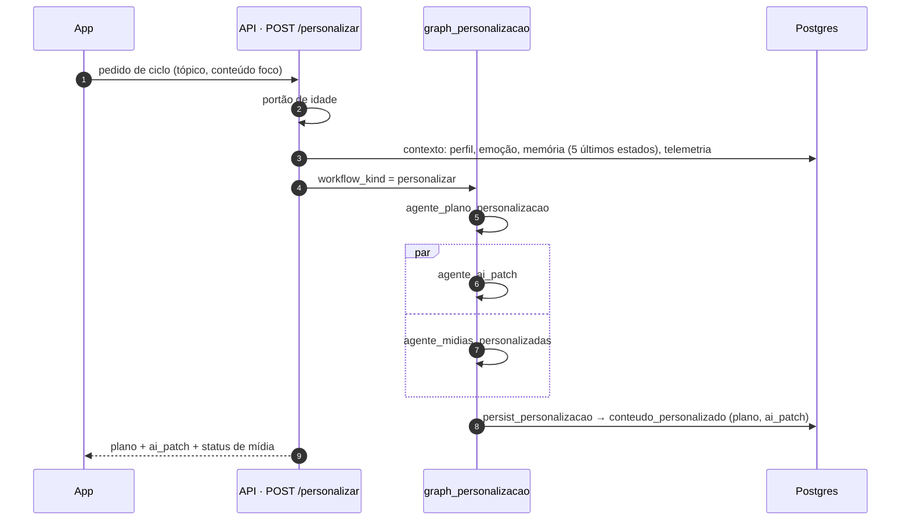

Nesse fluxo o supervisor é **determinístico**: `compute_personalizacao_next` não consulta modelo.

## P8 — Professor: intervenções e insights

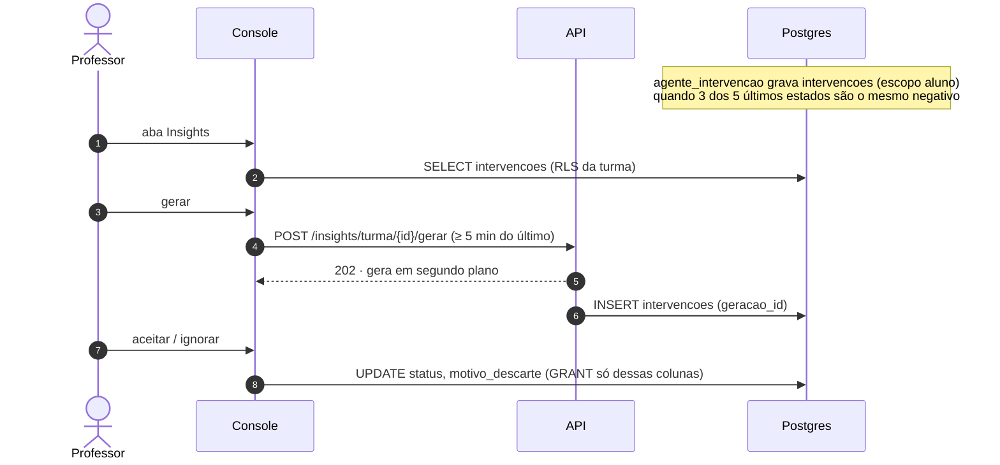

Sem modelo disponível, nada é gravado. Não existe insight "de reserva".

## P9 — Progresso, nota e gamificação (só banco)

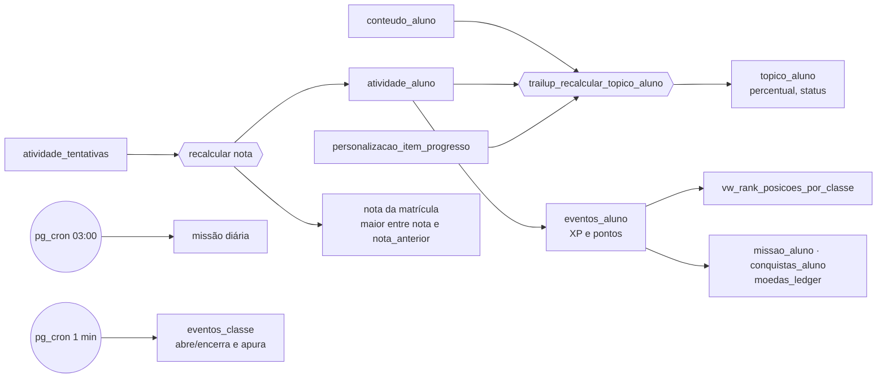

- **Quem grava o progresso:** nenhum cliente escreve `percentual_concluido` nem `status` em `topico_aluno`.
- **Denominador:** é o material personalizado. Enquanto ele não existir, vale o material do professor.

## P10 — Chat do Guardião

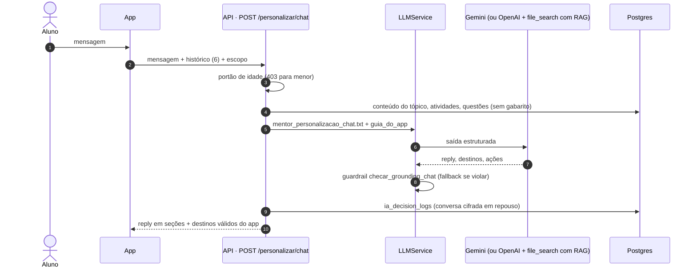

## P11 — O professor muda algo que um aluno já viu

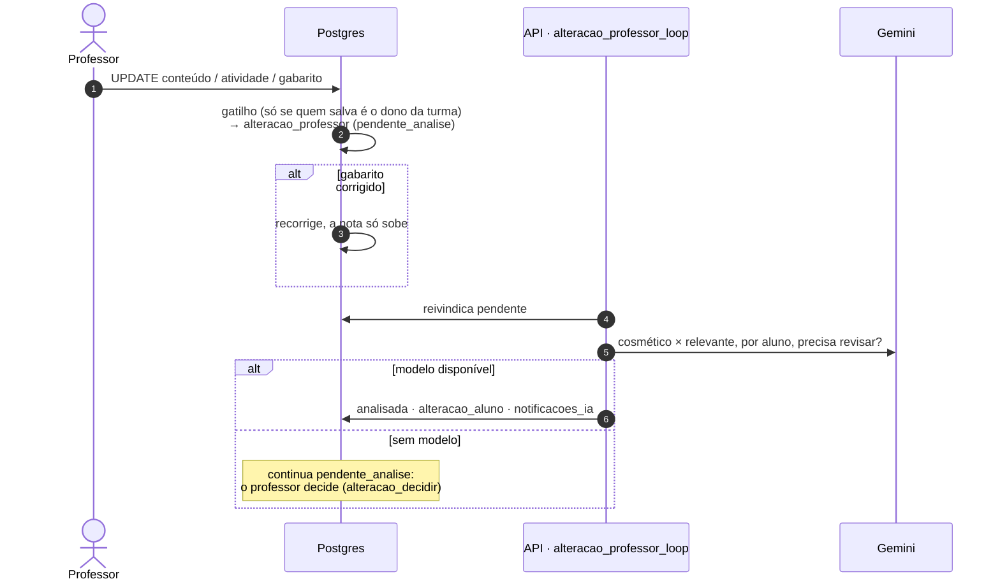

## P12 — Notificações (motor no banco)

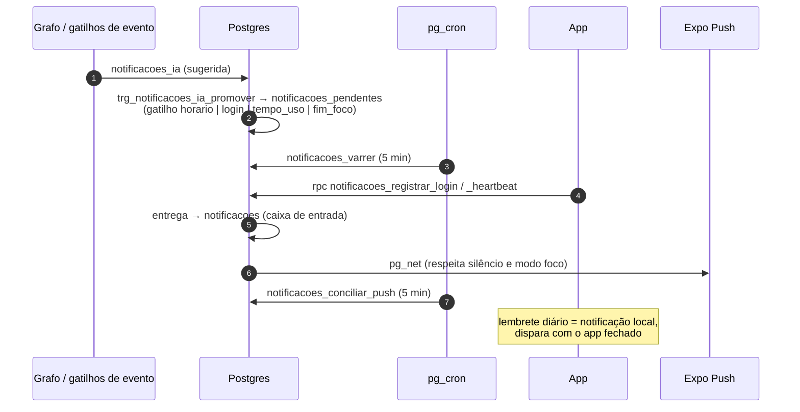

## P13 — Privacidade: retenção, exclusão e arquivo da pesquisa

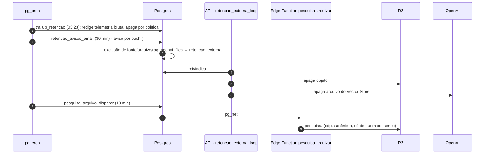
