# 3. Pipeline de ponta a ponta

O ciclo inteiro, do cadastro ao material adaptado e de volta à análise:

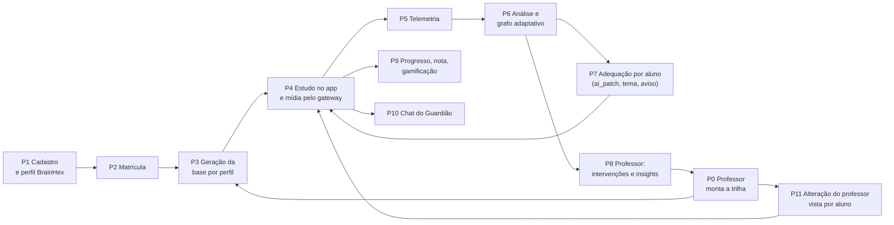

Em volta desse ciclo correm os fluxos que não dependem dele:

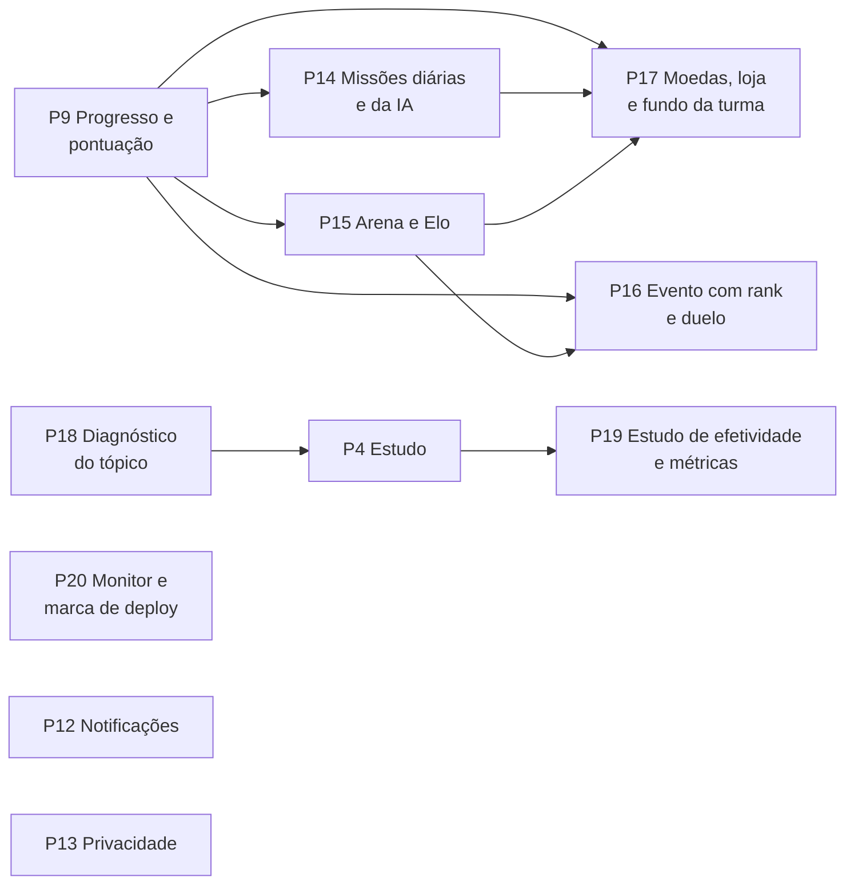

Cada etapa abaixo traz o diagrama de sequência e onde está no código.

---

## P0 + P3 — O professor salva a trilha e a base por perfil é gerada

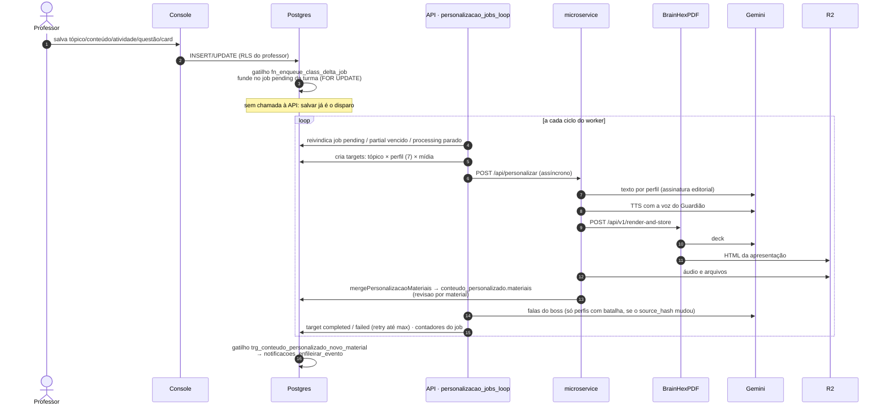

- **Deduplicação:** `source_hash` inclui `_PERSONALIZACAO_PIPELINE_VERSION`. Hash igual não gera de novo.
- **Kinds de job:** `class_delta_sync`, `student_enrollment`, `class_theme_sync`, `full_class_sync`, `student_cleanup`, `manual_retry`, `manual_profile_generate`, `manual_profile_generate_all`. Os manuais furam o circuit breaker.
- **Sem cota de TTS:** o alvo vai direto para `failed`. Reprocessar retoma só as partes de áudio que faltam.
- **Fallback:** se o microservice não responder, o `MultiOutputPipeline` em Python gera o material.
- **Quais perfis (11/11, `20261111_01`, #1107):** a base é gerada para os perfis que algum aluno da turma tem como representativo, pela regra única do vetor (`app_perfis_representativos`). Antes, era o 1º e o 2º de cada aluno, inclusive o 2º com afinidade 0, e nunca o 3º representativo.
- **Antes de chegar ao aluno (10 e 11/11):** o material gerado nasce `pendente` e só aparece ao aluno depois que o professor aprova no console (`personalizacao_decidir`, #1100). Tópico novo nasce em rascunho e só é visto quando o professor publica (#1102). O aviso de material novo sai na aprovação, não no fim da geração.
- **Código:**
  - `api/app/services/personalizacao_jobs.py`
  - `api/app/services/media_agents.py`
  - `microservice/server.ts`
  - `api/alembic/versions/20260827_03*`

## P1 + P2 — Cadastro, perfil e matrícula

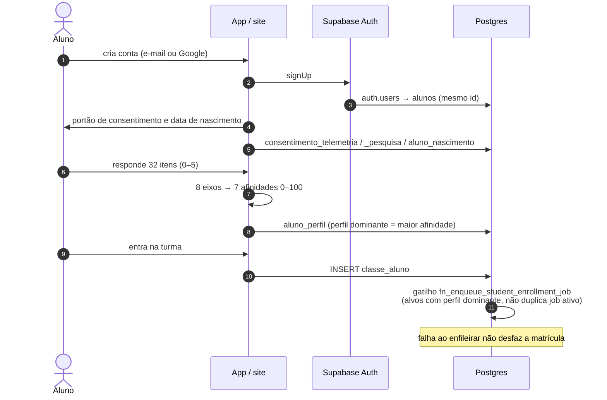

**Regra de idade:** sem data de nascimento, ou com menos de 18 anos, o aluno usa o material-base, que é gerado sem dado dele, mas não tem chat, ciclo adaptativo, TTS nem imagem por IA.

## P4 — Estudo no app e mídia pelo gateway

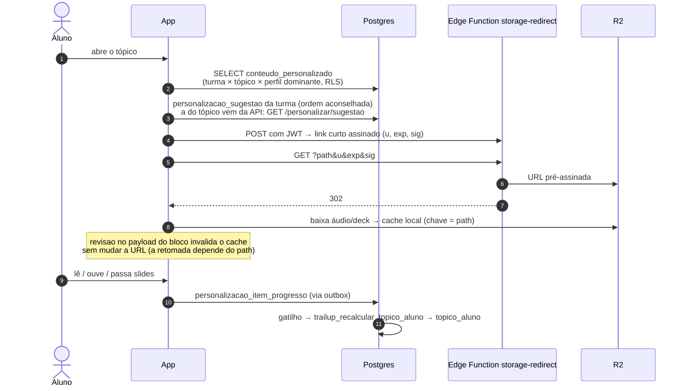

- **Exigência do link assinado:** `GATEWAY_EXIGE_LINK_ASSINADO=true` desde 04/11. Link sem assinatura recebe 401.
- **Leitura de servidor:** API e microservice não têm sessão de usuário, então pedem o link no mesmo `POST` com a chave de serviço (#974). O `GET` segue sem cabeçalho, e a chave não acompanha o redirecionamento até o R2.
- **Limite atual:** o app 1.0.6, que está na Play Store, não pede link e fica sem a mídia do gateway até a 1.0.7 ser publicada.
- **Código:**
  - `mobile/src/context/TrilhaContext.tsx`
  - `mobile/src/utils/linkDoGateway.ts`
  - `frontend/supabase/functions/storage-redirect`

## P5 + P6 — Telemetria, análise e grafo adaptativo

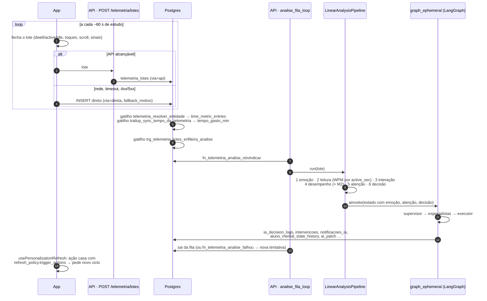

- **Fechamento da sessão:** é local e imediato (`cicloSessao.ts`). Só o envio do último lote espera a fila.
- **Lote no worker:** chega sem o frame da câmera, porque o lote gravado não guarda rosto. A emoção por imagem (YuNet + FER+) só roda no envio direto pela API.
- **Turma retida pelo estudo:** o grafo roda só emoção, perfil e intervenção.

## P7 — Ciclo de personalização por aluno

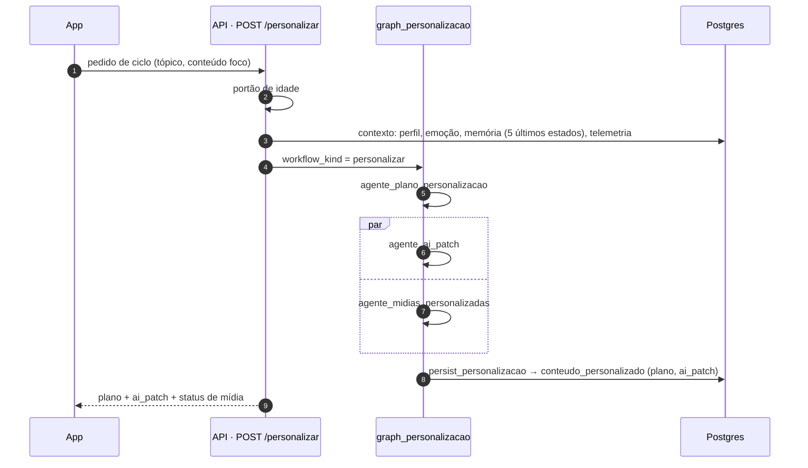

Nesse fluxo o supervisor é **determinístico**: `compute_personalizacao_next` não consulta modelo.

## P8 — Professor: intervenções e insights

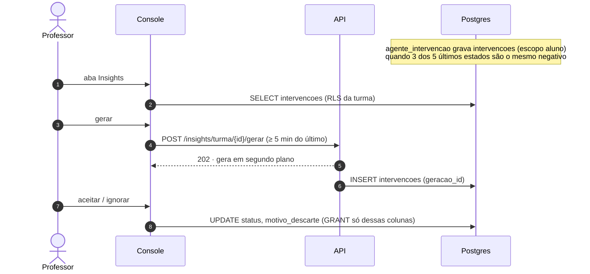

Sem modelo disponível, nada é gravado. Não existe insight "de reserva".

## P9 — Progresso, nota e gamificação (só banco)

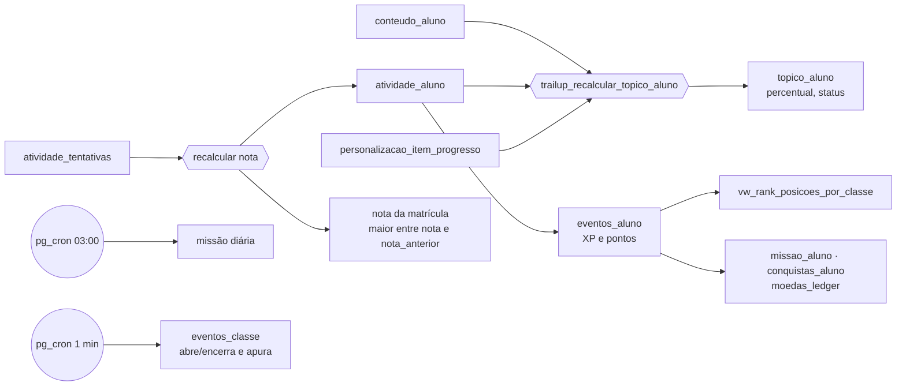

- **Quem grava o progresso:** nenhum cliente escreve `percentual_concluido` nem `status` em `topico_aluno`.
- **Denominador:** é o material personalizado. Enquanto ele não existir, vale o material do professor.

## P10 — Chat do Guardião

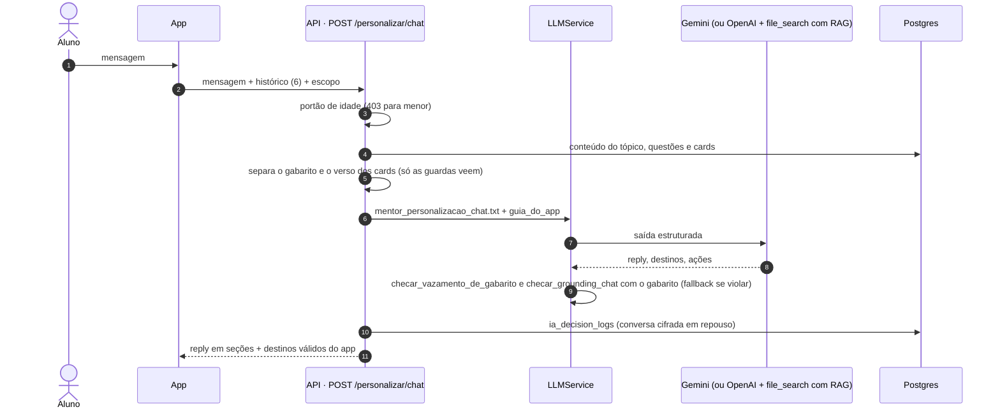

## P11 — O professor muda algo que um aluno já viu

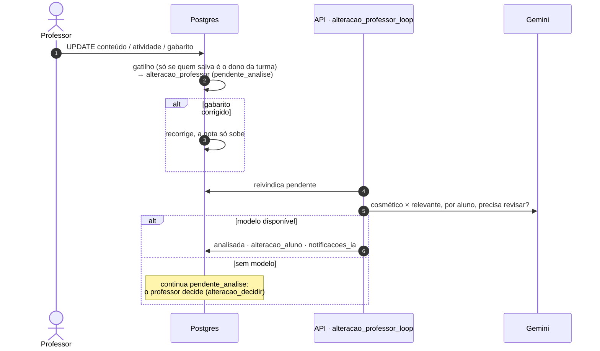

## P12 — Notificações (motor no banco)

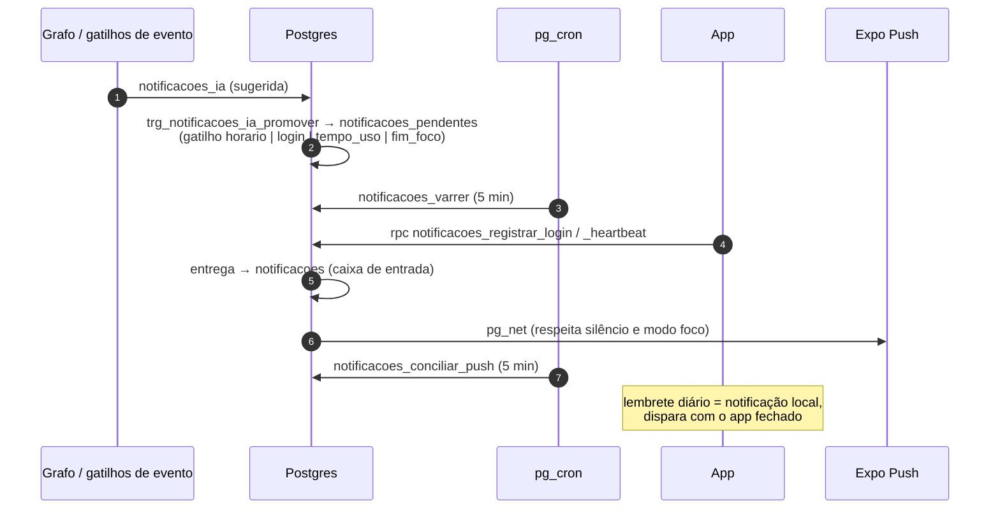

## P13 — Privacidade: retenção, exclusão e arquivo da pesquisa

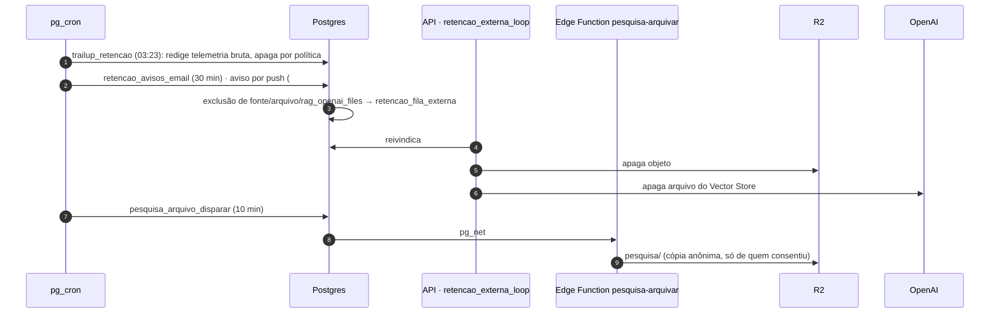

## P14 — Missões: a diária do banco e a sugestão da IA

A missão diária e a sugerida pela IA usam a mesma entidade (`missoes`) e o mesmo avaliador. O critério reaproveita as métricas das conquistas, e a recompensa é uma chave de `eventos_pontuacao`, nunca um número solto.

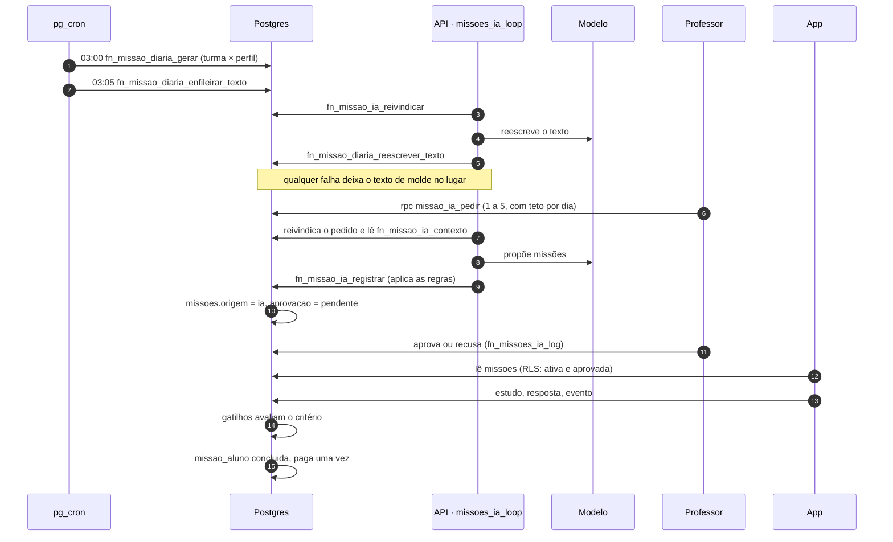

- Trocar o perfil ativo gera na hora a coorte do perfil novo (`trg_alunos_missao_diaria_perfil`). Sem isso, o aluno ficaria sem diária até a madrugada seguinte.
- A missão de guilda soma os membros (`fn_missao_guilda_progresso`): é o único caminho que grava `pendente` e `em_andamento`.

## P15 — Arena: desafio com adversário e Elo

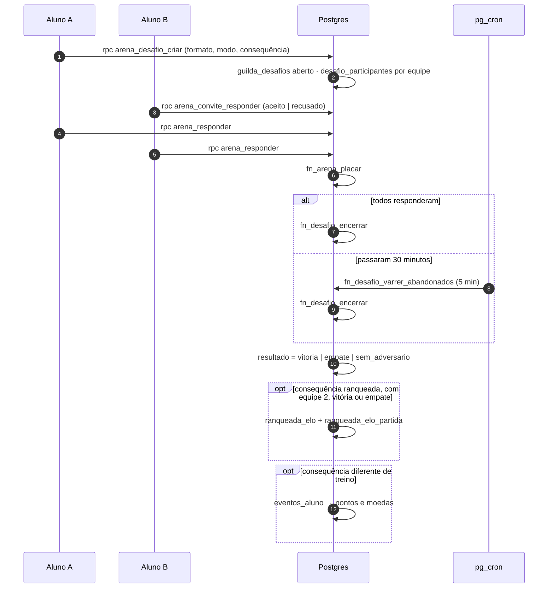

- `fn_desafio_encerrar` é o fechamento compartilhado: atende arena, desafio de guilda e varredura. A função é idempotente: desafio já encerrado devolve o resultado guardado.
- `arena_encerrar` saiu da mão do jogador (`20261021_26`): encerrar por conta própria faria o adversário perder sem jogar.
- O desafio cooperativo de guilda usa as mesmas tabelas, sem equipe 2, por `guilda_desafio_responder`. Cada função recusa o tipo da outra.

## P16 — Evento com rank e duelo

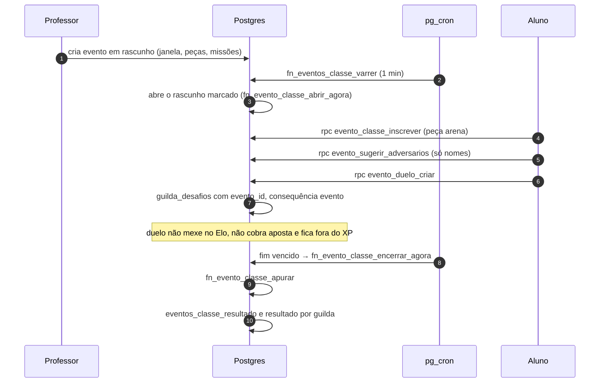

Os miolos sem sessão travam a linha e decidem pelo estado. Por isso, um clique do professor e a rotina no mesmo instante não creditam duas vezes.

## P17 — Moedas, loja e fundo da turma

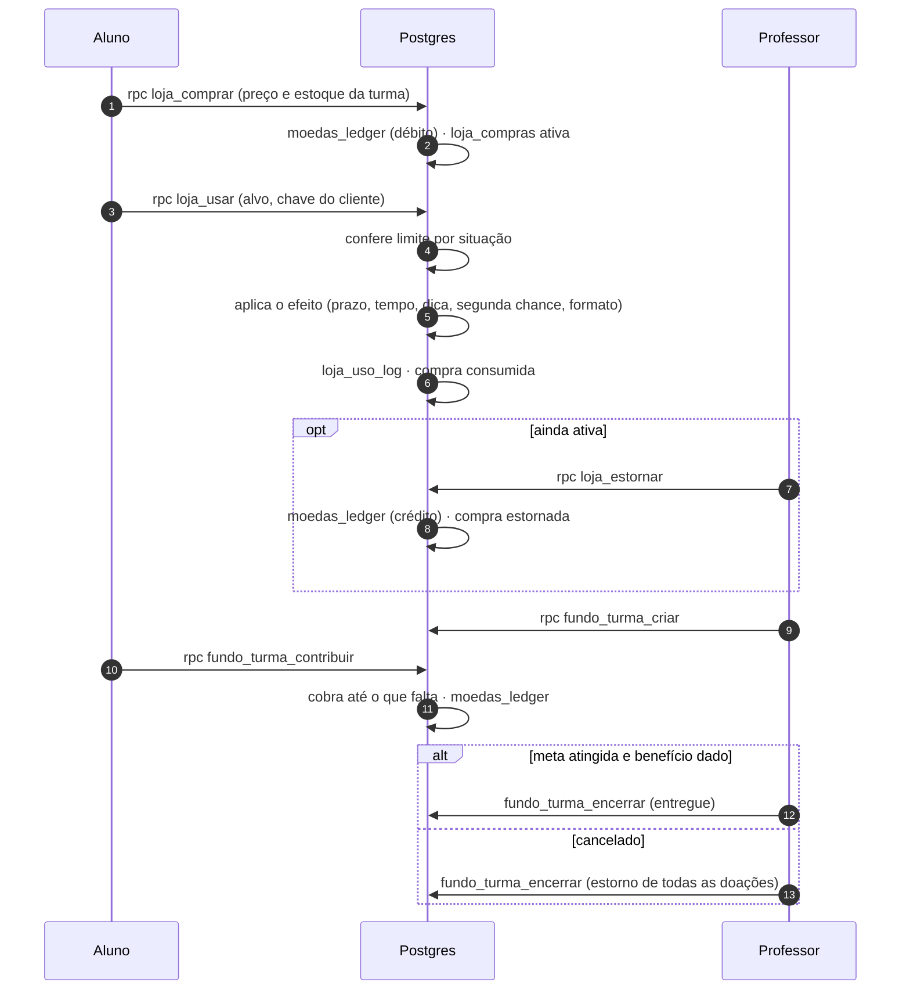

- O saldo é a soma do razão `moedas_ledger`, que só recebe acréscimos. Ele nunca é materializado.
- A compra só concede a posse. O efeito sai no uso, com chave para não aplicar duas vezes quando a resposta se perde.
- As configurações resolvem em camadas: atividade, tópico, turma e padrão global. Toda mudança vai para `economia_auditoria`.
- Moldura nova ou imagem trocada vem da aba Molduras (UC53): o console sobe o arquivo direto no bucket público `molduras`, e `admin_moldura_gravar` grava a referência. Sem imagem no banco, vale o desenho do pacote do app.

## P18 — Diagnóstico do tópico

A IA escreve as perguntas. Pedir, guardar, corrigir, decidir o nível e dispensar são do banco.

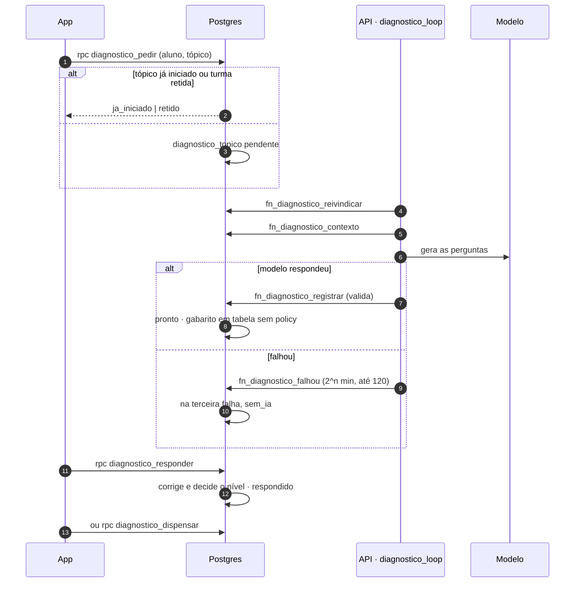

O diagnóstico é opcional, acontece uma vez por aluno e tópico, e nunca dispara geração de material.

## P19 — Estudo de efetividade e métricas

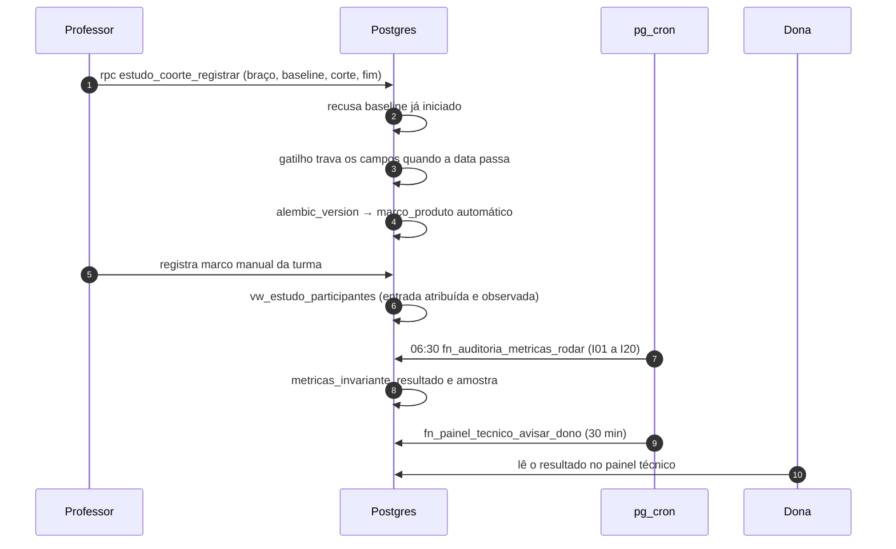

O desenho é prospectivo: a coorte precisa existir antes do estudo começar. A produção tem zero coortes registradas, então o fluxo está pronto e ainda não tem resultado.

## P20 — Monitor e marca de deploy

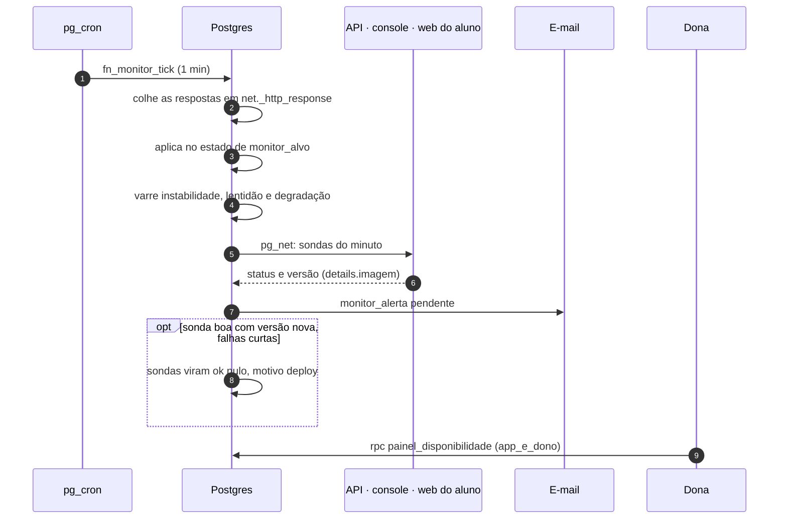

Quem mede a API é o banco, de fora do VPS, então relógio e alerta continuam com a API fora do ar. Se o Supabase cair, nada disso roda. Para esse caso existe a batida externa, ainda não configurada.
