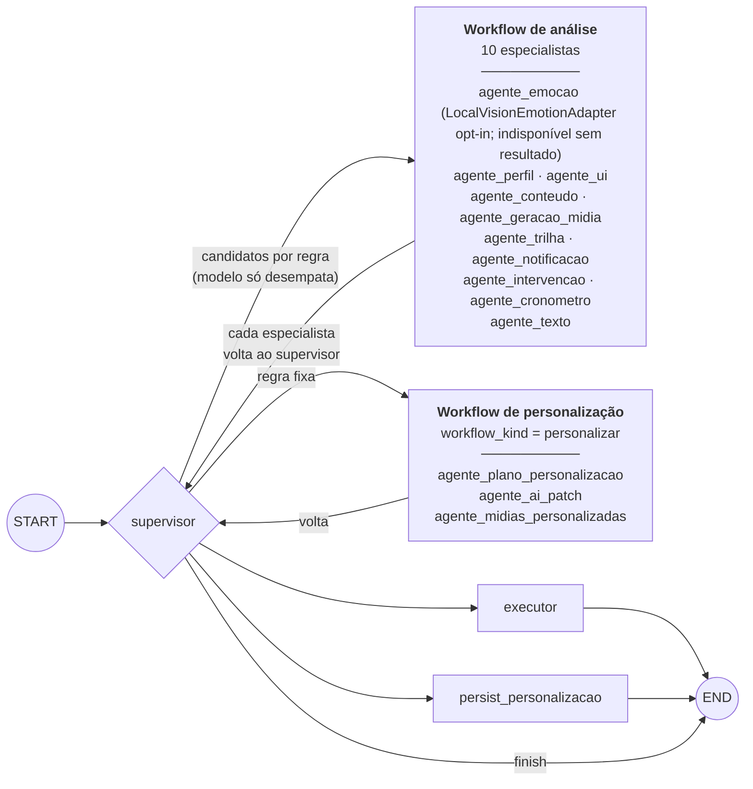
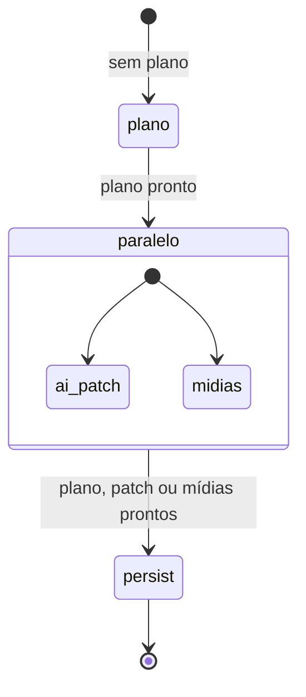
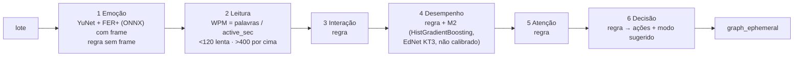
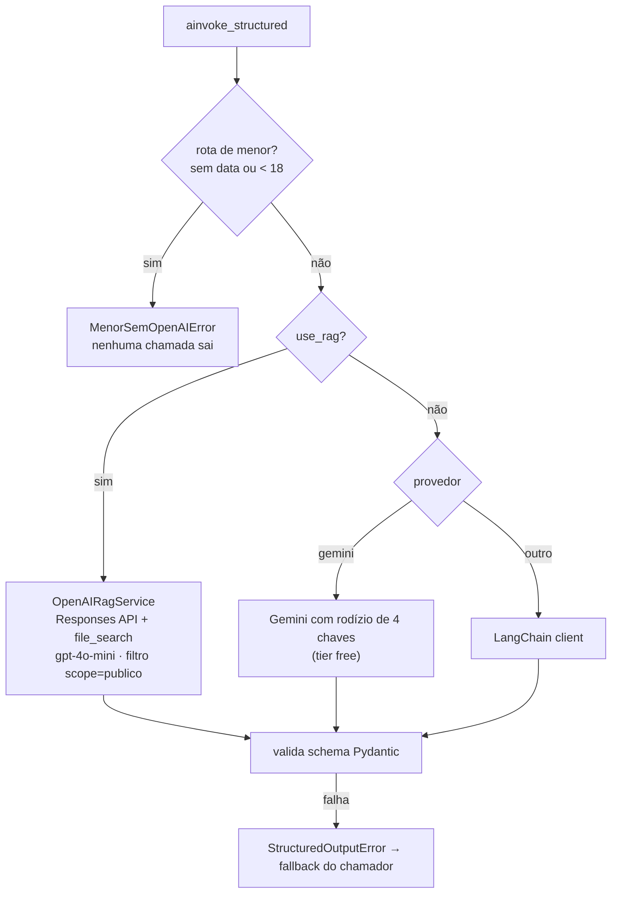

# 4. IA: grafo, análise e escolha do modelo

## 4.1 O grafo LangGraph

O grafo tem 16 nós (`api/app/agent/graph/builder.py`): o supervisor, 13 especialistas e 2 terminais. Todo especialista devolve o controle ao supervisor, e os dois terminais vão direto para o fim.

O mesmo grafo é compilado duas vezes, e as duas instâncias têm todos os nós; a diferença está no checkpointer:

- `graph_personalizacao`: checkpoint persistente no Postgres;
- `graph_ephemeral`: usado pela análise de telemetria.

Qual workflow roda depende de `workflow_kind` no estado, não da instância.

### Regras de roteamento da análise (`compute_supervisor_next`)

O supervisor primeiro calcula os **candidatos** por regra. O modelo só é consultado (`supervisor.txt`) quando há mais de um candidato não terminal, e a resposta dele é filtrada contra os candidatos. Se o modelo falhar, os candidatos seguem como estão.

| Especialista | Entra quando | Também na turma retida? |
|---|---|---|
| `agente_emocao` | há frame de câmera ou eventos novos, e ainda não há emoção | sim |
| `agente_perfil` | histórico vazio, múltiplo de 10 eventos, ou eventos novos | sim |
| `agente_ui` | há emoção e ainda não há `ui_config` | não |
| `agente_conteudo` | há tópico no pedido, tópico concluído, ou média de acertos < 50 | não |
| `agente_geracao_midia` | há conteúdo adaptado e `gerar_materiais` | não |
| `agente_trilha` | o perfil foi atualizado | não |
| `agente_notificacao` | valência ≤ −0,4 ou evento `inatividade` | não |
| `agente_intervencao` | há turma e recorrência em `memoria_aluno` (3 dos 5 últimos estados com o mesmo negativo) | sim |
| `agente_cronometro` | há turma e `decidir_desligar_cronometro(tentativas)` decide desligar | não |
| `agente_texto` | `ui_config.precisa_texto` ou há notificação a redigir | não |

Sem candidato, o supervisor vai para o `executor` se algum especialista produziu saída, e para `finish` se nenhum produziu. O `executor` grava as saídas pelos repositórios: trilha, notificação, `iaDescricao`, materiais, eventos, intervenção e cronômetro.

### Regras da personalização (`compute_personalizacao_next`)

Nesse workflow o supervisor não consulta modelo.

## 4.2 Pipeline de análise da telemetria

Os estágios têm nomes de algoritmos de ML (`DeepFace`, `IsolationForest`, `HiddenMarkov`, `DeepKnowledgeTracing`, `RandomForest`, `XGBoost`), mas, exceto onde o diagrama indica, **são regras heurísticas**. Ver o [dossiê, seção 5.3](../sistema-para-a-monografia-2026-11-04.md#53-pipeline-de-análise-da-telemetria-linear_analysis_pipelinepy).

Ações possíveis da decisão: `reduzir_ruido_visual`, `sugerir_pausa_curta`, `aumentar_dificuldade`, `manter_fluxo_atual`, além das ações de reforço. Modos sugeridos: `reforco`, `desafio` e `imediato`.

## 4.3 Escolha do provedor numa chamada de IA

- **Quem pode usar o RAG** (`use_rag`): chat do Guardião, `agente_intervencao` e `agente_notificacao`. O corpus v1, com as 12 regras derivadas, está na PR #948 e ainda não foi indexado.
- **Guardrails:** o chat passa por `checar_grounding_chat`. Quando a guarda reprova, o chamador usa `fallback_factory` e a violação é auditada.

## 4.4 Onde o modelo é chamado

O grafo é só uma parte. Estas chamadas passam todas por `ainvoke_structured`, com o mesmo portão de idade e a mesma escolha de provedor.

| Quem chama | O que produz | Caminho | Sem modelo |
|---|---|---|---|
| Nós do grafo | plano, conteúdo, texto, tema, aviso, intervenção | `graph_personalizacao`, `graph_ephemeral` | a regra decide; nada é inventado |
| `personalizacao.py`, `media_agents.py` | material por perfil (fallback do microservice) | worker `personalizacao_jobs_loop` | alvo falha e pode ser reprocessado |
| `boss_falas.py` | nome e falas do boss | mesmo worker | valem as falas fixas do app |
| `demanda_formato.py` | formato que o conteúdo pede | mesmo worker | a sugestão segue sem esse sinal |
| `classe_mapa_tema.py` | tema do mapa da turma | job `class_theme_sync` | tema de reserva (`_build_fallback_theme`) |
| `missao_diaria_texto.py` | texto da missão diária | `missoes_ia_loop` | fica o texto de molde |
| `missoes_ia.py` | sugestão de missão ao professor | `missoes_ia_loop` | pedido falha e para |
| `diagnostico_topico.py` | perguntas do diagnóstico | `diagnostico_loop` | `sem_ia` na terceira falha |
| `alteracao_professor.py` | cosmético × relevante | `alteracao_professor_loop` | fica `pendente_analise` |
| `insights_turma.py` | insights da turma | `POST /insights/turma/{id}/gerar` | nada é gravado |
| `escriba.py` | resposta da Lumi | `POST /escriba/perguntar` | recusa `EscribaIndisponivel` |
| rota do chat | resposta do Guardião | `POST /personalizar/chat` | o Guardião não responde |

O padrão é o mesmo nos workers: a API só chama o modelo. As regras que não são do modelo (tamanho, catálogo, teto, duplicação) ficam na função do banco que recebe a saída, como `fn_missao_ia_registrar` e `fn_diagnostico_registrar`.

Do lado do `microservice`, o Gemini gera texto, áudio e cards, e o BrainHexPDF gera o deck. Esses caminhos não passam pelo `ainvoke_structured`.
