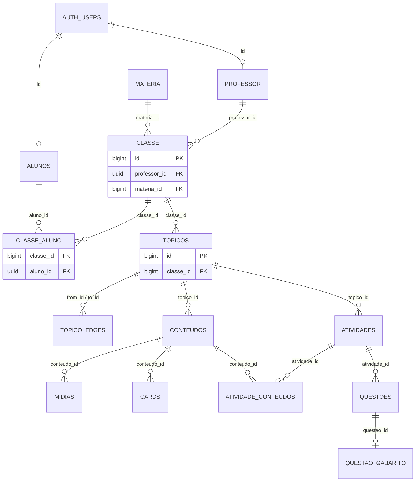
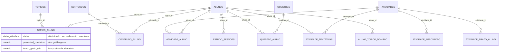
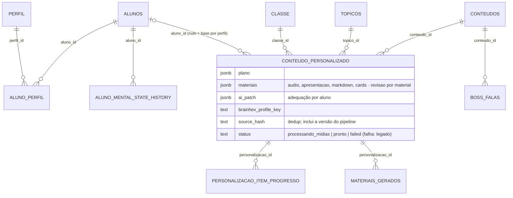
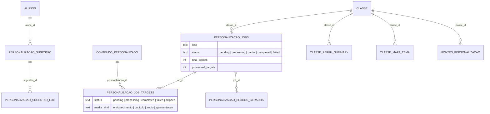
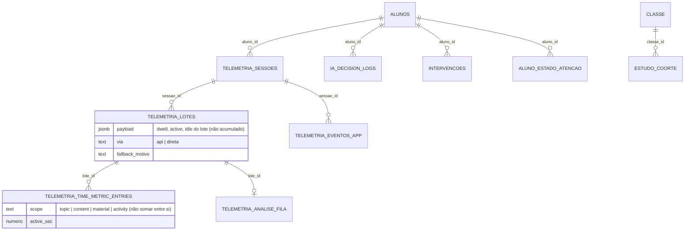
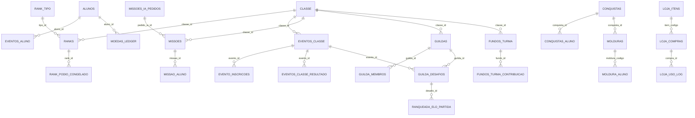
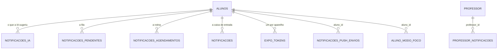
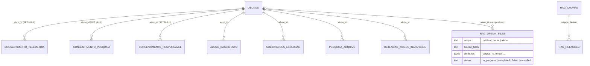

# 5. Modelo de dados

Os diagramas saem das **chaves estrangeiras reais** de produção (`pg_constraint`, lidas em 04/11/2026). São 171 tabelas, agrupadas aqui por domínio. Cada diagrama mostra as tabelas centrais e as relações entre elas; colunas aparecem só quando definem o papel da tabela. `alunos.id` e `professor.id` são o próprio `auth.users.id`.

## 5.1 Núcleo acadêmico

`questao_gabarito` fica separada de `questoes` para que o aluno leia a questão sem conseguir ler a resposta.

## 5.2 Progresso e avaliação

## 5.3 Perfil e personalização

### 5.3.1 Perfil e material

### 5.3.2 Fila de geração, sugestão e resumo da turma

## 5.4 Telemetria e decisões da IA

## 5.5 Gamificação

**Duelo no evento:** `guilda_desafios.evento_id` é nulo fora de evento, e um `CHECK` exige `consequencia = 'evento'` quando ele existe. Essa consequência não mexe no Elo nem cobra aposta, e fica fora do XP. No evento, o adversário vem dos inscritos de desempenho mais próximo (`evento_sugerir_adversarios`, que devolve só nomes). No Social, a escolha continua livre.

## 5.6 Notificações

As quatro primeiras têm papéis que não se trocam. Só `notificacoes_ia` recebe escrita da API.

## 5.7 Privacidade, pesquisa e RAG

- **Consentimentos:** as FKs usam `SET NULL` de propósito, para que a prova de consentimento sobreviva à exclusão da conta. As demais tabelas do aluno usam `CASCADE`.
- **Exclusões que saem do banco:** apagar uma linha de `rag_openai_files` ou de uma fonte enfileira em `retencao_externa` a remoção do arquivo fora do banco, no R2 ou na OpenAI.

## 5.8 Observabilidade

- **De fora (`monitor_*`):** o `pg_cron` sonda a API, o console e a web do aluno, aplica o resultado na máquina de estados de `monitor_alvo` e envia os alertas de `monitor_alerta` por e-mail. A sonda sem resposta fica com `ok` nulo, porque quem falhou foi o medidor. O monitor cai junto com o Supabase.
- **De dentro (`cliente_*`):** erro, Web Vitals, falha de chamada e acesso são gravados pelo próprio cliente, direto no Supabase, por RPC. `cliente_sessao` tem uma linha por sessão e `cliente_erro` agrega por assinatura, dia, superfície e versão, guardando até 50 ids de sessão para contar pessoas afetadas. Não há stack, URL completa nem texto digitado, e as tabelas não têm policy nem GRANT: a RPC é a única porta.
- **Modelo (`ia_uso_llm`):** registra cada chamada ao modelo de linguagem: prompt, provedor, tokens, cache e tempo. Não tem `aluno_id` nem texto, e só o `service_role` lê e escreve.
- **Acesso por aluno:** a lista do painel técnico abre com código curto, e mostrar nomes fica registrado em `monitor_consulta`. Nela não entram emoção, BrainHex nem nota.
