# 5. Modelo de dados

Os diagramas saem das **chaves estrangeiras reais** de produção (`pg_constraint`, lidas em 05/11/2026). São 188 tabelas e 27 views em `public`, agrupadas aqui por domínio, com 679 funções, 291 policies e 147 gatilhos. Cada diagrama mostra as tabelas centrais e as relações entre elas; colunas aparecem só quando definem o papel da tabela. `alunos.id` e `professor.id` são o próprio `auth.users.id`.

O [apêndice](#apêndice-todas-as-tabelas-por-domínio) lista todas as tabelas. `conferir_tabelas.py`, nesta pasta, compara essa lista com o banco e aponta o que ficou de fora.

## 5.1 Núcleo acadêmico

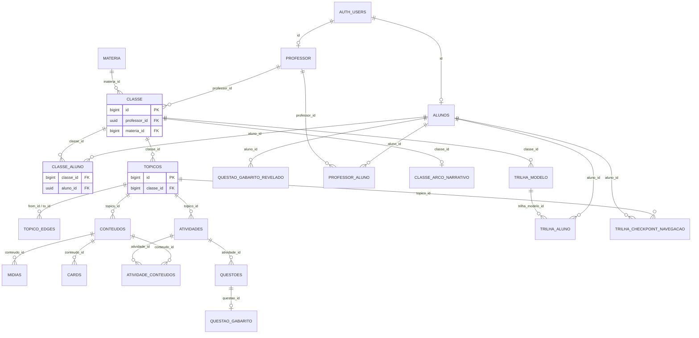

`questao_gabarito` fica separada de `questoes` para que o aluno leia a questão sem conseguir ler a resposta. `questao_gabarito_revelado` registra o fato de o aluno ter visto o gabarito. `classe_aluno_saidas` guarda quando o aluno saiu da turma, porque essa data conta o prazo de retenção.

## 5.2 Progresso e avaliação

```mermaid
erDiagram
  ALUNOS ||--o{ TOPICO_ALUNO : aluno_id
  TOPICOS ||--o{ TOPICO_ALUNO : topico_id
  ALUNOS ||--o{ CONTEUDO_ALUNO : aluno_id
  CONTEUDOS ||--o{ CONTEUDO_ALUNO : conteudo_id
  ALUNOS ||--o{ ATIVIDADE_ALUNO : aluno_id
  ATIVIDADES ||--o{ ATIVIDADE_ALUNO : atividade_id
  ATIVIDADES ||--o{ ATIVIDADE_TENTATIVAS : atividade_id
  ALUNOS ||--o{ ATIVIDADE_TENTATIVAS : aluno_id
  QUESTOES ||--o{ QUESTAO_ALUNO : questao_id
  ALUNOS ||--o{ QUESTAO_ALUNO : aluno_id
  ATIVIDADES ||--o{ ATIVIDADE_APROVACAO : atividade_id
  ATIVIDADES ||--o{ ATIVIDADE_PRAZO_ALUNO : atividade_id
  ALUNOS ||--o{ ESTUDO_SESSOES : aluno_id
  ALUNOS ||--o{ ALUNO_TOPICO_DOMINIO : aluno_id
  ALUNOS ||--o{ ESTUDO_INTERVALOS : aluno_id
  TOPICOS ||--o{ TOPICO_ALUNO_CONCLUSAO : topico_id
  ALUNOS ||--o{ ATIVIDADE_TEMPO_ALUNO : aluno_id
  ALUNOS ||--o| ALUNO_CRONOMETRO : aluno_id
  ALUNOS ||--o{ BAG_ITENS : aluno_id
  TOPICOS ||--o{ BAG_ITENS : topico_id
  CONTEUDOS ||--o{ BAG_ITENS : conteudo_id

  TOPICO_ALUNO {
    status_atividade status "não iniciado | em andamento | concluido"
    numeric percentual_concluido "só o gatilho grava"
    numeric tempo_gasto_min "tempo ativo da telemetria"
  }
```

## 5.3 Perfil e personalização

### 5.3.1 Perfil e material

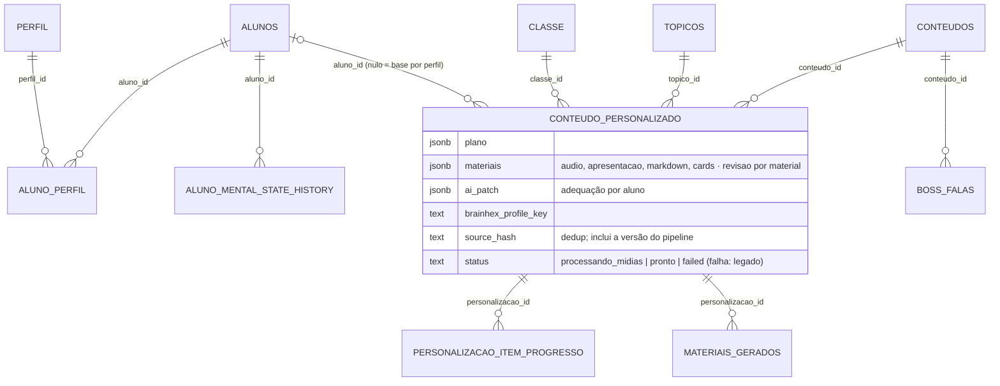

### 5.3.2 Fila de geração, sugestão e resumo da turma

### 5.3.3 Diagnóstico, formato e percurso

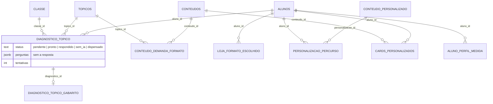

`diagnostico_topico_gabarito` não tem policy: só as funções do banco leem a resposta. `conteudo_demanda_formato` guarda o formato que cada conteúdo pede para ser entendido (visual, escrito, sonoro, prática), classificado pela IA e usado pelo motor de sugestão. `loja_formato_escolhido` é tabela própria porque `conteudo_personalizado` é compartilhado por perfil, e a compra é de um aluno.

## 5.4 Telemetria e decisões da IA

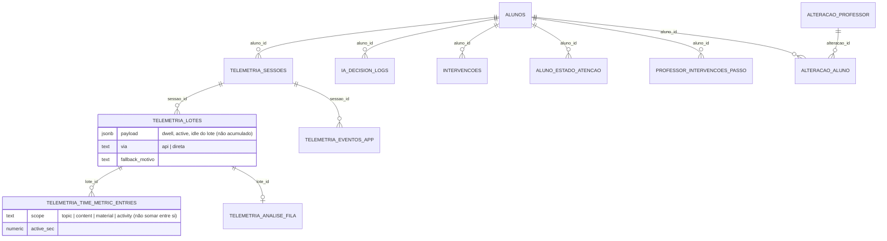

## 5.5 Gamificação

### 5.5.1 Pontuação, ranking, missões e conquistas

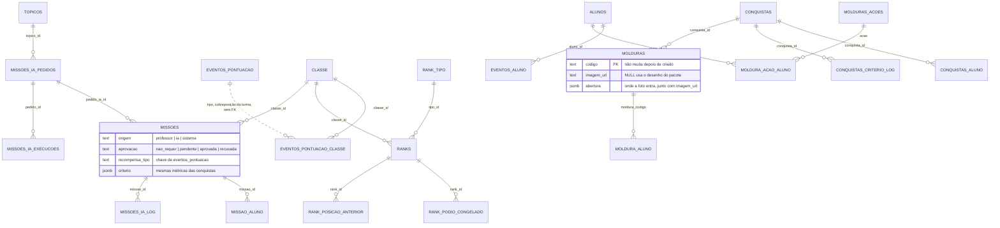

`xp_faixa` guarda piso e título de cada nível. O nível é a posição pelo piso, então não existe tabela de nível por aluno.

### 5.5.2 Economia e loja

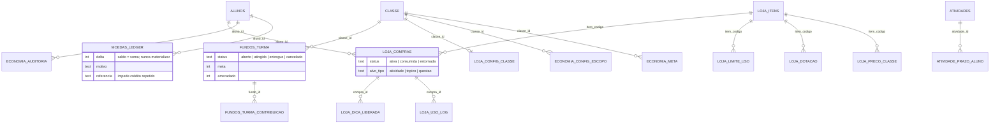

Os cinco itens do catálogo são `dica`, `prazo_extra`, `segunda_chance`, `tempo_extra` e `troca_formato`. `plataforma_dev` diz quem lê a auditoria, e nasce vazia.

### 5.5.3 Guildas, arena e eventos

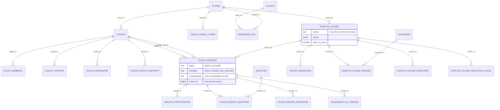

**Duelo no evento:** `guilda_desafios.evento_id` é nulo fora de evento, e um `CHECK` exige `consequencia = 'evento'` quando ele existe. Essa consequência não mexe no Elo nem cobra aposta, e fica fora do XP. No evento, o adversário vem dos inscritos de desempenho mais próximo (`evento_sugerir_adversarios`, que devolve só nomes). No Social, a escolha continua livre.

As tabelas de arena têm RLS e nenhuma policy: só se chega a elas por função `SECURITY DEFINER`.

### 5.5.4 Social

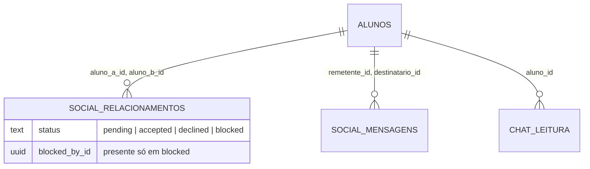

As mensagens privadas e de guilda são cifradas em repouso (`20261022_05`).

## 5.6 Notificações

```mermaid
erDiagram
  ALUNOS ||--o{ NOTIFICACOES_IA : "o que a IA sugeriu"
  ALUNOS ||--o{ NOTIFICACOES_PENDENTES : "a fila"
  ALUNOS ||--o{ NOTIFICACOES_AGENDAMENTOS : "a rotina"
  ALUNOS ||--o{ NOTIFICACOES : "a caixa de entrada"
  ALUNOS ||--o{ EXPO_TOKENS : "um por aparelho"
  ALUNOS ||--o{ NOTIFICACOES_PUSH_ENVIOS : aluno_id
  ALUNOS ||--o{ ALUNO_MODO_FOCO : aluno_id
  PROFESSOR ||--o{ PROFESSOR_NOTIFICACOES : professor_id
  ALUNOS ||--o| ALUNOS_NOTIFICACAO_PREFERENCIAS : aluno_id
  ALUNOS ||--o| ALUNO_NOTIFICACAO_INTENSIDADE : aluno_id
  ALUNOS ||--o{ ALUNO_NOTIFICACAO_INTENSIDADE_LOG : aluno_id
  ALUNOS ||--o{ NOTIFICACOES_SILENCIADAS : aluno_id
  ALUNOS ||--o{ NOTIFICACOES_SILENCIAMENTO_LOG : aluno_id
  ALUNOS ||--o{ NOTIFICACOES_MATERIAL_PRONTO : aluno_id
  ALUNOS ||--o{ ALUNO_SESSOES_APP : aluno_id
  ALUNOS ||--o{ ALUNO_ATIVIDADE_DIARIA : aluno_id
  NOTIFICACOES_CATEGORIAS ||--o{ NOTIFICACOES_TIPOS : categoria
```

As quatro primeiras têm papéis que não se trocam. Só `notificacoes_ia` recebe escrita da API. `notificacoes_tipos` traz os 28 tipos, com categoria e intervalo mínimo, e `notificacoes_textos_perfil` e `notificacoes_modelos_texto` escrevem cada aviso no tom do perfil. `aluno_notificacao_intensidade` é calculada pelo banco, às 06:10.

## 5.7 Privacidade, pesquisa e RAG

```mermaid
erDiagram
  ALUNOS ||--o{ CONSENTIMENTO_TELEMETRIA : "aluno_id (SET NULL)"
  ALUNOS ||--o{ CONSENTIMENTO_PESQUISA : "aluno_id (SET NULL)"
  ALUNOS ||--o{ CONSENTIMENTO_RESPONSAVEL : "aluno_id (SET NULL)"
  PROFESSOR ||--o{ CONSENTIMENTO_PROFESSOR : "professor_id (SET NULL)"
  ALUNOS ||--o| ALUNO_NASCIMENTO : aluno_id
  ALUNOS ||--o{ SOLICITACOES_EXCLUSAO : aluno_id
  ALUNOS ||--o{ PESQUISA_ARQUIVO : aluno_id
  ALUNOS ||--o{ RETENCAO_AVISOS_INATIVIDADE : aluno_id
  ALUNOS ||--o{ CONTATO_ENVIOS : aluno_id
  RETENCAO_POLITICA
  RETENCAO_EXECUCOES
  RETENCAO_FILA_EXTERNA
  PESQUISA_ANONIMIZACAO
  EXCLUSAO_CONTA_PROFESSOR
  CONTATO_PUBLICO_ENVIOS
  ALUNOS |o--o{ RAG_OPENAI_FILES : "aluno_id (escopo aluno)"
  RAG_CHUNKS ||--o{ RAG_RELACOES : "origem / destino"

  RAG_OPENAI_FILES {
    text scope "publico | turma | aluno"
    text source_hash
    jsonb attributes "corpus, rd, fontes …"
    text status "in_progress | completed | failed | cancelled"
  }
```

- **Consentimentos:** as FKs usam `SET NULL` de propósito, para que a prova de consentimento sobreviva à exclusão da conta. As demais tabelas do aluno usam `CASCADE`.
- **Exclusões que saem do banco:** apagar uma linha de `rag_openai_files` ou de uma fonte enfileira em `retencao_fila_externa` a remoção fora do banco: R2, Storage, OpenAI ou usuário do Auth.
- **Política:** `retencao_politica` tem 118 linhas, uma por tabela com dado de pessoa.
- **`consentimento_professor` e `aluno_nascimento_correcao`:** criadas pela `20261105_27`. A segunda guarda cada correção de data de nascimento feita pela dona e é só de RPC: RLS ligada e sem policy, de propósito.

## 5.8 Observabilidade

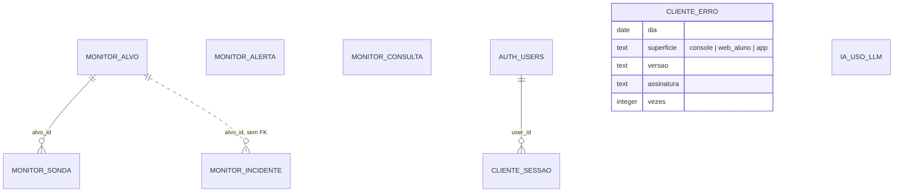

- **De fora (`monitor_*`):** o `pg_cron` sonda a API, o console e a web do aluno a cada minuto, 24 horas por dia, aplica o resultado na máquina de estados de `monitor_alvo` e envia os alertas de `monitor_alerta` por e-mail. A sonda sem resposta fica com `ok` nulo, porque quem falhou foi o medidor. O monitor cai junto com o Supabase.
- **De dentro (`cliente_*`):** erro, Web Vitals, falha de chamada e acesso são gravados pelo próprio cliente, direto no Supabase, por RPC. `cliente_sessao` tem uma linha por sessão e `cliente_erro` agrega por assinatura, dia, superfície e versão, guardando até 50 ids de sessão para contar pessoas afetadas. Não há stack, URL completa nem texto digitado, e as tabelas não têm policy nem GRANT: a RPC é a única porta.
- **Modelo (`ia_uso_llm`):** registra cada chamada ao modelo de linguagem: prompt, provedor, tokens, cache e tempo. Não tem `aluno_id` nem texto, e só o `service_role` lê e escreve.
- **Acesso por aluno:** a lista do painel técnico abre com código curto, e mostrar nomes fica registrado em `monitor_consulta`. Nela não entram emoção, BrainHex nem nota.

## 5.9 Estudo de efetividade e métricas

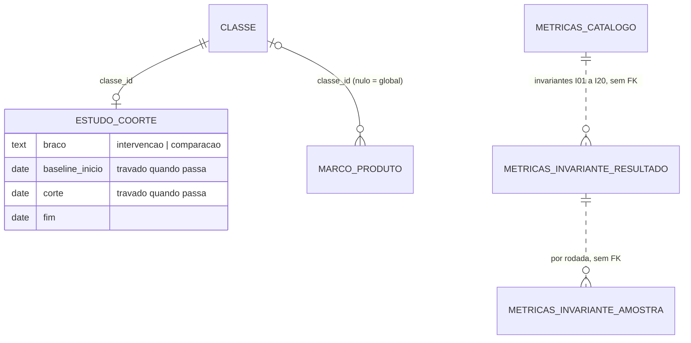

- **Coorte é a turma**, com data de corte. O material-base é compartilhado por perfil e o ranking compara colegas, então sortear dentro da turma contaminaria a comparação.
- **`metricas_catalogo`** tem 29 métricas: quem enxerga, de onde vem e de quais invariantes depende.
- **`metricas_invariante_amostra`** guarda até 20 ids por rodada. Tem id de aluno, então só o `service_role` lê.

## 5.10 Configuração e infraestrutura

| Tabela | Papel |
|---|---|
| `app_config` | parâmetros, uma linha por chave. `publico` decide o que o cliente lê; os tetos anti-abuso ficam privados |
| `alembic_version` | migração aplicada. O gatilho dela também registra marcos de produto |
| `checkpoints`, `checkpoint_blobs`, `checkpoint_writes`, `checkpoint_migrations` | estado persistente do LangGraph |
| `iaDescricao`, `modoOperacao` | tabelas do fluxo adaptativo com nome em camelCase, herdadas da primeira versão |

## Apêndice: todas as tabelas por domínio

| Domínio | Qtd. | Tabelas |
|---|---:|---|
| Núcleo acadêmico | 25 | `aluno_cadastro_concluido`, `aluno_introducao`, `aluno_nascimento`, `alunos`, `atividade_conteudos`, `atividades`, `cards`, `classe`, `classe_aluno`, `classe_aluno_saidas`, `classe_arco_narrativo`, `classe_mapa_tema`, `conteudos`, `materia`, `midias`, `professor`, `professor_aluno`, `questao_gabarito`, `questao_gabarito_revelado`, `questoes`, `topico_edges`, `topicos`, `trilha_aluno`, `trilha_checkpoint_navegacao`, `trilha_modelo` |
| Progresso e avaliação | 15 | `aluno_cronometro`, `aluno_topico_dominio`, `atividade_aluno`, `atividade_aprovacao`, `atividade_prazo_aluno`, `atividade_tempo_aluno`, `atividade_tentativa`, `atividade_tentativas`, `bag_itens`, `conteudo_aluno`, `estudo_intervalos`, `estudo_sessoes`, `questao_aluno`, `topico_aluno`, `topico_aluno_conclusao` |
| Perfil e personalização | 23 | `alteracao_aluno`, `alteracao_professor`, `aluno_estado_atencao`, `aluno_mental_state_history`, `aluno_perfil`, `aluno_perfil_medida`, `boss_falas`, `cards_personalizados`, `classe_perfil_summary`, `conteudo_demanda_formato`, `conteudo_personalizado`, `diagnostico_topico`, `diagnostico_topico_gabarito`, `fontes_personalizacao`, `materiais_gerados`, `perfil`, `personalizacao_blocos_gerados`, `personalizacao_item_progresso`, `personalizacao_job_targets`, `personalizacao_jobs`, `personalizacao_percurso`, `personalizacao_sugestao`, `personalizacao_sugestao_log` |
| Telemetria e IA | 12 | `iaDescricao`, `ia_decision_logs`, `ia_uso_llm`, `intervencoes`, `modoOperacao`, `professor_intervencoes_passo`, `telemetria_agregado_turma_dia`, `telemetria_analise_fila`, `telemetria_eventos_app`, `telemetria_lotes`, `telemetria_sessoes`, `telemetria_time_metric_entries` |
| Pontuação, missões e conquistas | 20 | `conquistas`, `conquistas_aluno`, `conquistas_criterio_log`, `eventos_aluno`, `eventos_pontuacao`, `eventos_pontuacao_classe`, `missao_aluno`, `missoes`, `missoes_ia_execucoes`, `missoes_ia_log`, `missoes_ia_pedidos`, `moldura_acao_aluno`, `moldura_aluno`, `molduras`, `molduras_acoes`, `rank_podio_congelado`, `rank_posicao_anterior`, `rank_tipo`, `ranks`, `xp_faixa` |
| Economia e loja | 16 | `economia_auditoria`, `economia_config_escopo`, `economia_meta`, `fundos_turma`, `fundos_turma_contribuicao`, `loja_compras`, `loja_config_classe`, `loja_dica_liberada`, `loja_dotacao`, `loja_formato_escolhido`, `loja_itens`, `loja_limite_uso`, `loja_preco_classe`, `loja_uso_log`, `moedas_ledger`, `plataforma_dev` |
| Guildas, arena e eventos | 17 | `desafio_participantes`, `evento_inscricoes`, `eventos_classe`, `eventos_classe_missoes`, `eventos_classe_resultado`, `eventos_classe_resultado_guilda`, `guilda_config_turma`, `guilda_convites`, `guilda_desafio_questoes`, `guilda_desafio_respostas`, `guilda_desafios`, `guilda_evento_snapshot`, `guilda_membros`, `guilda_mensagens`, `guildas`, `ranqueada_elo`, `ranqueada_elo_partida` |
| Social | 3 | `chat_leitura`, `social_mensagens`, `social_relacionamentos` |
| Notificações | 21 | `aluno_atividade_diaria`, `aluno_modo_foco`, `aluno_notificacao_intensidade`, `aluno_notificacao_intensidade_log`, `aluno_sessoes_app`, `alunos_notificacao_preferencias`, `expo_tokens`, `notificacoes`, `notificacoes_agendamentos`, `notificacoes_categorias`, `notificacoes_config`, `notificacoes_ia`, `notificacoes_material_pronto`, `notificacoes_modelos_texto`, `notificacoes_pendentes`, `notificacoes_push_envios`, `notificacoes_silenciadas`, `notificacoes_silenciamento_log`, `notificacoes_textos_perfil`, `notificacoes_tipos`, `professor_notificacoes` |
| Privacidade, pesquisa e RAG | 18 | `aluno_nascimento_correcao`, `consentimento_pesquisa`, `consentimento_professor`, `consentimento_responsavel`, `consentimento_telemetria`, `contato_envios`, `contato_publico_envios`, `exclusao_conta_professor`, `pesquisa_anonimizacao`, `pesquisa_arquivo`, `rag_chunks`, `rag_openai_files`, `rag_relacoes`, `retencao_avisos_inatividade`, `retencao_execucoes`, `retencao_fila_externa`, `retencao_politica`, `solicitacoes_exclusao` |
| Observabilidade | 7 | `cliente_erro`, `cliente_sessao`, `monitor_alerta`, `monitor_alvo`, `monitor_consulta`, `monitor_incidente`, `monitor_sonda` |
| Estudo e métricas | 5 | `estudo_coorte`, `marco_produto`, `metricas_catalogo`, `metricas_invariante_amostra`, `metricas_invariante_resultado` |
| Configuração e infraestrutura | 6 | `alembic_version`, `app_config`, `checkpoint_blobs`, `checkpoint_migrations`, `checkpoint_writes`, `checkpoints` |
