# 6. Diagramas de estado

Os estados vêm de duas fontes:

- das restrições `CHECK` e do enum `status_atividade`, lidos no banco de produção em 04/11/2026;
- do código, onde o status é texto livre: filas de geração e `conteudo_personalizado`.

As contagens entre parênteses são de produção, em 04/11/2026.

## 6.1 Job de geração (`personalizacao_jobs`)

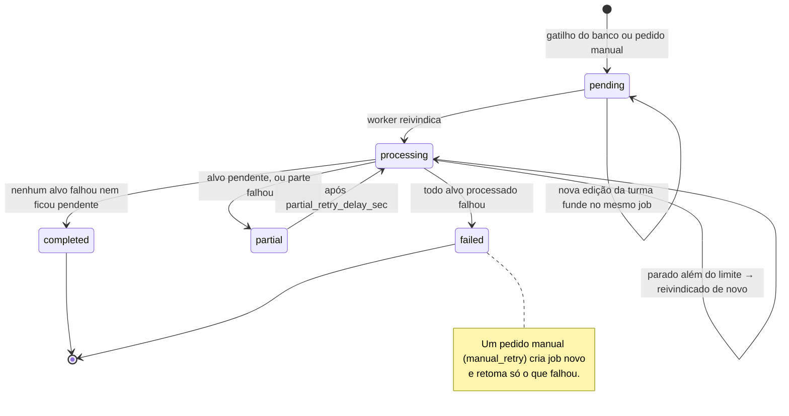

Produção: 79 `completed`, 16 `failed`, 4 `partial`. Regra do fim em `personalizacao_jobs.py` (`final_status`).

Só job `pending` aceita fusão. Job em `processing` nunca é reaproveitado, porque o worker já leu o `total_targets` dele.

## 6.2 Alvo do job (`personalizacao_job_targets`)

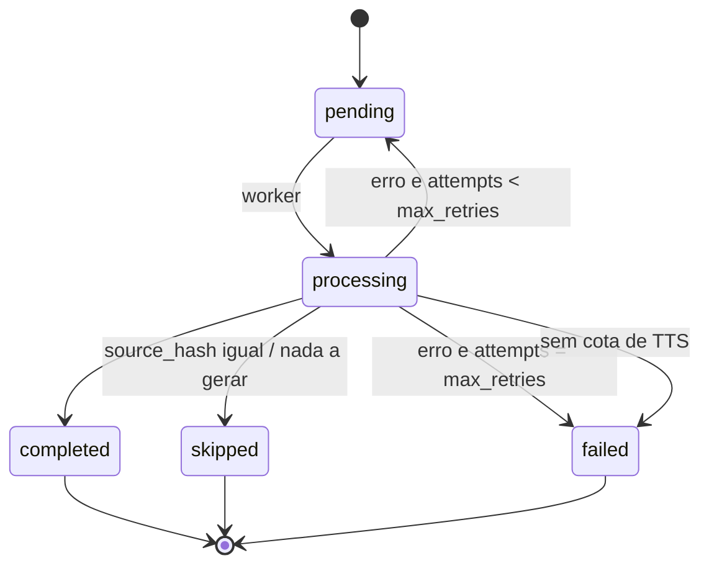

Produção: 52 `completed`, 31 `failed`, 8 `skipped`.

## 6.3 Material personalizado (`conteudo_personalizado.status`)

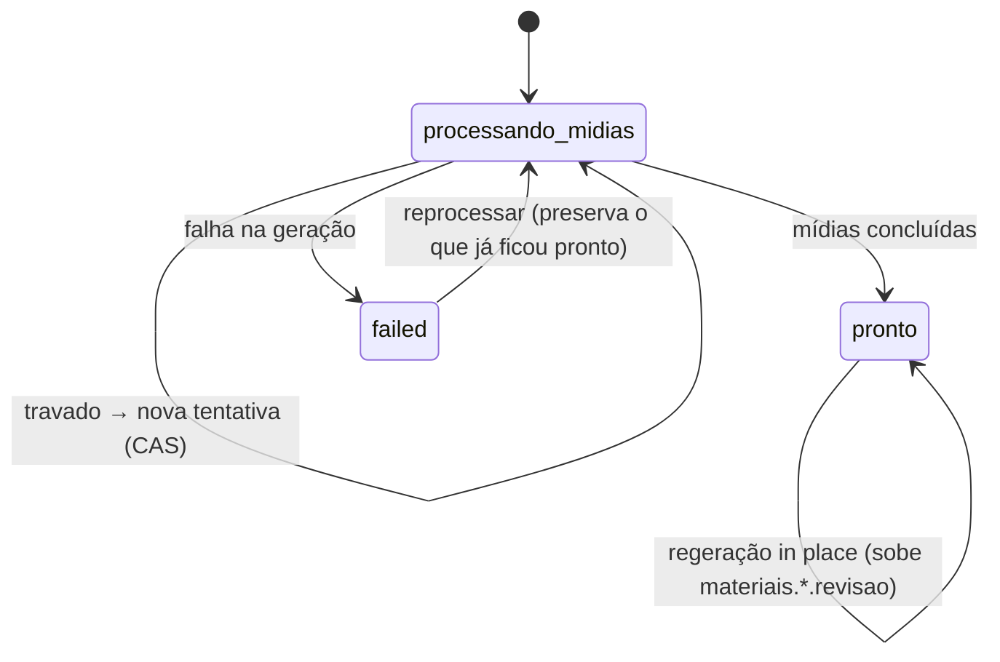

Produção: 4 `pronto`, 13 `failed`. Em 12/11: 4 `pronto`, 14 `failed`.

**Aprovação, ortogonal ao status** (`conteudo_personalizado.aprovacao`, `20261110_09`, 10/11): todo registro nasce `pendente` e volta a `pendente` quando o material muda (`materiais`, `plano` ou `source_hash`, ou a entrada em `processando_midias`), subindo `conteudo_versao`. Só o professor dono decide, `pendente` → `aprovado` ou `recusado`, pela RPC `personalizacao_decidir`, que recusa a decisão se a versão mudou desde que ele viu. Material em `processando_midias` não pode ser aprovado. O aluno só lê o `aprovado`. Em 12/11, os 18 registros estavam `aprovado`, todos pela migração, que deu esse estado ao legado.

O gatilho `trg_conteudo_personalizado_novo_material` avisa o aluno quando o tópico termina para o perfil dele, inclusive se o último conteúdo falhou.

## 6.4 Progresso (`status_atividade`, enum)

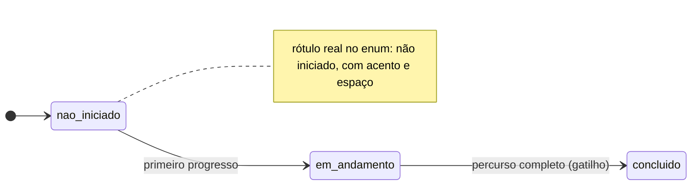

O status vale para `topico_aluno`, `conteudo_aluno` e `atividade_aluno`. Em `topico_aluno` só o gatilho `trailup_recalcular_topico_aluno` escreve. A revisão pedida pelo professor não muda `atividade_aluno.status`.

## 6.5 Evento de turma (`eventos_classe`)

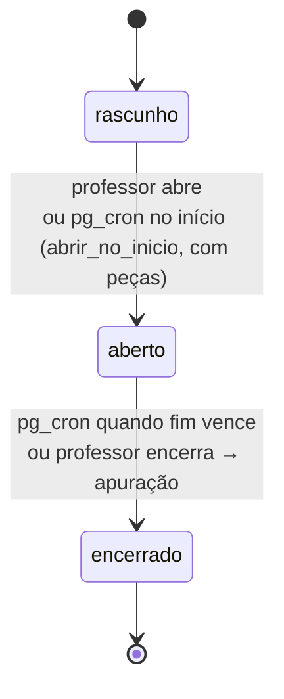

`fn_evento_classe_abrir_agora` e `_encerrar_agora` travam a linha. Um clique e o cron ao mesmo tempo não creditam o resultado duas vezes.

## 6.6 Notificações

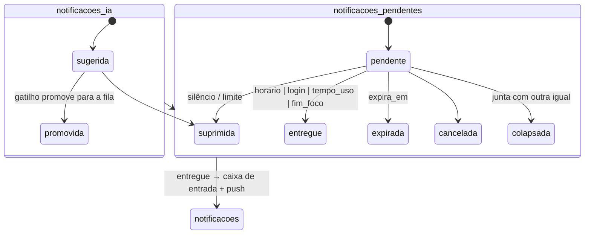

## 6.7 Intervenção e alteração do professor

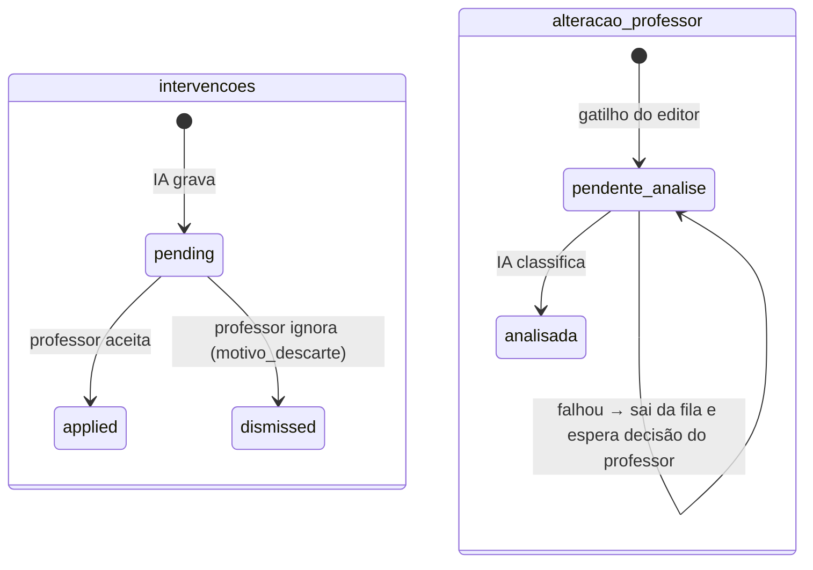

## 6.8 Gamificação e social

As transições abaixo foram auditadas nas funções em 05/11/2026, no lugar de seguir só os rótulos do `CHECK`.

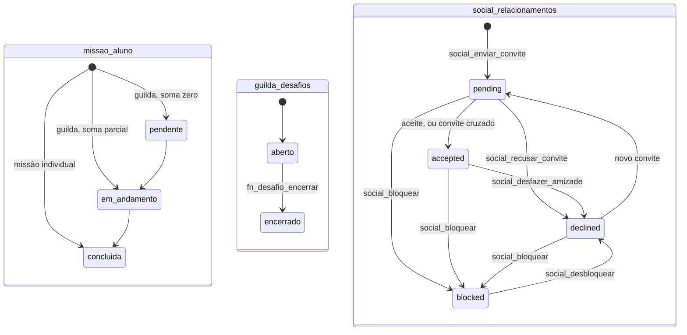

- **`missao_aluno`:** a linha da missão individual só nasce quando o critério é cumprido, já `concluida`. `pendente` e `em_andamento` são gravados apenas pela missão de guilda.
- **`expirada`:** o rótulo existe no `CHECK`, mas nenhuma função o grava. A diária vale pela janela da missão (`janela_fim`).
- **`guilda_desafios.resultado`:** `vitoria`, `empate` ou `sem_adversario`. A `consequencia` é `treino`, `ranqueada` ou `evento`.
- **Bloqueio:** é um estado da mesma linha, e `blocked_by_id` existe se e somente se o status é `blocked`. Desbloquear volta a `declined`, nunca à amizade.

Aprovação de missão, pedido à IA e os demais estados dos fluxos novos:

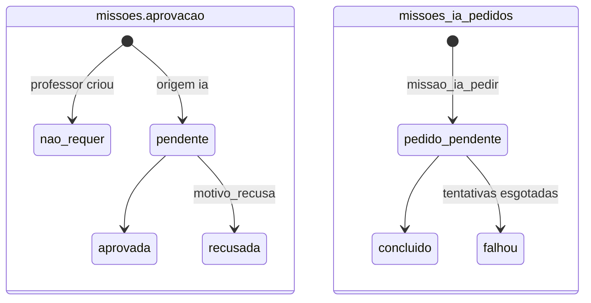

`CHECK (origem <> 'ia' OR aprovacao <> 'nao_requer')` garante no banco que nada da IA chega ao aluno sem aprovação. A policy só entrega missão `ativa` com `nao_requer` ou `aprovada`.

## 6.9 Arquivo do RAG (`rag_openai_files`)

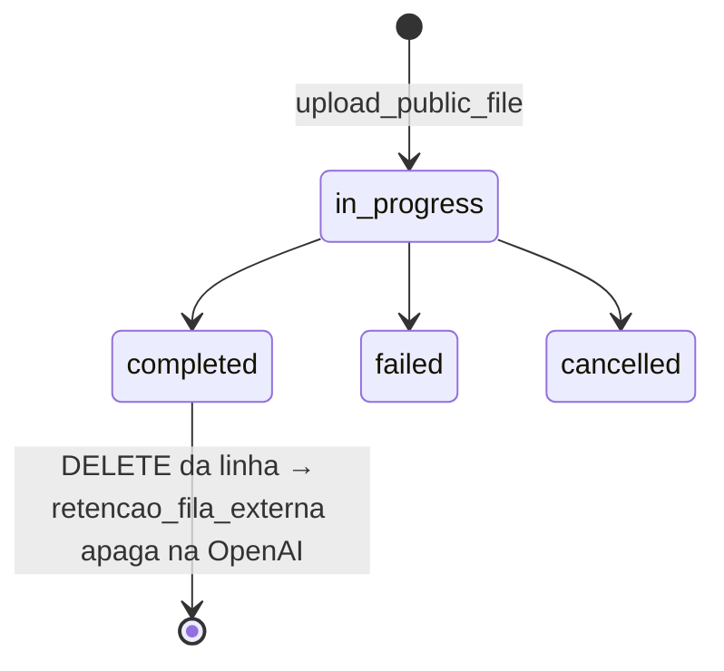

Produção em 04/11: nenhuma linha. Em 10/11 o corpus v1 foi indexado: 12 linhas, todas `completed` (#1077).

## 6.10 Diagnóstico do tópico (`diagnostico_topico`)

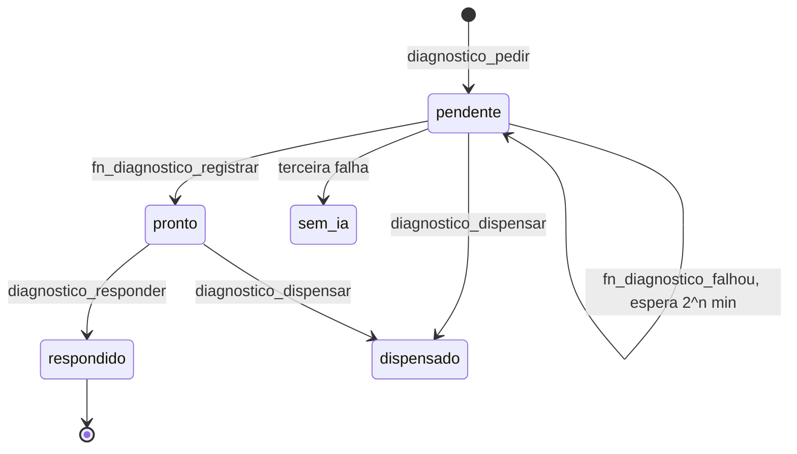

Produção: nenhuma linha em 05/11/2026.

## 6.11 Economia

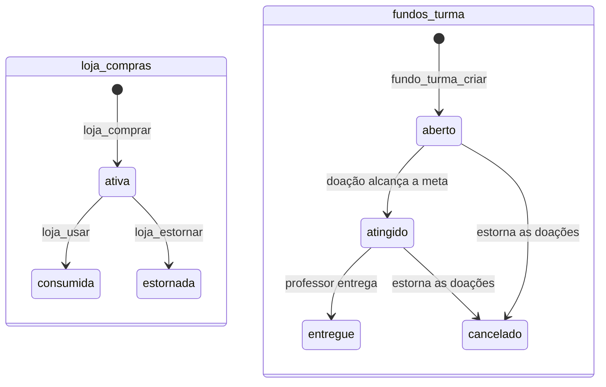

Compra consumida não estorna (`ja_usado`), e repetir um estorno devolve o resultado anterior. Só existe um fundo `aberto` ou `atingido` por turma, garantido por índice parcial.

## 6.12 Convites

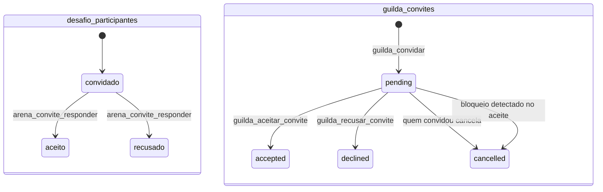

O aceite do convite de guilda reconfere o bloqueio (`20261031_09`). Se os dois se bloquearam depois do convite, ele é cancelado em vez de aceito.

## 6.13 Consentimento (`consentimento_*`)

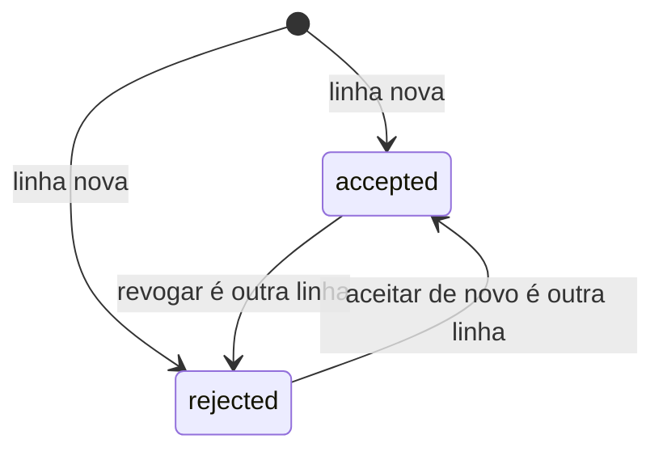

O registro é só de acréscimo: `registrado_em` vem do servidor, e o estado vigente é a linha mais recente. Nada apaga prova. Ao excluir a conta, a FK usa `SET NULL` e a linha sobrevive sem o titular. Vale o mesmo para `consentimento_professor` (`20261105_27`), criada na `main` e ainda não aplicada em produção na data da medição.

## 6.14 Monitor de disponibilidade

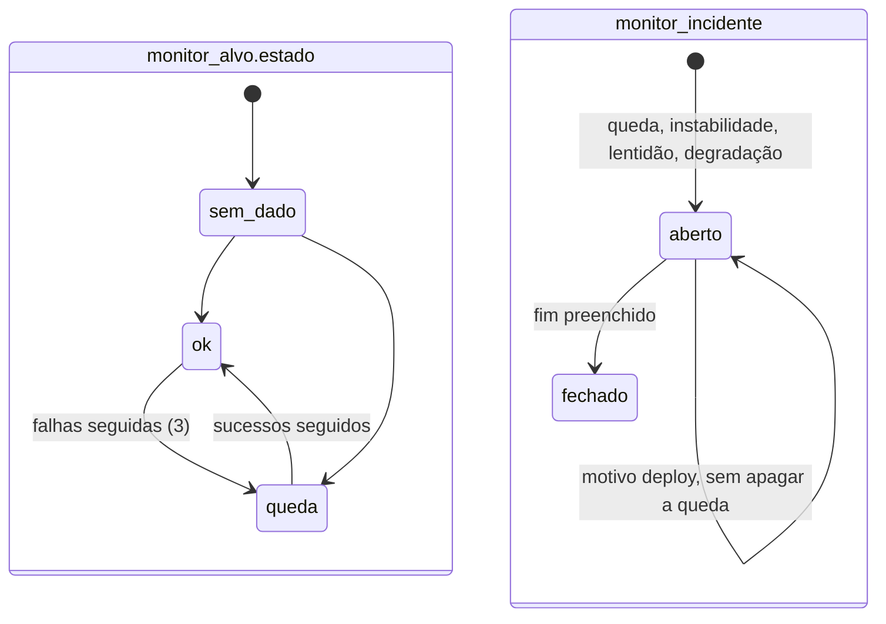

- O início do incidente é a primeira sonda ruim, não a terceira.
- Sonda sem resposta fica com `ok` nulo, porque quem falhou foi o medidor.
- Sonda da marca de deploy também fica com `ok` nulo, com `motivo = 'deploy'`, e aparece no painel como `minutos_deploy`. Valem as três condições: versão nova, sequência curta e versão anterior conhecida.
- Enquanto a instabilidade do alvo está aberta, as quedas dele não mandam e-mail.
