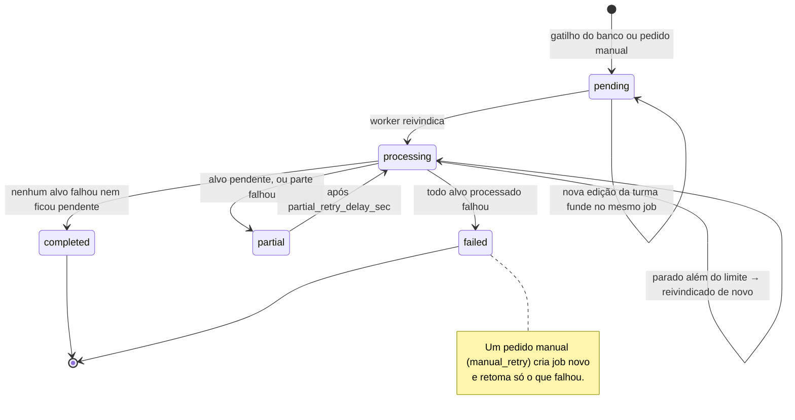
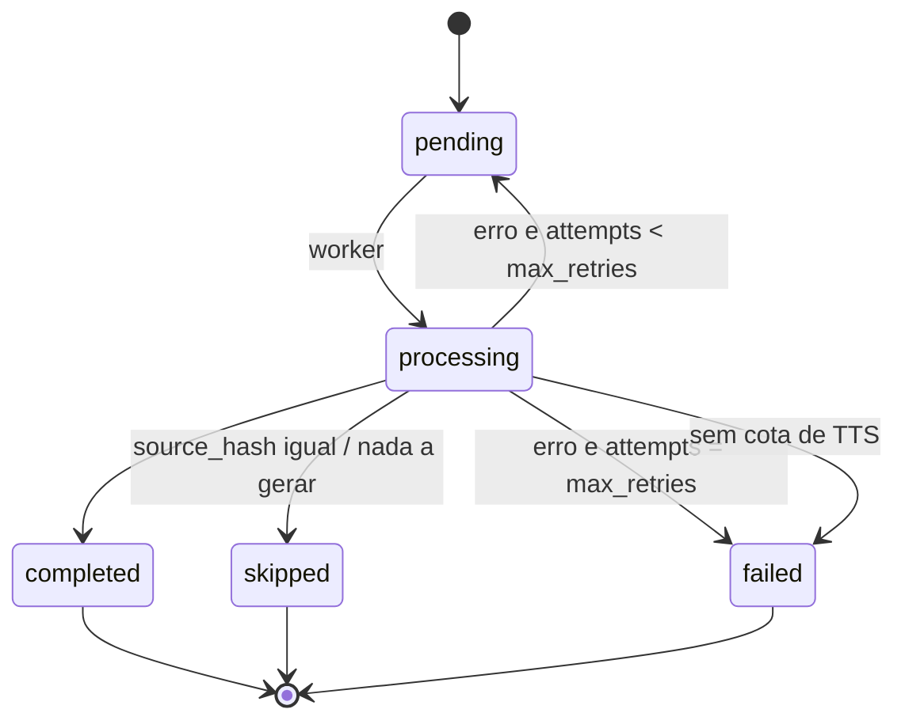
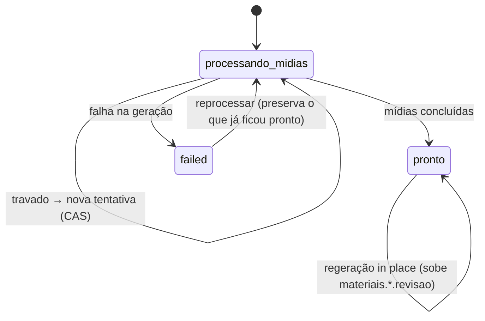
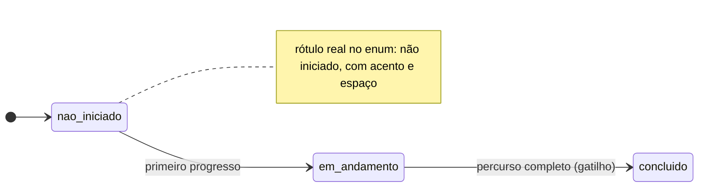
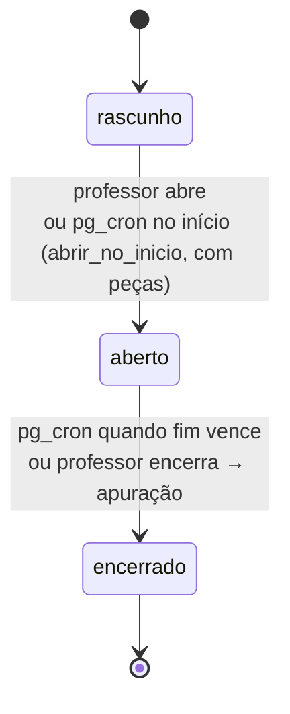
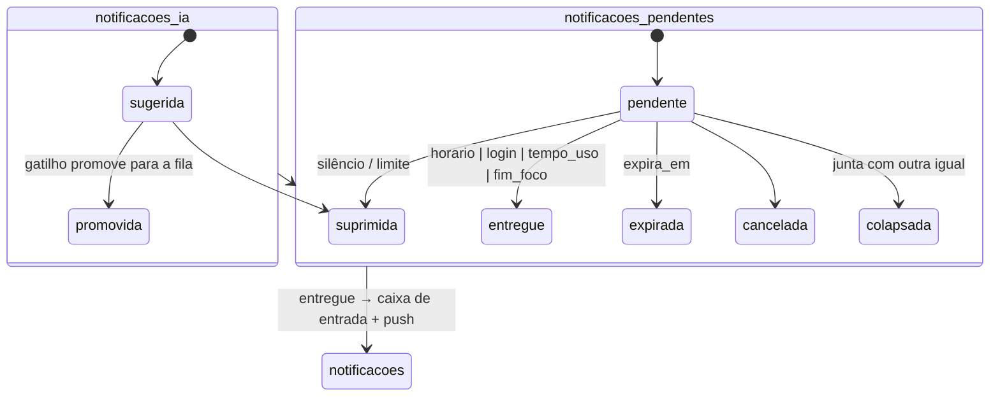
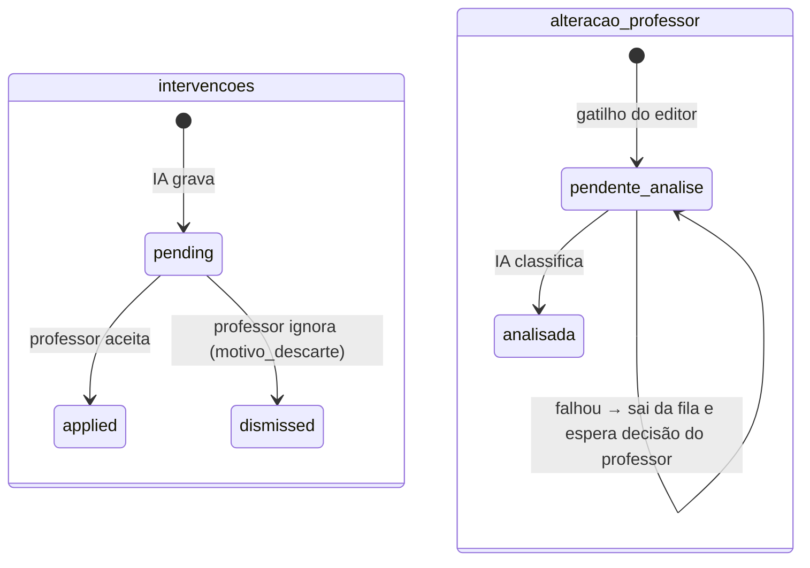
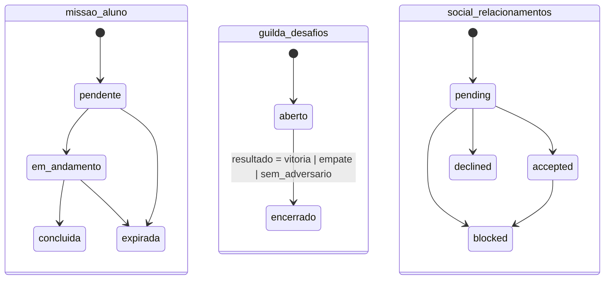
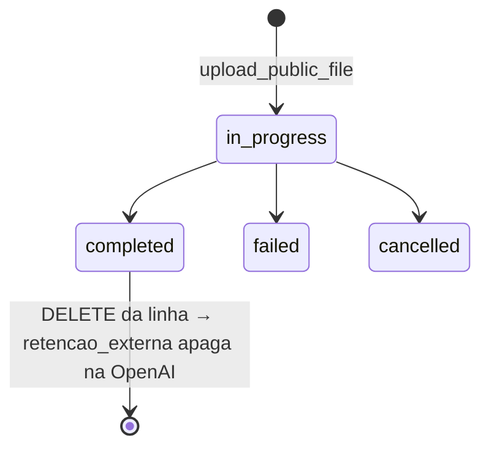

# 6. Diagramas de estado

Os estados vêm de duas fontes:

- das restrições `CHECK` e do enum `status_atividade`, lidos no banco de produção em 04/11/2026;
- do código, onde o status é texto livre: filas de geração e `conteudo_personalizado`.

As contagens entre parênteses são de produção, em 04/11/2026.

## 6.1 Job de geração (`personalizacao_jobs`)

Produção: 79 `completed`, 16 `failed`, 4 `partial`. Regra do fim em `personalizacao_jobs.py` (`final_status`).

Só job `pending` aceita fusão. Job em `processing` nunca é reaproveitado, porque o worker já leu o `total_targets` dele.

## 6.2 Alvo do job (`personalizacao_job_targets`)

Produção: 52 `completed`, 31 `failed`, 8 `skipped`.

## 6.3 Material personalizado (`conteudo_personalizado.status`)

Produção: 4 `pronto`, 13 `failed`.

O gatilho `trg_conteudo_personalizado_novo_material` avisa o aluno quando o tópico termina para o perfil dele, inclusive se o último conteúdo falhou.

## 6.4 Progresso (`status_atividade`, enum)

O status vale para `topico_aluno`, `conteudo_aluno` e `atividade_aluno`. Em `topico_aluno` só o gatilho `trailup_recalcular_topico_aluno` escreve. A revisão pedida pelo professor não muda `atividade_aluno.status`.

## 6.5 Evento de turma (`eventos_classe`)

`fn_evento_classe_abrir_agora` e `_encerrar_agora` travam a linha. Um clique e o cron ao mesmo tempo não creditam o resultado duas vezes.

## 6.6 Notificações

## 6.7 Intervenção e alteração do professor

## 6.8 Gamificação e social

Em 6.8, os estados são os do `CHECK`. As transições desenhadas são as que os nomes indicam; elas não foram auditadas função por função.

## 6.9 Arquivo do RAG (`rag_openai_files`)

Produção: nenhuma linha. O corpus ainda não foi indexado.
