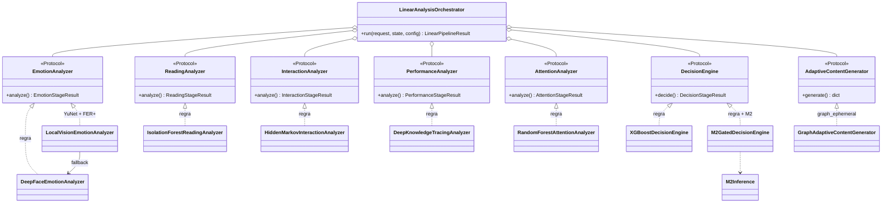
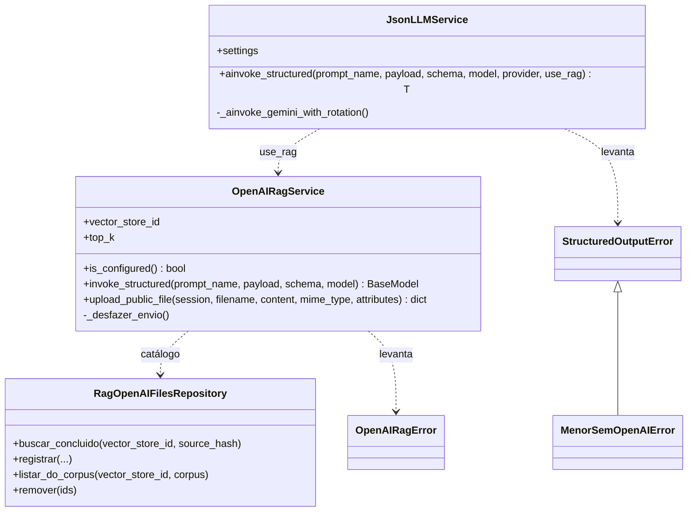
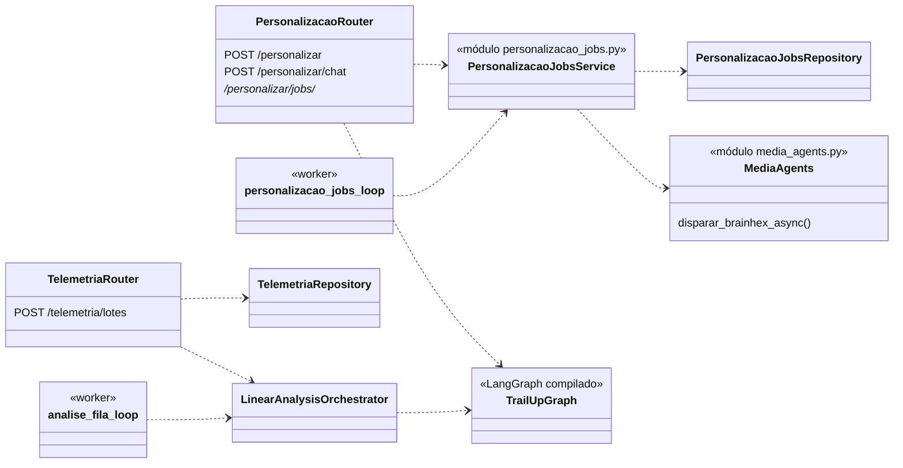
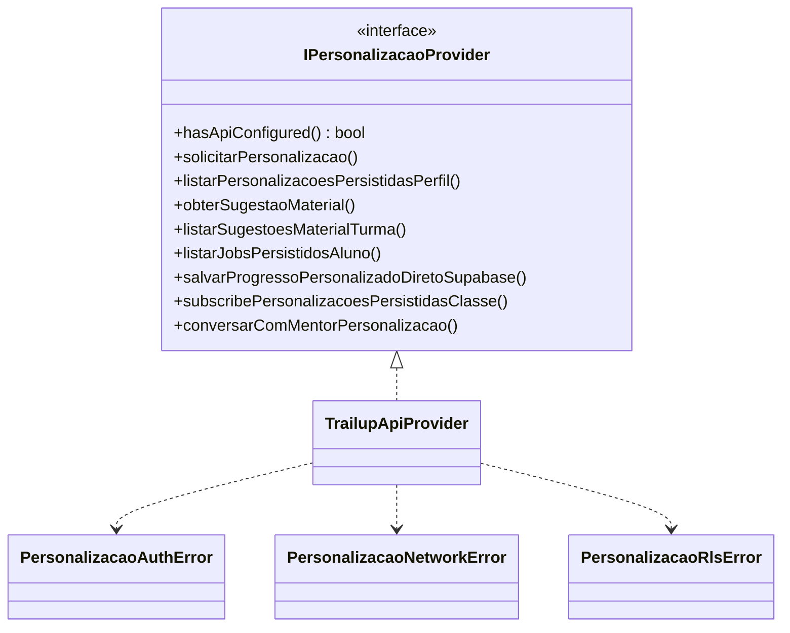
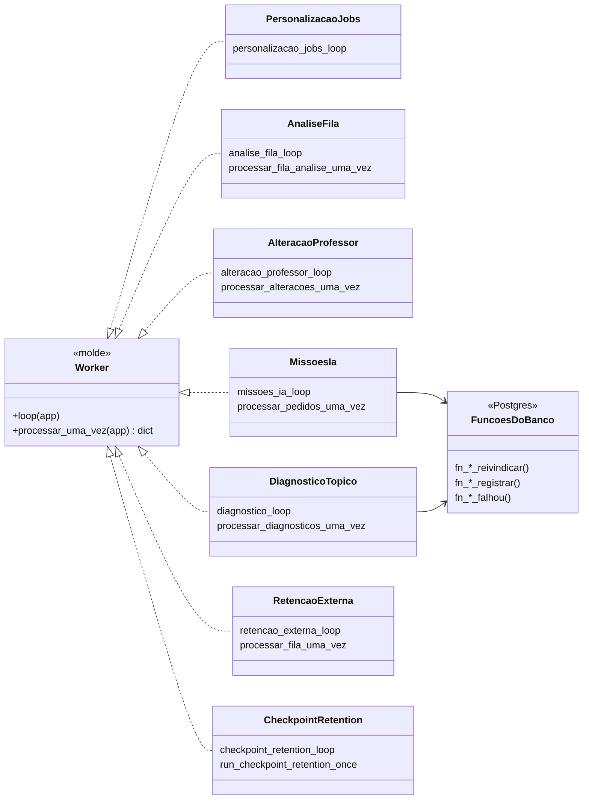
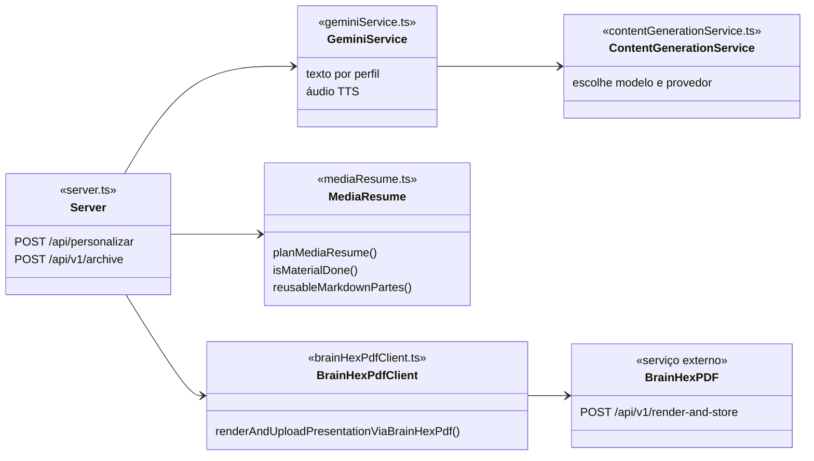

# 7. Diagramas de classes

O sistema não tem um modelo de objetos de domínio único. O domínio vive no banco (ver o [capítulo 5](./05-dados.md)), e as classes de cada serviço organizam o **comportamento**. Este capítulo mostra as estruturas em que a orientação a objetos é decisão de projeto.

## 7.1 Pipeline de análise: estratégia por estágio

`LinearAnalysisOrchestrator` recebe uma implementação por estágio. Cada estágio é um `Protocol`, e `build_linear_analysis_orchestrator` escolhe a implementação pela configuração (`*_MODEL_PROVIDER`). É o padrão Strategy. Ele permite trocar uma regra por um modelo treinado sem tocar no orquestrador, que é o que o nome "desenhado para receber modelos" quer dizer.

## 7.2 Serviços de modelo de linguagem

`listar_do_corpus` e `remover` chegam com a PR #948.

## 7.3 Camadas do backend: rota, serviço e repositório

Os 27 repositórios em `api/app/repositories/` escrevem SQL explícito (`text()`), e cada um recebe uma `AsyncSession`. Não há ORM de entidades.

## 7.4 App do aluno: provedor de personalização

O app acessa a personalização por uma interface. A implementação mistura os dois caminhos da regra de fronteira: o que é IA vai para a API, e o que é leitura ou escrita simples vai direto ao Supabase.

| Método | Caminho |
|---|---|
| `solicitarPersonalizacao` | API (`POST /personalizar`) |
| `conversarComMentorPersonalizacao` | API (`POST /personalizar/chat`) |
| `obterSugestaoMaterial` | API (`GET /personalizar/sugestao/{aluno}/{tópico}`), porque o motor de sugestão roda lá |
| `listarPersonalizacoesPersistidasPerfil`, `listarSugestoesMaterialTurma`, `listarJobsPersistidosAluno` | Supabase, com RLS |
| `salvarProgressoPersonalizadoDiretoSupabase` | Supabase |
| `subscribePersonalizacoesPersistidasClasse` | Supabase Realtime |

## 7.5 Workers da API

Os workers seguem o mesmo molde: um laço longo no `lifespan` de `app/main.py`, uma função que processa um lote e um contrato com o banco para reivindicar e devolver. Isso permite testar a passada sem o laço.

`Worker` é um molde de código, não uma classe base: são funções de módulo com o mesmo formato. O diagrama mostra a convenção. O trio `reivindicar`, `registrar` e `falhou` existe em missões e diagnóstico; os outros workers têm contratos próprios.

## 7.6 Microservice de mídia

`mediaResume` decide o que reaproveitar quando uma geração é retomada: arquivo que já existe não é gerado de novo. O microservice continua dono do merge em `conteudo_personalizado.materiais`, mesmo quando a apresentação vem do BrainHexPDF.
