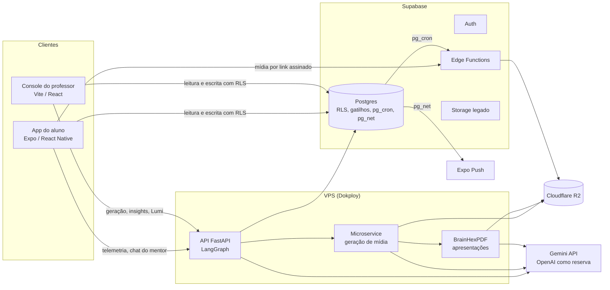
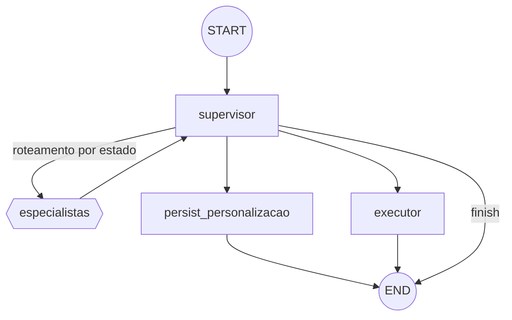

# O sistema TrailUp para a monografia (04/11/2026)

Varredura completa do sistema, para os capítulos de desenvolvimento (5), Evidence Base e RAG (6), avaliação (7) e limitações (9) da monografia. Cada dado tem uma marca de procedência:

- **[código]**: lido na `main` do Lab no commit `20cfdd78` (04/11/2026).
- **[banco]**: consultado em produção (projeto `xrebtkmdewolzmpsdwgh`) em 04/11/2026, só leitura.
- **[doc]**: tirado de um documento do repositório, citado no item.

O catálogo peça por peça (cada módulo, tela, aba, tabela, função, rotina e prompt) está no [inventário completo](./inventario-completo-2026-11-04.md), que também lista o que a segunda varredura acrescentou: desenho experimental, análise BrainHex v3, guardrails e mais formatos de saída.

Os capítulos `01` a `11` desta pasta são de abril de 2026 e estão desatualizados em vários pontos (ver a seção 15). Onde este documento e eles divergirem, vale este, até os capítulos serem revistos.

---

## 1. O sistema em números

| Item | Valor | Procedência |
|---|---|---|
| Serviços | 4 no monorepo (API, microservice, console web, app) e o BrainHexPDF (`brainhexpdf/`) | [código] |
| Linhas de código, sem testes | API 46.413 (Python) · microservice 12.506 · console web 59.024 · app 93.567 · BrainHexPDF 26.845 (TypeScript) | [código] |
| Arquivos de teste | API 338 · microservice 44 · console 143 · app 200 | [código] |
| Migrations de banco | 307 (Alembic, de `20260405_01` a `20261104_06`) | [código] |
| Histórico do monorepo | 882 commits desde 25/08/2026 · 777 PRs mesclados · 145 issues (136 fechadas) | [código] e GitHub |
| Banco | 171 tabelas · 27 views · 612 funções · 144 gatilhos · 286 políticas de RLS · 16 rotinas agendadas (`pg_cron`). Em 08/11, na revisão `20261108_02`: 189 tabelas · 705 funções · 149 gatilhos · 292 políticas · 21 rotinas | [banco] |
| Edge Functions | 6: `generate-content-ai`, `validate-essay-answer-ai`, `storage-redirect`, `storage-upload-url`, `pesquisa-arquivar`, `personalize_path` | [banco] |

O desenvolvimento ocupou cerca de 716 horas em 137 dias com commit (set/2025 a nov/2026), segundo o levantamento de custos feito para o resumo da JIC 2026 (pausa de até 2 h entre commits, faixa de 613 a 1.009 h). A conta inclui os repositórios anteriores ao monorepo.

---

## 2. Arquitetura

**Regra de fronteira** (`CLAUDE.md`): a API só faz o que envolve modelo de linguagem, ou seja, LangGraph, RAG, geração e decisão adaptativa. Fila, agendamento, contadores, notificações, progresso e cópias de turma ficam no Postgres, em funções, gatilhos e `pg_cron`. Os clientes falam direto com o Supabase, autorizados por RLS. A regra tem dois motivos registrados:

- a API pode cair, e o que depende de relógio pararia junto;
- `cliente → API → banco` acrescenta um salto e uma segunda cópia das regras de acesso.

Isso é uma decisão de arquitetura própria do projeto e pode ser descrita como contribuição de engenharia. Ficaram exceções antigas registradas como dívida, por exemplo `POST /telemetria/lotes`.

**Hospedagem** [doc]:
- API, microservice e BrainHexPDF rodam no Dokploy, numa VPS Hetzner em Ashburn (EUA).
- O console está no Vercel e é publicado a partir do repositório espelho.
- Banco e autenticação ficam no Supabase, região `us-west-2`.
- Os arquivos ficam no Cloudflare R2, região ENAM. O Storage do Supabase guarda só o legado.

---

## 3. App do aluno (`mobile/`)

Expo SDK 54, React Native, roteamento por arquivos (`expo-router`). Versão 1.0.6 na Play Store, de 01/11/2026. A 1.0.7 tem build de 05/11 e ainda não foi publicada; até lá, o app da loja não carrega a mídia servida pelo gateway, porque não pede o link assinado. [código]

| Área | Telas | O que faz |
|---|---|---|
| Entrada | `(auth)/`: login, recuperar senha | Login com e-mail ou Google, portão de consentimento e data de nascimento |
| Trilha | `(tabs)/trilha`, `trilha/[id]` | Mapa de tópicos (grafo), material personalizado por perfil (texto, áudio, apresentação, cards), atividades e questões, batalha com o boss nos perfis Survivor, Daredevil e Conqueror |
| Ranking | `(tabs)/ranking`, `ranking/[id]` | Ranks da turma e do evento |
| Social | `(tabs)/social` | Amigos, mensagens, guildas |
| Notificações | `(tabs)/notificacoes` | Caixa de entrada; o toque leva ao destino |
| Perfil | `(tabs)/perfil/*` (20 telas) | Loja, molduras, conquistas, métricas de estilo, modo foco, lembrete diário, coleta de dados e consentimentos, relatório dos dados (LGPD), exclusão da conta |

Coleta de telemetria, fila local de envio (outbox de 7 dias), cache de mídia offline e retomada de leitura e áudio ficam em `mobile/src/context/metricas/` e `mobile/src/services/`.

---

## 4. Console do professor (`frontend/`)

Vite e React. O site público tem início, sobre, blog, download, contato, termos, privacidade e cadastro de aluno e de professor. O console tem 16 abas (`frontend/src/pages/consoleSections.ts`) [código]:

> Visão geral · Recomendações · Trilhas · Missões · Conquistas · Notas · Eventos · Economia · Turmas · Personalizações · Rankings · Rank de batalhas · Guildas · Meus dados · Aprovações\* · Painel técnico\*
>
> \* só para a dona do projeto. A proteção é no banco (`app_e_dono()`), não na rota.

- **Editor de trilha:** cria tópicos, conteúdos, atividades, questões e cards. Salvar já enfileira a regeração do material por gatilho no banco; o console não chama a API depois.
- **Lumi (escriba):** assistente do professor que responde sobre as turmas dele. Os alunos aparecem só como `A1…An`, sem nome.

---

## 5. API e inteligência artificial (`api/`)

### 5.1 Endpoints

Cerca de 30 rotas em `/api/v1` [código]:

| Grupo | Rotas |
|---|---|
| Personalização | `POST /personalizar`, `GET /personalizar/{aluno}`, `POST /personalizar/chat` (mentor), fontes, progresso, status de mídia, histórico de sugestão, `GET /personalizar/grupo/{classe}` |
| Fila de geração | `/personalizar/jobs/*`: `enrollment`, `class-delta`, `class-theme`, `full-sync`, `student-cleanup`, `manual-*` |
| Telemetria | `POST /telemetria/lotes`, que grava e dispara a análise |
| Emoção | `POST /emocoes/analisar`, `/analisar-stream` |
| Professor | `POST /escriba/perguntar` (Lumi), status de `/insights/turma/{classe}` |
| Administração | economia, molduras, professores, `GET /health` |

Além das rotas, a API roda **workers em laço** no próprio processo:
- fila de geração;
- análise de telemetria;
- remoção de arquivos externos (retenção);
- análise de alteração do professor.

### 5.2 Grafo LangGraph (`api/app/agent/graph/`)

- **Especialistas de análise (10):**
  - `agente_emocao`, `agente_perfil`, `agente_trilha`, `agente_conteudo`, `agente_geracao_midia`;
  - `agente_notificacao`, `agente_intervencao`, `agente_cronometro`, `agente_ui`, `agente_texto`.
- **Especialistas de personalização (3):** `agente_plano_personalizacao`, `agente_ai_patch`, `agente_midias_personalizadas`.
- **Roteamento:** o supervisor decide por regras sobre o estado (`routing.py`). Exemplos:
  - perfil a cada 10 eventos;
  - conteúdo quando a média de acertos fica abaixo de 50%.
- **Turma retida pelo estudo:** só rodam emoção, perfil e intervenção (`RETIDA_SPECIALIST_NODES`), para não contaminar a comparação.
- **Persistência:** o estado tem checkpoint no Postgres (`langgraph-checkpoint-postgres`).
- **Memória do aluno:** o histórico de estado mental (`aluno_mental_state_history`) volta ao grafo. Uma recorrência é 3 estados negativos iguais entre os 5 últimos registros. Ela alimenta o tema de suporte (`agente_ui`) e o alerta ao professor (`agente_intervencao`).
- **O guia ajuda sem entregar a resposta (07/11, #1059):** o chat da matéria recebe o conteúdo, os enunciados e as alternativas das questões (sem marcar a certa) e a frente dos cards. O gabarito e o verso dos cards só chegam às guardas, que barram a resposta antes de ela sair:
  - uma checagem determinística (`checar_vazamento_de_gabarito`) procura a resposta inteira ou um trecho de 8 palavras dela;
  - depois, o juiz de *grounding* (`mentor_grounding_check.txt`) julga com o gabarito à vista;
  - a correção da dissertativa (`validate-essay-answer-ai`, #1060) troca o comentário que repetiria a resposta esperada, e a nota não muda.

### 5.3 Pipeline de análise da telemetria (`linear_analysis_pipeline.py`)

Tem seis estágios em sequência: emoção, leitura, interação, desempenho, atenção e decisão.

> **Atenção para a redação.** Os estágios têm nomes de algoritmos (DeepFace, IsolationForest, HiddenMarkov, DeepKnowledgeTracing, RandomForest, XGBoost), mas **nenhum roda o algoritmo do nome**. São heurísticas por regra, e a própria docstring do módulo avisa isso. Os nomes marcam o algoritmo *pretendido*. Na monografia, descreva como "pipeline de seis estágios com regras heurísticas, desenhado para receber modelos treinados", nunca como "modelos de ML".

Há duas exceções, em que existe modelo de verdade:

1. **Emoção por imagem** (`emotion_vision.py`, `EMOTION_MODEL_PROVIDER=local_vision`, ligado em produção):
   - o detector de rosto YuNet e o classificador FER+ rodam em ONNX, no próprio servidor;
   - a imagem não é gravada nem enviada a nenhum provedor;
   - sem câmera, ou sem rosto detectado, cai na regra.
   - O nó `agente_emocao` do *grafo* é outra coisa: usa `MockEmocaoAdapter`, uma regra fixa sobre os eventos, com `origem = mock_*`.
2. **Knowledge tracing M2** (`m2_inference.py`, `models/m2_knowledge_tracing/v3/`):
   - são dois `HistGradientBoostingClassifier` treinados no EdNet KT3;
   - o de domínio responde "o aluno acerta?" (AUC 0,753, ECE 0,002);
   - o gate responde "o aluno vai travar no tópico?" (AUC 0,779);
   - a regra que eles substituem tinha AUC 0,587 e 0,703;
   - **não estão calibrados em dado próprio**: as probabilidades valem só como ordenação (`m2_calibrated=false`);
   - em qualquer falha, a origem volta a ser `regra`.

**Leitura (WPM):** o denominador é o tempo ativo (`active_sec`), não o tempo com o material aberto. Leitura lenta é abaixo de 120 palavras por minuto; leitura por cima, acima de 400.

### 5.4 Provedores e modelos

[código: `api/app/core/settings.py`, microservice e edge functions]

| Uso | Modelo |
|---|---|
| Texto, supervisor, materiais, enriquecimento | `gemini-3.6-flash`, com reserva `gemini-3.1-flash-lite` |
| Áudio (TTS) | `gemini-2.5-flash-preview-tts`; 7 vozes de guardião, uma por perfil (`guardianVoices.ts`) |
| Imagem | `gemini-2.0-flash-preview-image-generation` |
| Reserva | OpenAI `gpt-4o-mini` (sem crédito hoje) |

As 4 chaves do Gemini estão no **plano gratuito**, em rodízio. Nesse plano, o Google pode usar o que é enviado para melhorar os produtos (declarado na Privacidade). [doc]

### 5.5 Regra de idade

A IA é só para maiores de 18 anos confirmados pela data de nascimento (#933, 04/11/2026):
- para menor ou aluno sem data, nenhuma chamada sai: nem LLM, nem RAG, nem TTS, nem imagem;
- o mentor responde 403 para esse aluno;
- menores podem se cadastrar e usam o material-base por perfil, que é gerado sem dado de aluno.

A exceção é a Lumi do professor: ela recebe a turma com referências `A1…An`. A razão é que os termos da Gemini API exigem 18 anos ou mais. [código e doc]

---

## 6. Geração do material personalizado

**Duas camadas** (`CLAUDE.md`):
1. **Base por perfil:** um material por `turma × tópico × perfil BrainHex`, gerado pelo microservice e reaproveitado entre os alunos do mesmo perfil. É texto (markdown), áudio narrado pelo guardião do perfil, apresentação (deck HTML) e cards.
2. **Adequação por aluno:** uma camada leve sobre a base (`ai_patch`), feita a partir de preferências, emoção, estado mental e necessidades do grupo. Não gera mídia pesada de novo.

**Fluxo de geração:**
1. O professor salva o tópico.
2. Um gatilho no banco enfileira o job (`fn_enqueue_class_delta_job`), juntando as edições em um job pendente por turma.
3. O worker da API processa o job e chama o microservice.
4. O microservice gera o texto e o áudio com o Gemini e pede a apresentação ao BrainHexPDF.
5. Os arquivos sobem para o R2.
6. O resultado é gravado em `conteudo_personalizado.materiais`, com `revisao` por material.

A deduplicação usa `source_hash`, que inclui a versão do pipeline.

**Contraste WCAG AAA:** cada perfil mantém a cor-assinatura dele. O sistema clareia o accent quando a cor fica escura demais, e as cores de sucesso, aviso e informação são fixas.

**Estado em produção** [banco]: 17 registros em `conteudo_personalizado`, com **4 prontos e 13 com falha**. Entre 10/2026 e 11/2026 a geração manual por perfil teve 4 jobs concluídos e 6 com falha.
- A causa provável é a cota do plano gratuito do Gemini, mas **isso não foi medido nesta varredura**.
- Para a monografia, o pipeline é **funcional, mas instável no plano gratuito**.
- Não afirme taxa de sucesso maior que a medida.

---

## 7. Perfis BrainHex

- **Questionário** (`frontend/src/features/signup/brainhex.ts`): 32 itens autorais em escala de 0 a 5, 4 por eixo, em 8 eixos:
  - curiosidade, desafio, risco, maestria, competição, conclusão, social e imersão;
  - 8 itens são invertidos, para controlar a aquiescência;
  - o código declara que os itens **não reproduzem o questionário original** e que a adaptação ainda pede entrevistas cognitivas e validação local.
- **Resultado:** os eixos viram 7 perfis com afinidade de 0 a 100, guardados em `aluno_perfil`. O perfil dominante é o de maior afinidade, mas o vetor completo também é usado.
- **Cada perfil tem:**
  - cor, ícone e guardião;
  - assinatura editorial: tom, ritmo, abertura e proibições;
  - voz de TTS com idade, sexo, origem e interpretação definidos.
- **Como hipótese:** o motor de sugestão diz ao aluno que ordenar os formatos pelo perfil é hipótese. A avaliação da literatura não achou evidência de que aprender no formato "preferido" melhore o resultado (DAT-14, DAT-35, DAT-40). O único achado a favor é de tempo de uso (DAT-03). Todos os formatos ficam disponíveis para todos. [código: `evidencias_pedagogicas.py`]

Distribuição dos perfis dominantes em produção [banco], 6 alunos com perfil: Daredevil 2, Achiever 1, Conqueror 1, Mastermind 1, Seeker 1.

---

## 8. Evidence Base e RAG

### 8.1 O que está implementado [código]
- `OpenAIRagService` usa o **Vector Store da OpenAI** com `file_search` na Responses API. A OpenAI faz o parsing, o chunking, os embeddings e a recuperação.
- O RAG é chamado em três lugares:
  - `llm.ainvoke_structured`, usado pelo mentor;
  - `agente_intervencao`;
  - `agente_notificacao`.
- **Observabilidade:** cada busca grava em `ia_decision_logs` (`stage = rag_retrieval`) o `file_id`, o score, o número de resultados e a latência, sem texto do aluno.
- A intervenção valida cada citação contra os arquivos que foram de fato recuperados.

### 8.2 Estado em produção [banco]
- **0 buscas** registradas, **0 chunks** em `rag_chunks` e **0 arquivos** em `rag_openai_files`.
- A OpenAI está sem crédito, e o corpus licenciado não foi indexado. A ordem planejada é: inventário (#70) → triagem (#71) → extração (#72) → curadoria (#73) → indexação → golden set (#75) → medição (#67). Ela parou antes da indexação.

**Conclusão para o capítulo 6:** o RAG está **implementado e instrumentado, mas não operacional**. Não há resultado de recuperação para relatar.

### 8.3 O que existe no lugar
- **Avaliação da literatura** (`docs/rag/avaliacao-documentos.md`): os 47 documentos da planilha, cada um com um destino:
  - *corpus do RAG*;
  - *texto derivado*;
  - *só citação*;
  - *não usar*.
- **Texto derivado em produção** (`evidencias_pedagogicas.py`):
  - as regras do motor de sugestão de material citam a fonte (`DAT-xx`) e um grau de confiança: forte, moderada, hipótese ou dado do aluno;
  - o motor é **determinístico**, e o RAG não entra na decisão;
  - cada decisão grava a versão do catálogo em `personalizacao_sugestao_log`.
- **Golden set v1** (`docs/rag/golden-set-documentos-v1.md`): 30 perguntas de referência com a resposta esperada e as fontes aceitáveis. Algumas são de propósito "não respondíveis", para testar se o sistema reconhece o limite.
- **Duas regras de honestidade:**
  - casar formato com perfil é hipótese;
  - telemetria mede engajamento comportamental, e não emoção nem atenção (DAT-45, DAT-04).
- **PRISMA:** o projeto desistiu dele em 02/11. Chame de análise crítica da literatura: 24 aprovados entre os 28 já decididos, e 19 pendentes.

---

## 9. Telemetria e métricas

- **Coleta** (`docs/architecture/coleta-de-metricas.md`):
  - um lote por minuto;
  - ocioso depois de 15 s sem toque;
  - toques amostrados a cada 750 ms, com no máximo 25 por lote;
  - câmera opcional, uma foto a cada 6 s, com no máximo 30 por lote;
  - fila local de 7 dias.
- **Tempo de estudo** é **tempo ativo**: a soma de `active_sec` por escopo. Cada lote traz só o tempo daquele lote. Os escopos tópico, conteúdo e material contam o mesmo intervalo e não podem ser somados entre si.
- **Fluxo da análise:**
  1. O lote chega à API ou direto ao Supabase. A coluna `via` registra o caminho.
  2. É gravado em `telemetria_lotes`.
  3. Entra na fila de análise.
  4. O pipeline de 6 estágios processa o lote.
  5. A decisão é gravada em `ia_decision_logs`.
  6. Se a ação casar com a política de atualização, o app pede um novo ciclo de personalização.
- **Catálogo e auditoria:**
  - 29 métricas no catálogo (`metricas_catalogo`);
  - invariantes conferidas todo dia por `pg_cron` (`trailup_auditoria_metricas`);
  - agregado diário por turma (`telemetria_agregado_turma_dia`).
- **Dados reais** [banco]:
  - 113 sessões de telemetria;
  - 184 lotes: 156 de 14 a 29/10, e 28 depois de 31/10 (5 pela API e 23 direto no Supabase);
  - 1.013 eventos do app;
  - 29 análises adaptativas registradas entre 31/10 e 03/11.

---

## 10. Gamificação

[banco: contagens · código]

| Mecanismo | Estado |
|---|---|
| XP e faixas | 10 faixas com título e barra até a próxima |
| Conquistas | 38 no catálogo em 04/11; 45 do sistema em 05/11 (24 comuns, 21 por perfil), com as 8 da #1011; as do sistema têm um tipo cada |
| Molduras de perfil | 40: 20 na loja, 18 por desafio e 2 por ação (05/11, #1011) |
| Moedas e loja | Livro-caixa (`moedas_ledger`), 5 itens, preço por turma, auditoria da economia |
| Missões | 201 geradas. A missão diária sai do banco (`pg_cron` às 03h); o texto dela é gerado por IA. Missões de turma e de aluno contam a partir da criação |
| Rankings | Por turma; posições visíveis limitadas; pódio congelado |
| Eventos de turma | Abrem e fecham sozinhos pelo banco a cada minuto; inscrição, rank do evento (pontuação, missões, ranqueada) |
| Guildas | Convites, desafios, mensagens, fundo da turma |
| Batalha com boss | Perfis Survivor, Daredevil e Conqueror. Nome e falas por perfil gerados por IA (`boss_falas`); sem eles, falas fixas |
| Ranqueada | Placar ELO por partida (`ranqueada_elo`) |

Em produção ainda não há evento de turma nem guilda criados: 0 de cada. [banco]

---

## 11. Banco de dados e automações

- **Autorização:** a RLS é a autorização, não uma defesa a mais. Cliente tem GRANT em tudo, e as policies decidem.
  - Funções auxiliares `SECURITY DEFINER` evitam recursão de RLS: `app_classes_do_professor()`, `app_alunos_do_professor()`, `app_colegas_de_turma()`.
  - Tabela nova já nasce com RLS ligada, por um event trigger.
  - Toda view nasce com `security_invoker = on`.
- **16 rotinas `pg_cron`** em 04/11, 21 em 08/11 [banco]:
  - missão diária e o texto dela;
  - eventos de turma, a cada minuto;
  - desafios de guilda;
  - notas com prazo;
  - notificações: varredura, ranking, conciliação de push e recálculo de rotinas;
  - retenção, avisos de inatividade e limpeza de logs de IA;
  - arquivo da pesquisa;
  - auditoria de métricas;
  - expurgo de medidas de perfil;
  - aviso ao dono pelo painel técnico.
- **Motor de notificações inteiro no banco**, com quatro tabelas de papéis diferentes:
  - `notificacoes_ia`: o que a IA sugeriu;
  - `notificacoes_pendentes`: a fila;
  - `notificacoes_agendamentos`: a rotina;
  - `notificacoes`: a caixa de entrada.
  - O push sai do Postgres por `pg_net` para o Expo e respeita horário de silêncio e modo foco. O lembrete diário é uma notificação local do aparelho.
  - Em produção há 431 notificações entregues.
- **Progresso:** um gatilho calcula o percentual do tópico (`trailup_recalcular_topico_aluno`), e nenhum cliente grava esse valor. O denominador é o material personalizado; o do professor é opcional e dá bônus.
- **Operações em transação no banco:** duplicar turma, tópico e atividade.
- **Questão da turma corrigida no banco (08/11, #1064 e #1065):** o app novo responde pelas RPCs `questao_responder` e `questao_revelar_gabarito` e não lê mais o gabarito. A questão personalizada local continua corrigida no aparelho. O app instalado (1.0.x) ainda lê o gabarito; fechar a coluna é a fase 3, que espera a versão mínima do app.
- **Recibos de push (08/11, #1066):** o banco lê os recibos da Expo e desativa o token que não entrega mais. O build Android passa a ligar o Firebase (#1067), o que só vale a partir do próximo build.

---

## 12. Privacidade, LGPD e ética

[código e doc: `docs/lgpd/`, página `/privacidade`]

- **Consentimentos separados:** telemetria, câmera, emoção e pesquisa. Menor de 18 precisa de autorização do responsável, item por item. Em produção há 24 registros de consentimento de telemetria e 1 de pesquisa. [banco]
- **Câmera:** é opcional e vem desligada. A análise é local (seção 5.3) e a imagem nunca é gravada.
- **Pseudonimização:**
  - nome e e-mail não vão aos prompts;
  - o UUID do aluno também saiu dos prompts em 04/11;
  - os insights e a Lumi usam referências `A1…An`.
- **Retenção:** 113 políticas, aplicadas todo dia em modo `aplicar` desde 04/11. Os prazos são:
  - telemetria bruta, 90 dias (180 com consentimento de pesquisa);
  - indicadores, 13 meses;
  - emoção estimada, 30 dias;
  - conta inativa, 24 meses, com aviso por e-mail e push e mais 30 dias de prazo;
  - registro de consentimento, 5 anos.
- **Arquivo da pesquisa:** o R2 guarda em `pesquisa/` uma cópia das sessões, lotes e eventos de quem consentiu. Esse arquivo não expira por prazo. Hoje são 1.310 objetos. [banco]
  - Se o aluno pede exclusão, a cópia identificada sai.
  - Fica só uma cópia anônima, e só de quem consentiu: os identificadores viram HMAC com um sal que é descartado.
- **Arquivos do material:**
  - pelo gateway (`storage-redirect`), só saem por link assinado e de curta duração, exigido desde 04/11;
  - os quatro buckets do Storage ainda estão públicos em 05/11, à espera do fechamento: o que vive lá abre por URL direta, então não afirme que todo arquivo exige link;
  - conteúdo apagado leva os arquivos dele do Storage e do R2.
- **Direitos do titular, no app:** relatório dos dados, exclusão da conta e revogação dos consentimentos.
- **Encarregado (DPO):** publicado na seção 10 da Privacidade.
- **Transferência internacional:** todos os fornecedores ficam nos EUA. Não há cláusulas-padrão da ANPD assinadas (`docs/lgpd/transferencias-internacionais.md`). Isso é uma **limitação declarada**.

---

## 13. Qualidade e processo

- **CI** (`.github/workflows/ci.yml`): o job de cada serviço só roda quando esse serviço muda. Os jobs são API, microservice, frontend, mobile, BrainHexPDF e docs.
  - A API roda `ruff`, `pytest` e a migração completa num Postgres em Docker.
  - Os clientes rodam lint, typecheck e testes.
  - Os docs passam por uma checagem de encoding (UTF-8 sem BOM e sem mojibake).
- **Migrations:** uma única head no Alembic; a API aplica `upgrade head` ao subir.
- **Fluxo de trabalho:**
  - todo trabalho entra por PR no repositório do Lab;
  - um sync leva a `main` ao espelho, de onde saem o site e a API;
  - nenhum merge é feito por agente.
- **Desenvolvimento assistido por agente de programação (Claude):** se entrar na metodologia, declare que o código foi revisado e mesclado pela autora, PR a PR.

---

## 14. Os dados de produção e o que eles permitem

[banco]
- **Usuários:** 7 alunos, 6 professores, 4 turmas e 6 matrículas.
- **Conteúdo:** 8 tópicos, 15 conteúdos, 1 atividade e 1 questão.
- **Coorte de estudo:** nenhuma (`estudo_coorte` está vazia).

É uma **base de teste e de piloto**, não um uso em escala. Para os capítulos 7 e 8:
- **não há amostra** para efeito educacional, comparação entre coortes ou validação do BrainHex;
- o que dá para relatar é a **viabilidade técnica**: o pipeline funciona de ponta a ponta, com as taxas de falha da seção 6. Somam-se a isso a avaliação da literatura e o desenho do experimento;
- o M2 tem métrica de validação no EdNet, que é **dado externo**. Ela não vale como resultado no TrailUp.

---

## 15. O que não afirmar na monografia

| Não escreva | Escreva |
|---|---|
| "modelos de ML (Random Forest, XGBoost, HMM…) analisam o aluno" | pipeline de seis estágios com regras heurísticas, preparado para modelos treinados; o único modelo treinado em uso é o M2 (knowledge tracing, dado externo) e o FER+ para emoção por imagem |
| "o RAG recupera evidências para o aluno" | o RAG está implementado e instrumentado, mas não indexado nem em uso; a evidência entra como texto derivado em regras determinísticas |
| "o sistema detecta a emoção do aluno" | o sistema **estima** um estado a partir de imagem (opcional) ou de comportamento; telemetria mede engajamento, não emoção |
| "o perfil BrainHex determina o melhor formato" | ordenar formatos pelo perfil é hipótese; todos os formatos ficam disponíveis |
| "questionário BrainHex validado" | adaptação autoral de 32 itens, sem validação local |
| "revisão sistemática PRISMA" | análise crítica da literatura (47 documentos) |
| "dados não são usados para treino" | Gemini no plano gratuito; o Google pode usar os dados para melhorar produtos |
| "API hospedada no Render" | Dokploy, em VPS própria |
| "resultados mostram melhora de aprendizagem" | não há amostra para isso; relatar viabilidade técnica |
| "o aluno não tem acesso ao gabarito" | o app novo corrige no banco e não lê o gabarito; o app instalado ainda lê, até a fase 3 (08/11) |
| "o guia nunca dá a resposta" | duas guardas barram a resposta (texto e juiz de modelo); é redução de risco medida em teste, não garantia |

**O que os capítulos 01 a 11 desta pasta dizem que já mudou:**
- falam do Render, que não é usado;
- não têm a regra de fronteira com o banco;
- não têm a regra de idade;
- não têm o R2 nem o link assinado;
- descrevem o RAG como parte do fluxo;
- não registram que os estágios da análise são heurísticos.

Revise-os a partir deste documento.

---

## 16. A monografia (versão do Drive de 30/10/2026) comparada com o sistema

O texto da `Monografia TrailUp.docx` é cuidadoso: não antecipa resultado e já tem um quadro de limites de redação (Apêndice H). O problema é que ele descreve o sistema de forma genérica, às vezes desatualizada, e **condiciona a avaliação em sala ao RAG**, que não está operacional.

### 16.1 O ponto que bloqueia o cronograma

No Resumo, em 4.10, em 7.3 e no Apêndice G, a monografia diz que a avaliação será feita "após a implementação do RAG" ou "após o fechamento do RAG". Em produção, o RAG tem 0 documentos indexados e 0 buscas (seção 8.2). **Isso exige uma decisão:**

1. **Indexar o corpus antes do experimento.** Exige crédito na OpenAI, ou trocar o Vector Store por embeddings em outro provedor. Exige também terminar a extração e a curadoria (#72, #73). Depois disso, o golden set (#75) já existe para medir.
2. **Reformular a avaliação sem RAG em produção.** A evidência já entra no sistema como texto derivado: regras do motor de sugestão com fonte e grau de confiança (seção 8.3). O experimento avaliaria a personalização fundamentada em evidência, e o RAG passa a trabalho futuro ou a uma avaliação offline contra o golden set.

As duas são defensáveis. A segunda cabe no prazo com o sistema como está.

### 16.2 Seção por seção

| Seção | O que diz | O que o sistema tem hoje |
|---|---|---|
| Resumo, 4.7, 6.19, Apêndice F ("fluxo PRISMA") | PRISMA 2020 e PRISMA-ScR como referência de relato | O PRISMA foi abandonado em 02/11. O que existe é uma análise crítica de 47 documentos: 24 aprovados entre os 28 decididos, e 19 pendentes (`docs/rag/avaliacao-documentos.md`) |
| 1.7 Delimitação | MVP, sem diagnóstico, BrainHex não determinístico | Falta incluir que a **IA é só para maiores de 18**: menores usam o app sem IA (seção 5.5) |
| 4.4 | "microsserviço com Gemini e Supabase Storage e contingência por OpenAI" | Os arquivos estão no **Cloudflare R2**; o Storage guarda só o legado. A OpenAI está sem crédito. O Gemini está no **plano gratuito**. Há também o **BrainHexPDF**, que gera as apresentações |
| 5.2 Arquitetura | 4 componentes: mobile, web, API Core e ApiBrainHex, com o banco "compartilhado" | O banco é a **camada de lógica** (regra de fronteira): 612 funções, 144 gatilhos, 16 rotinas agendadas, motor de notificações e fila de geração. Usar o diagrama da seção 2 |
| 5.3 App do estudante | Jornada de turma, tópico, atividade, reforço e ranking | Também tem material por perfil (texto, áudio narrado, apresentação, cards), batalha com boss, social e guildas, loja, molduras, notificações, consentimentos e direitos LGPD (seção 3) |
| 5.4 Interface do professor | Aciona personalização e vê indicadores | 16 abas (seção 4); a Lumi, assistente com alunos pseudonimizados; insights da turma gerados por IA; editor que já dispara a regeração |
| 5.5 API | Endpoints de personalização, progresso, chat, jobs e telemetria | Falta o **grafo LangGraph** (supervisor e 13 especialistas), o **pipeline de 6 estágios** (heurístico, ver o aviso na seção 5.3) e o **M2** (único modelo treinado do desempenho) |
| 5.8 BrainHex | "A etapa do RAG pretende reduzir o caráter engessado das regras" | Isso já existe sem RAG: o motor de sugestão diz ao aluno que ordenar por perfil é hipótese e deixa todos os formatos disponíveis (`evidencias_pedagogicas.py`). Descrever também o questionário autoral de 32 itens em 8 eixos (seção 7) |
| 5.9 Gamificação | "progressão, conquistas e ranking" | Muito mais amplo: XP com 10 faixas, 45 conquistas do sistema (05/11), 40 molduras, moedas e loja, missões diárias, eventos de turma, guildas, boss por perfil e ranqueada com ELO (seção 10) |
| 5.10 Telemetria | Tempo ativo, conclusão, acerto, interação | Confere. Falta citar os limites de coleta (seção 9), a câmera opcional com análise local YuNet + FER+, e que tempo é **tempo ativo** |
| 6.2 e 6.4 | **vazias** | Usar os 4 destinos de cada documento (corpus, texto derivado, só citação, não usar) e os níveis de confiança das regras (forte, moderada, hipótese, dado do aluno) |
| 6.5 e 6.6 Fluxo | dados → RAG → evidências → regras → LLM | No código, o RAG está no mentor, na intervenção e na notificação. A **sugestão de material não usa RAG**: é determinística, com texto derivado. Descrever as duas coisas como são |
| 6.21 Exemplo de consulta | Exemplo hipotético | O golden set v1 tem 30 perguntas reais com resposta esperada e fontes, inclusive "não respondíveis". Usar um caso dele (GS-19 combina com o exemplo) |
| 4.11 Ética | Princípios gerais | Está implementado e dá para descrever (seção 12): consentimentos por finalidade, autorização do responsável, pseudonimização nos prompts, retenção em 113 políticas, arquivo da pesquisa com cópia anônima, link assinado e DPO publicado. **Declarar** o Gemini no plano gratuito (o Google pode usar os dados enviados) e a falta de cláusulas da ANPD |
| 8.1 | "\[A preencher\]" | 47 documentos, 28 decididos, 24 aprovados, 19 pendentes. Sem fluxograma PRISMA |
| 8.2 | "\[A preencher com métricas reais\]" | Dá para preencher já com: personalizações (4 prontas, 13 com falha), jobs por tipo, 29 análises adaptativas, 184 lotes de telemetria (seções 6, 9 e 14) |
| 9 Limitações | 4 limitações | Acrescentar: estágios heurísticos com nome de algoritmo; M2 não calibrado em dado próprio; geração instável no plano gratuito; IA vedada a menores; RAG não indexado; base de produção pequena |
| Apêndice H | Quadro "evitar / preferir" | Acrescentar as linhas da seção 15 deste documento (ML, RAG em uso, PRISMA, plano do Gemini) |

### 16.3 O que já está bom e pode ficar
- O tratamento do BrainHex como dimensão de preferência e não como diagnóstico (2.7.1, 2.8). O código diz a mesma coisa.
- A separação entre a fonte curricular do professor e a evidência científica (6.3).
- A recusa em antecipar resultado (8) e o Apêndice H.
- O cuidado com a telemetria como comportamento observado (5.10, 9), que coincide com as regras de honestidade do motor (DAT-45, DAT-04).
